<div align="center">

# Regression Uncertainty Quantification Benchmark

### Over 30 uncertainty-quantification methods evaluated with 9 tuned regressors on 9 engineering and environmental datasets

[](LICENSE)


[](papers/benchmark/paper.pdf)
[](https://github.com/DaneshSelwal/Regression-UQ-Benchmark/releases)

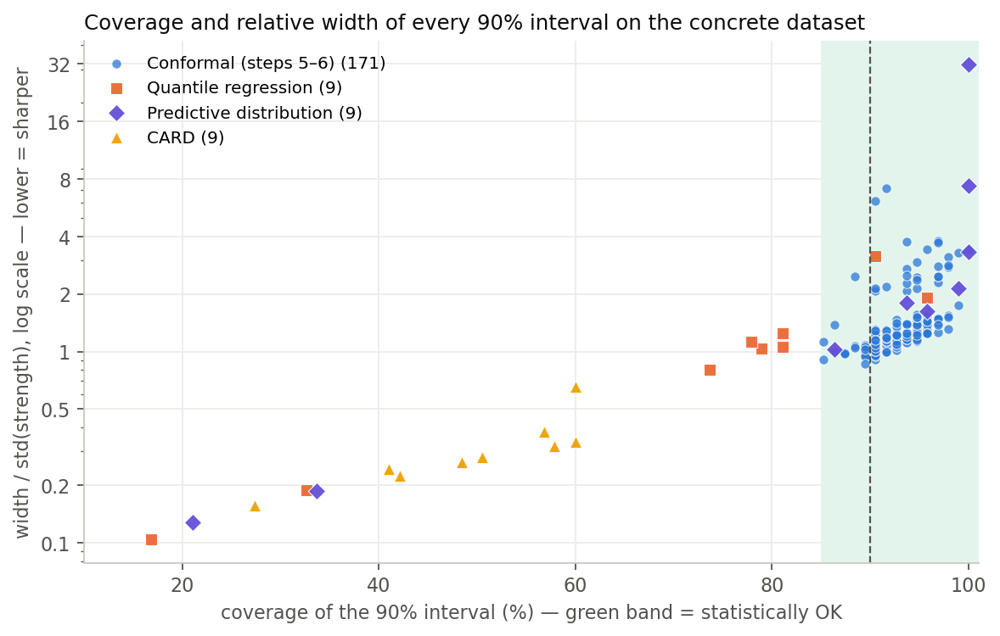

</div>

<sub>Repository formerly named <code>Regression_Uncertainty_Quantification_Analysis</code>; former links redirect here.</sub>

> **Abstract.** A regression model returns a point prediction without indicating how far that prediction can be trusted.
> This repository evaluates **more than thirty uncertainty-quantification (UQ) methods**, applied to **nine tuned regressors**,
> on **nine engineering and environmental datasets**. The methods cover quantile regression, parametric and generative
> predictive distributions (NGBoost, PGBM, IBUG, Treeffuser, CARD), split, cross-validation, bootstrap, weighted and online
> conformal prediction, learned coverage policies and single-network uncertainty. Every 90% prediction interval is assessed
> on held-out data for validity (coverage within sampling tolerance of 90%) and sharpness (width).
>
> The analysis is presented in detail on the **concrete compressive-strength dataset** (Section 2), one page per notebook.
> On that dataset, raw quantile regression and the native predictive distributions undercover for most models, whereas all
> 171 ranked conformal intervals are valid; the sharpest valid intervals are obtained with J+aB and, when labels are revealed
> sequentially, with online methods (MFCS Full, FACI, COP). The same conclusions hold across the nine datasets (Section 3):
> conformal intervals are valid in 1,480 of 1,557 cases (95%), and the sharpest valid method depends on the dataset.
>
> All numbers are read from executed Kaggle notebooks stored in this repository. A report per dataset and a cross-dataset
> **[benchmark paper](papers/benchmark/paper.pdf)** give the full mathematical treatment.

---

## Contents

1. [Overview and pipeline](#1-overview-and-pipeline)
2. [Case study: concrete compressive strength](#2-case-study-concrete-compressive-strength)
3. [Results on all nine datasets](#3-results-on-all-nine-datasets)
4. [Methods](#4-methods)
5. [Evaluation protocol](#5-evaluation-protocol)
6. [Reproducing the results](#6-reproducing-the-results)
7. [Repository structure](#7-repository-structure)
8. [Changes in version 2.0](#8-changes-in-version-20)
9. [Limitations](#9-limitations)
10. [Future work: the `reguq` library](#10-future-work-the-reguq-library)
11. [Citation, license and authors](#11-citation-license-and-authors)

---

## 1. Overview and pipeline

<p align="center">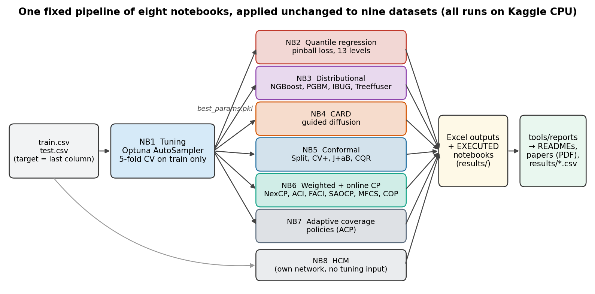</p>

*__Figure 1.__ The pipeline of eight notebooks, applied without modification (apart from paths, file names and column names)
to every dataset.*

| # | Notebook | Methods | Principal outputs | Method guide |
|:-:|---|---|---|---|
| 1 | Hyperparameter tuning | Optuna AutoSampler (TPE), 5-fold CV, 8 pruners; SHAP, LIME, EBM | Tuned settings (`best_params.json`), CV and test RMSE | [NB1](notebooks/01_hyperparameter_tuning/README.md) |
| 2 | Quantile regression | 13 quantile levels per model | Coverage, width, CRPS, crossing rate | [NB2](notebooks/02_quantile_regression/README.md) |
| 3 | Predictive distributions | NGBoost, PGBM, IBUG, Treeffuser | μ̂, σ̂, NLL, CRPS (Hersbach), PIT, calibration | [NB3](notebooks/03_probabilistic_distribution/README.md) |
| 4 | CARD | Guided diffusion, 1,000 samples per point | Predictive distribution, CRPS, calibration | [NB4](notebooks/04_probabilistic_distribution_card/README.md) |
| 5 | Conformal (MAPIE, PUNCC) | Split, CV+, J+aB, CQR | Intervals, coverage, width | [NB5](notebooks/05_conformal_mapie_puncc/README.md) |
| 6 | Conformal (NexCP, online, MFCS) | NexCP (4 variants), ACI, FACI, SF-OGD, SAOCP, online split/CV+/J+aB, MFCS, COP, AlphaNet, Extreme CP | One workbook sheet per family; GPD fits | [NB6](notebooks/06_conformal_nexcp_online/README.md) |
| 7 | Adaptive coverage policies | ACP with e-values; λ ∈ {10, 20, 50} | Learned level, coverage, width | [NB7](notebooks/07_adaptive_coverage_policies/README.md) |
| 8 | Hyperspherical confidence mapping | HCM (single network) | Coverage at 1/2/3σ, error–uncertainty correlation | [NB8](notebooks/08_hyperspherical_confidence_mapping/README.md) |

Base models: RandomForest (tuning only), GradientBoosting, XGBoost, LightGBM, GPBoost, CatBoost, HistGradientBoosting, NGBoost,
PGBM and TabNet.

---

## 2. Case study: concrete compressive strength

The concrete dataset is used to present the complete analysis. It is the only dataset on which every notebook ran for every
model without restriction, and its 95 test mixes allow coverage to be assessed meaningfully. **The full case study, with one
page per notebook, is in [`docs/concrete_walkthrough/`](docs/concrete_walkthrough/README.md).**

| | |
|---|---|
| **Data** | 189 training and 95 test mixes; inputs: cement, mineral powder, fine aggregate, coarse aggregate, fly ash, water/powder ratio, admixture |
| **Target** | Compressive strength (MPa); test mean 36.2 MPa, standard deviation 10.0 MPa |
| **Validity criterion** | 90% interval; valid if test coverage ≥ 84.9% ([Section 5.2](#52-validity-of-a-coverage-value)) |
| **Material** | [Data, notebooks and outputs](examples/concrete_uncertainty_analysis/README.md) · [Dataset report (PDF)](examples/concrete_uncertainty_analysis/report/paper.pdf) |

### 2.1 Step 1: hyperparameter tuning

<p align="center">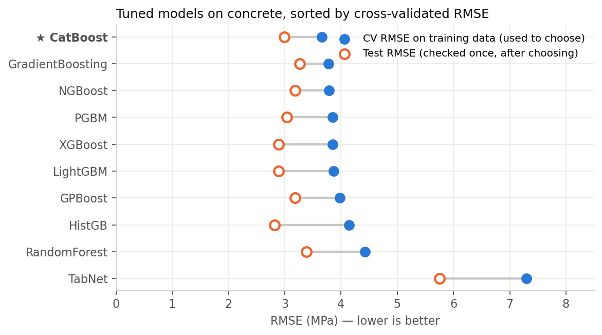</p>

**CatBoost** attains the lowest cross-validated RMSE (3.66 MPa); the eight gradient-boosting models lie within 0.5 MPa of it,
and TabNet is markedly less accurate (7.29 MPa). The AutoSampler selects the Tree-structured Parzen Estimator because every
hyperparameter is categorical; 50 trials replace grids of up to 3 × 10⁸ combinations. → [Step 1 in detail](docs/concrete_walkthrough/01_tuning.md)

### 2.2 Step 2: quantile regression

<p align="center">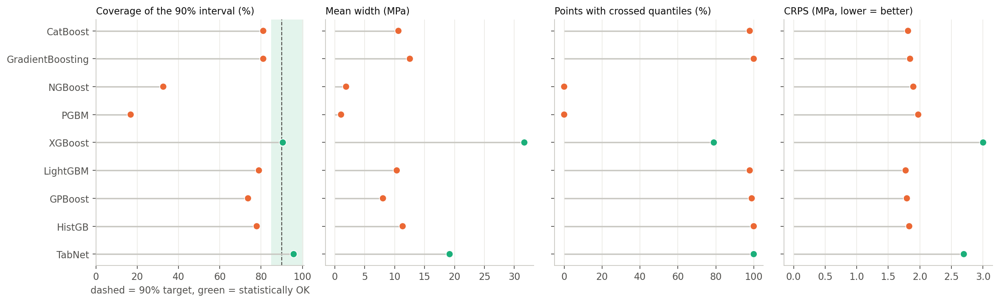</p>

Seven of the nine models cover only 17–81% of the test mixes, and the separately fitted quantiles cross for almost every mix.
Only XGBoost and TabNet reach the target, with intervals two to three times wider than the others.
→ [Step 2 in detail](docs/concrete_walkthrough/02_quantile_regression.md)

### 2.3 Step 3: predictive distributions

<p align="center">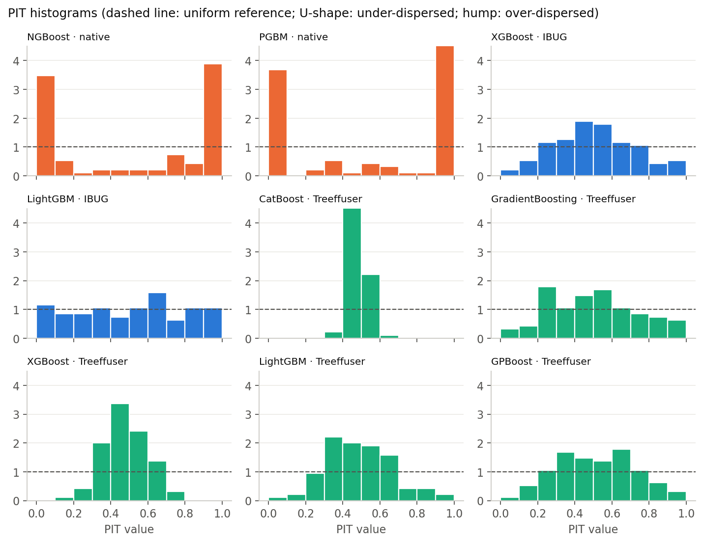</p>

The native NGBoost and PGBM Gaussians are over-confident (U-shaped PIT histograms, 21–34% coverage); Treeffuser is strongly
over-dispersed. **IBUG with LightGBM** is the best-calibrated distribution (86.3% coverage at 10.3 MPa).
→ [Step 3 in detail](docs/concrete_walkthrough/03_predictive_distributions.md)

### 2.4 Step 4: CARD

<p align="center">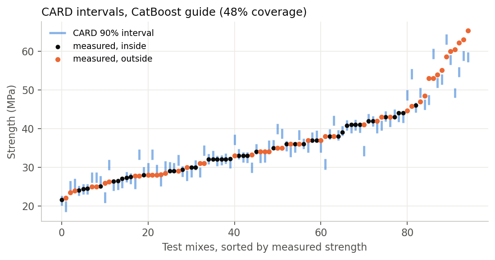</p>

CARD attains the lowest CRPS of the study (1.61 MPa with XGBoost as guide), but its intervals are 2–7 MPa wide and cover only
27–60% of the test mixes: a low CRPS does not imply a valid interval. → [Step 4 in detail](docs/concrete_walkthrough/04_card.md)

### 2.5 Step 5: split, CV+, J+aB and CQR conformal prediction

<p align="center">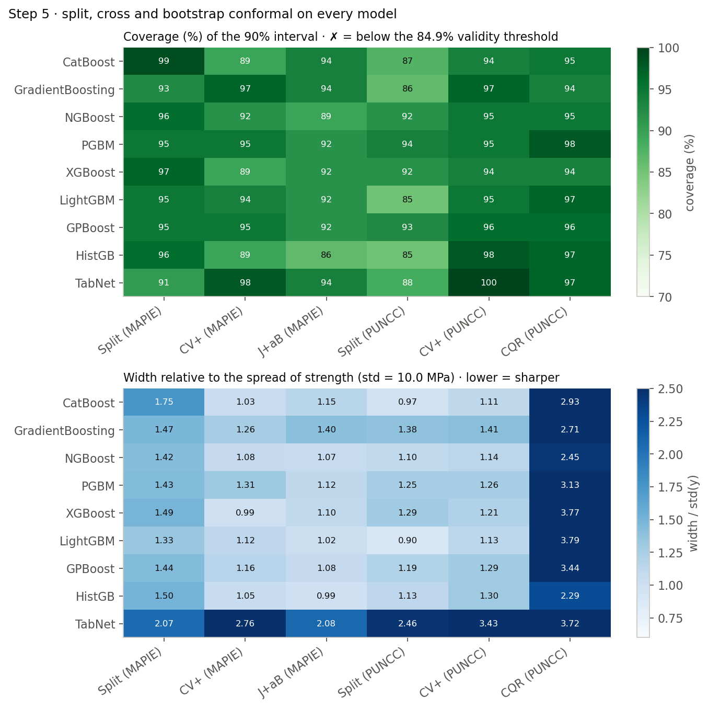</p>

**All 54 model–method combinations are valid.** J+aB is the sharpest method (median width 1.10 standard deviations of
strength); CQR is valid but about three times wider. → [Step 5 in detail](docs/concrete_walkthrough/05_conformal_split_cv_jab.md)

### 2.6 Step 6: weighted, online and optimistic conformal prediction

<p align="center">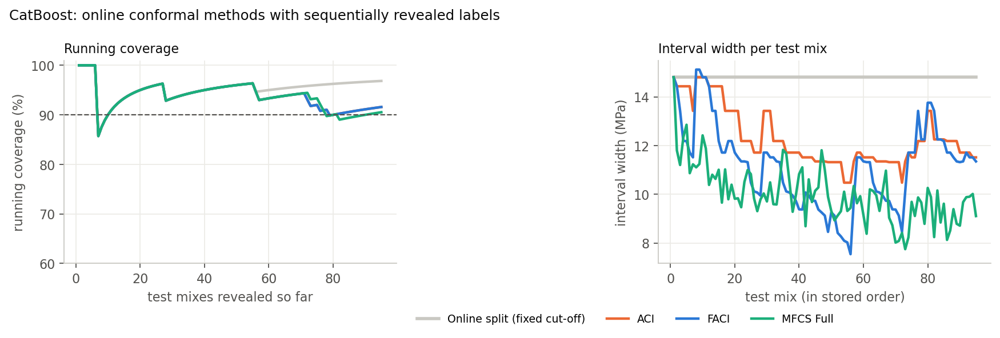</p>

All 117 ranked intervals are valid. Methods that update after each revealed label are the sharpest: **MFCS Full** (1.00 × std,
90.5% coverage), FACI and COP. AlphaNet is invalid for two models. → [Step 6 in detail](docs/concrete_walkthrough/06_conformal_weighted_online.md)

### 2.7 Step 7: adaptive coverage policies

<p align="center">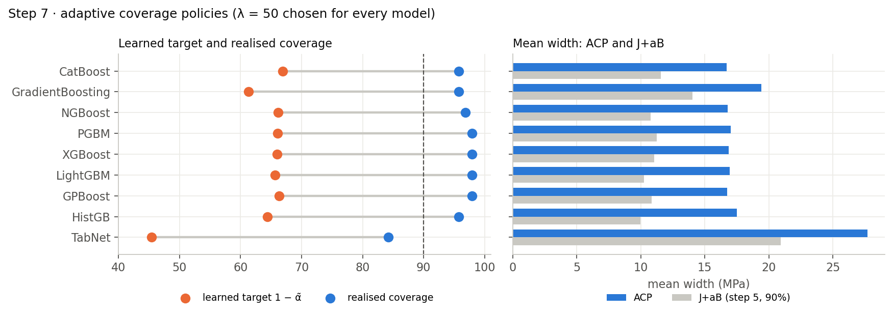</p>

ACP is valid at its learned level (target 61–67%, realised 96–98%) and does not saturate, but it is conservative and its
intervals are 5–7.5 MPa wider than J+aB. → [Step 7 in detail](docs/concrete_walkthrough/07_adaptive_coverage_policies.md)

### 2.8 Step 8: hyperspherical confidence mapping

<p align="center">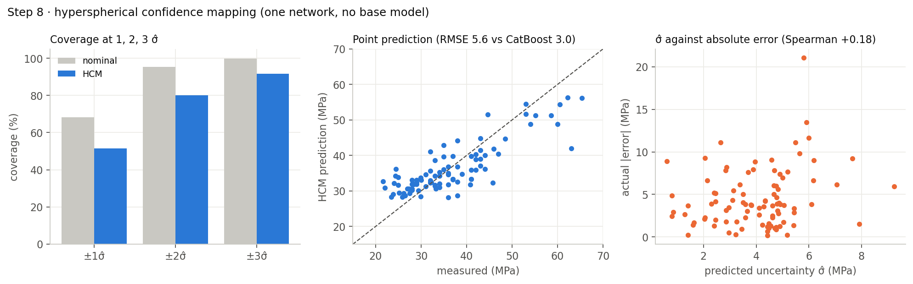</p>

With the extended training schedule (fix H1) the network converges: RMSE 5.6 MPa, and its uncertainty estimate is weakly related to the error (Spearman +0.18). Its 95% interval covers only 78.9% of the test mixes and is not valid. → [Step 8 in detail](docs/concrete_walkthrough/08_hcm.md)

### 2.9 Conclusions for the concrete dataset

| Purpose | Recommended method | Result |
|---|---|---|
| Point prediction | CatBoost (any tuned boosting model is practically equivalent) | CV RMSE 3.66 MPa |
| Prediction interval, fixed test set | J+aB or CV+ conformal on a boosting model | about 11 MPa at 90–94% coverage |
| Prediction interval, sequential labels | MFCS Full or FACI | about 10 MPa at 90.5% coverage |
| Predictive distribution | IBUG with LightGBM (calibrated); CARD (lowest CRPS, requires calibration) | 86.3% coverage; CRPS 1.61 MPa |
| Not to be used without calibration | Raw quantile regression, native NGBoost/PGBM, CARD intervals, Treeffuser, HCM | coverage 17–81% or excessive width |

→ [Summary of the case study](docs/concrete_walkthrough/09_summary.md)

---

## 3. Results on all nine datasets

Each dataset has its own folder with the data, the executed notebooks, the Excel outputs, a README per notebook and a full
report. Every interval targets 90%. *Recommended* denotes the narrowest method that is valid on at least 75% of the base models
it wraps ([Section 5.3](#53-recommended-method)); relative width is the interval width divided by the standard deviation of the
test target.

| Dataset | Train / test | Best model (CV) | Raw QR coverage | Recommended method | Coverage | Relative width | Report |
|---|---|---|--:|---|--:|--:|---|
| [**Concrete**](examples/concrete_uncertainty_analysis/README.md) | 189 / 95 | CatBoost | 79.0% | MFCS Full | 90.5% | 1.00 | [PDF](examples/concrete_uncertainty_analysis/report/paper.pdf) |
| [Noise](examples/noise_uncertainty_analysis/README.md) | 168 / 60 | LightGBM | 90.0% | FACI | 85.0% | 0.81 | [PDF](examples/noise_uncertainty_analysis/report/paper.pdf) |
| [Pile](examples/pile_uncertainty_analysis/README.md) | 81 / 24 | LightGBM | 58.3% | J+aB (MAPIE) | 95.8% | 1.60 | [PDF](examples/pile_uncertainty_analysis/report/paper.pdf) |
| [Pile settlement](examples/pile_settlement_uncertainty_analysis/README.md) | 371 / 186 | GPBoost | 82.8% | MFCS Full | 89.8% | 0.74 | [PDF](examples/pile_settlement_uncertainty_analysis/report/paper.pdf) |
| [Scour](examples/scour_uncertainty_analysis/README.md) | 154 / 78 | XGBoost | 84.6% | Split CP (MAPIE) | 93.6% | 1.48 | [PDF](examples/scour_uncertainty_analysis/report/paper.pdf) |
| [Sediment load](examples/sediment_load_uncertainty_analysis/README.md) | 1095 / 365 | TabNet | 81.1% | NexCP J+aB | 89.3% | 0.24 | [PDF](examples/sediment_load_uncertainty_analysis/report/paper.pdf) |
| [Streamflow](examples/streamflow_uncertainty_analysis/README.md) | 192 / 96 | GradientBoosting | 86.5% | J+aB (MAPIE) | 88.5% | 1.32 | [PDF](examples/streamflow_uncertainty_analysis/report/paper.pdf) |
| [Water quality (EWQI)](examples/water_quality_ewqi_uncertainty_analysis/README.md) | 47 / 47 | XGBoost | 66.0% | FACI | 91.5% | 1.33 | [PDF](examples/water_quality_ewqi_uncertainty_analysis/report/paper.pdf) |
| [Water quality (WQI)](examples/water_quality_wqi_uncertainty_analysis/README.md) | 190 / 82 | XGBoost | 79.3% | J+aB (MAPIE) | 89.0% | 1.18 | [PDF](examples/water_quality_wqi_uncertainty_analysis/report/paper.pdf) |

Coverages slightly below 90% are valid within the sampling tolerance of the respective test-set size (Section 5.2).

| Median coverage per method and dataset | Median relative width per method and dataset |
|:-:|:-:|
|  |  |

*__Figure 2.__ Median coverage (left) and median relative width (right) of each two-sided method over the base models, per
dataset (n/r: not run).*

### Cross-dataset findings

| # | Finding | Evidence |
|:-:|---|---|
| F1 | Raw quantile regression undercovers: median coverage of the 90% interval is 58–90% across datasets | [Benchmark paper](papers/benchmark/paper.pdf), RQ1 |
| F2 | Native NGBoost and PGBM Gaussians are over-confident: NGBoost is invalid on 7 of 9 datasets, PGBM on 8 of 9 (coverage 2–42%) | RQ1 |
| F3 | A low CRPS does not imply a valid interval: CARD's distributions are the most concentrated, yet only 15% of its intervals are valid | RQ1 |
| F4 | Conformal intervals are valid in 1,480 of 1,557 dataset × model × method cases (95%) | RQ2 |
| F5 | 58 of the 77 conformal failures occur on WQI (151 features, 190 training rows) and pile settlement (heavy right tail) | RQ2 |
| F6 | The sharpest valid method depends on the dataset: J+aB (3 datasets), FACI and MFCS Full (2 each), NexCP J+aB and split CP (1 each) | RQ3 |
| F7 | ACP's learned policy saturates (α̃ = 0.999) on sediment load and streamflow for every model | RQ4 |
| F8 | After fix H1, HCM's predicted spread is positively correlated with the error on all nine datasets (Spearman 0.12–0.56), but its 95% interval is valid on only four | RQ4 |

The cross-dataset analysis, with the mathematics of every method, is given in the
**[benchmark paper (PDF)](papers/benchmark/paper.pdf)**; machine-readable results are in [`results/`](results/).

---

## 4. Methods

| Family | Principle | Output | Coverage guarantee |
|---|---|---|---|
| **Quantile regression** | Separate models estimate the lower and upper conditional quantiles by minimising the pinball loss | interval | none (holds only if both quantile models are correct) |
| **Predictive distributions**: NGBoost, PGBM, IBUG, Treeffuser, CARD | A parametric or generative model of the conditional distribution of the target | distribution → interval | none (holds only if the noise model is correct) |
| **Conformal prediction**: split, CV+, J+aB, CQR, NexCP, online (ACI, FACI, SF-OGD, SAOCP, MFCS), COP | Calibrates the interval radius on held-out residuals so that it exceeds 90% of them | interval | **finite-sample**: ≥ 90% on average under exchangeability (online methods: long-run, without assumptions on the data) |
| **Learned level / single network**: ACP, HCM | A network learns the miscoverage level (ACP) or derives uncertainty from the geometry of its output (HCM) | interval at a learned level / σ̂ | ACP: at its learned level; HCM: none |

<p align="center">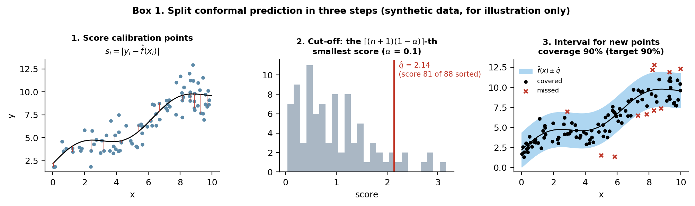</p>

*__Box 1.__ Split conformal prediction on synthetic data.*

**Split conformal prediction.** The model is fitted on part of the training data, and the absolute residuals
$`s_i=|y_i-\hat f(x_i)|`$ are computed on the remaining $`m`$ calibration points. With

```math
\hat q = s_{(k)},\qquad k=\bigl\lceil (m+1)(1-\alpha)\bigr\rceil,\qquad \alpha=0.1,
```

the interval for a new point is $`\hat C(x)=[\hat f(x)-\hat q,\ \hat f(x)+\hat q]`$. Under exchangeability the residual of the new
point is equally likely to occupy any rank among the $`m+1`$ residuals, so it does not exceed $`\hat q`$ with probability at
least $`1-\alpha`$, irrespective of the model. The other conformal methods modify one element of this construction: the reuse
of training points for calibration (CV+, J+aB), the score (CQR), the weighting of residuals (NexCP), or the sequential update
of the radius (online methods). Each method is derived in the [method guides](notebooks/README.md).

---

## 5. Evaluation protocol

### 5.1 Metrics

| Metric | Definition | Desired value |
|---|---|---|
| **Coverage** | Share of test points inside their interval | ≥ 90% within sampling tolerance |
| **Width** | Mean difference between upper and lower bound, in target units | small, given valid coverage |
| **Relative width** | Width divided by the standard deviation of the test target | small; comparable across datasets |
| **CRPS** | Continuous ranked probability score; equals the pinball loss integrated over all quantile levels | low |
| **PIT** | Predicted CDF evaluated at the observation; uniform if calibrated | uniform histogram |
| **Crossing rate** | Share of points whose separately fitted quantiles are not monotone | 0 |
| **Spearman (error, σ̂)** | Rank correlation between predicted uncertainty and absolute error | > 0 |

### 5.2 Validity of a coverage value

<p align="center">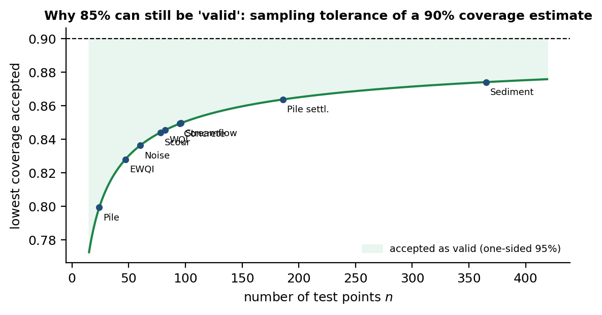</p>

The number of covered test points is binomial, so the coverage of a correctly calibrated 90% method has standard error
$`\sqrt{0.09/n}`$. A method is considered **valid** when its coverage is not significantly below 90% in a one-sided test at the
5% level:

```math
\hat c\ \ge\ 0.9-1.645\sqrt{\frac{0.09}{n_{\text{test}}}} .
```

The threshold is 79.9% for 24 test points (pile), 84.9% for 95 (concrete) and 87.4% for 365 (sediment load).

### 5.3 Recommended method

A method wraps up to nine base models. It is **recommended** on a dataset if it has the smallest median relative width among
methods that are valid on at least 75% of the models they ran on, ran on at least three models, and report no width that is
only a lower bound.

---

## 6. Reproducing the results

All results were computed on **Kaggle CPU sessions**; no model was trained locally.

1. **Data.** Attach the Kaggle dataset `daneshselwal/reguq-uq-data` or upload `examples/<dataset>_uncertainty_analysis/data/`.
2. **Notebook 1 first.** The `FIX K1` cell detects the Kaggle environment, copies the CSV files into the expected layout and
   installs only missing packages at pinned versions.
3. **Notebooks 2–8.** Add the output of the tuning run as an input; the `FIX K2` cell locates `best_params.pkl`.
4. **Batch execution.** [`tools/kaggle/`](tools/kaggle/README.md) wraps a notebook in a papermill job, names each run
   `REG<DD>_<MM>_<YYYY>_<HH>_<MM>` and records it in [`docs/run_registry.tsv`](docs/run_registry.tsv). Notebook 6 runs as one job
   per base model to remain within the 12-hour session limit.
5. **Reports and figures.** [`tools/reports/`](tools/reports/README.md) regenerates every README table, figure, report and
   `results/*.csv` file from the stored outputs.

The notebooks also run on **Google Colab** with the dataset folder at `MyDrive/Regression/<dataset>_uncertainty_analysis/`. To
apply the pipeline to a new dataset, provide `train.csv` and `test.csv` with the target in the last column, copy the notebooks
from `notebooks/`, and set the folder name, file names, `feature_names` and target label in the first cell
([`docs/DATASET_PARAMETERS.md`](docs/DATASET_PARAMETERS.md)).

---

## 7. Repository structure

```
.
├── README.md                     ← this document
├── docs/
│   ├── concrete_walkthrough/     ← the concrete case study, one page per notebook
│   ├── figures/                  ← figures (concrete/ for the case study)
│   ├── CHANGELOG_FIXES.md        ← every v2.0 correction: before, reason, after
│   ├── DATASET_PARAMETERS.md     ← dataset-specific settings
│   ├── KAGGLE_RUNS.md            ← construction and execution of the Kaggle jobs
│   └── run_registry.tsv          ← every Kaggle run: code name, notebook, time
├── examples/<dataset>_uncertainty_analysis/
│   ├── README.md                 ← data analysis, results by research question, Kaggle links
│   ├── report/                   ← dataset report: paper.pdf, LaTeX source, figures
│   ├── data/                     ← train.csv, test.csv
│   └── <phase>/                  ← README, notebook, results/ (EXECUTED_*.ipynb, *.xlsx)
├── notebooks/                    ← the generalised pipeline (without outputs) and a method guide per notebook
├── papers/benchmark/             ← cross-dataset benchmark paper
├── results/                      ← benchmark_long.csv (every interval), benchmark_methods.csv, benchmark_datasets.csv
├── references/                   ← REFERENCES.md and key papers (PDF)
└── tools/
    ├── kaggle/                   ← job builder and push queue
    └── reports/                  ← generators for READMEs, figures, reports and results/*.csv
```

---

## 8. Changes in version 2.0

Version 2.0 is a **correctness release**. Each notebook was checked method by method against the original publication and,
where available, the authors' reference implementation. Each confirmed defect was corrected with the smallest possible change,
approved individually and marked in the code with `# FIX <id>`; [`docs/CHANGELOG_FIXES.md`](docs/CHANGELOG_FIXES.md) records the
state before the change, the reason and the state after.

| Area | Change |
|---|---|
| Tuning | Model selection by 5-fold CV on the training set (previously on the test set); tuned settings saved and loaded by every later notebook |
| Quantile regression | Quantile crossing measured and removed; CRPS with correct level weights; TabNet early stopping on a validation split |
| Distributions | Hersbach CRPS decomposition; IBUG variance no longer square-rooted twice; Treeffuser score model uses squared error |
| CARD | Re-implemented following the official CARD code |
| MAPIE / PUNCC | Correct interval shapes; genuine split conformal and J+aB; CQR with quantile models; a single α = 0.1 |
| NexCP / online | Out-of-fold calibration residuals; NexCP weighted quantile as published; weighted full, CV+ and J+aB; SF-OGD, SAOCP and FACI ported from the reference code; ACI added; COP and Extreme CP following their official code |
| ACP | λ no longer selected by comparing losses across λ; coverage reported against the learned level |
| HCM | Silent fallback to synthetic data removed; training schedule extended so that the network converges (H1) |
| Infrastructure | Execution on Kaggle or Colab; executed notebooks stored with the results; one NB6 job per model; run registry; generated reports |

Outputs saved in the v1.2 notebooks were not produced on their stated datasets, so v1.2 numbers should not be compared with
v2.0. Earlier versions are preserved on the branches `version1.2`, `version-1.1` and `version-1.0`.

---

## 9. Limitations

| # | Limitation | Consequence |
|:-:|---|---|
| 1 | One train/test split and one run per notebook | No confidence intervals across splits or seeds; small test sets detect only large departures from 90% |
| 2 | Online methods process the test rows in their stored order | Their widths partly reflect learning from earlier test labels |
| 3 | All guarantees are marginal | A method can cover 90% overall and less for extreme target values |
| 4 | Optuna search is not bit-reproducible; neural models depend on seeds | Re-running yields slightly different numbers; the stored tuning run is the one used by every notebook |
| 5 | Kaggle's 12-hour session limit | Not run: NB6 TabNet and PGBM on sediment load (and NexCP Full there); NB6 NGBoost and PGBM on pile settlement |

---

## 10. Future work: the `reguq` library

The notebooks constitute a research pipeline: long, dataset-specific copies whose methods cannot be imported into other code.
The next stage of this project is **`reguq`** (regression uncertainty quantification), a Python package that provides the
verified methods of this benchmark as a tested and documented library:

- a common interface (`fit` / `calibrate` / `predict_interval` / `predict_distribution`) for every method family studied here,
  wrapping any scikit-learn-compatible regressor;
- the evaluation protocol of Section 5 (coverage with sampling tolerance, relative width, CRPS, PIT, crossing rate) and the
  recommendation rule as functions, so that a new dataset can be benchmarked with minimal code;
- tests that verify each method against the authors' reference implementation and against its theoretical coverage on
  synthetic data;
- repeated random splits with confidence intervals, and conditional-coverage diagnostics.

---

## 11. Citation, license and authors

| Resource | Location |
|---|---|
| Concrete case study | [`docs/concrete_walkthrough/`](docs/concrete_walkthrough/README.md) |
| Benchmark paper (all datasets) | [`papers/benchmark/paper.pdf`](papers/benchmark/paper.pdf) |
| Dataset reports | `examples/<dataset>_uncertainty_analysis/report/paper.pdf` ([index](papers/README.md)) |
| Machine-readable results | [`results/`](results/) |
| Kaggle runs | linked in each dataset README and report; complete log in [`docs/run_registry.tsv`](docs/run_registry.tsv) |
| References | [`references/REFERENCES.md`](references/REFERENCES.md) |
| Libraries | scikit-learn, XGBoost, LightGBM, CatBoost, GPBoost, NGBoost, PGBM, pytorch-tabnet, Optuna, MAPIE, PUNCC, IBUG, Treeffuser, PyTorch, SHAP, LIME, InterpretML |

**Citation.** If you use this benchmark or its results, please cite it (GitHub's *Cite this repository* button uses
[`CITATION.cff`](CITATION.cff)) together with the original publications of the methods used:

```bibtex
@misc{selwal_pal_regression_uq_2026,
  author       = {Selwal, Danesh and Pal, Mahesh},
  title        = {Regression Uncertainty Quantification Benchmark: Over Thirty Methods on
                  Nine Engineering and Environmental Datasets},
  year         = {2026},
  howpublished = {\url{https://github.com/DaneshSelwal/Regression-UQ-Benchmark}},
  note         = {Version 2.0}
}
```

**License.** [MIT](LICENSE).

**Authors.** Danesh Selwal and Dr. Mahesh Pal.
