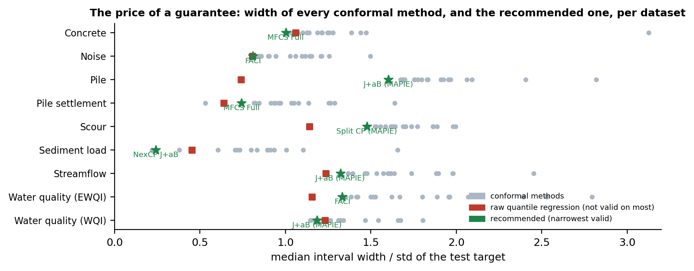
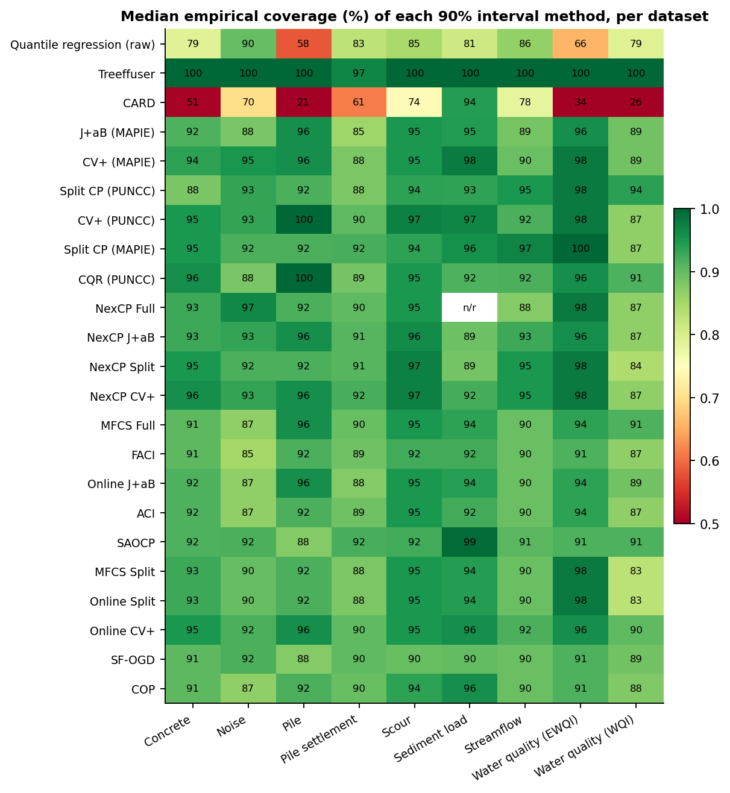
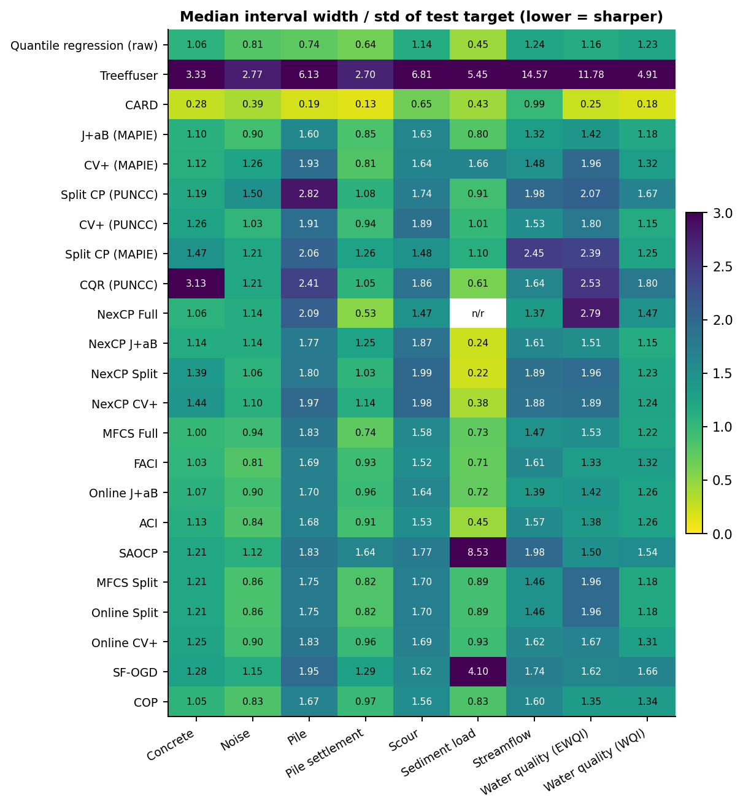
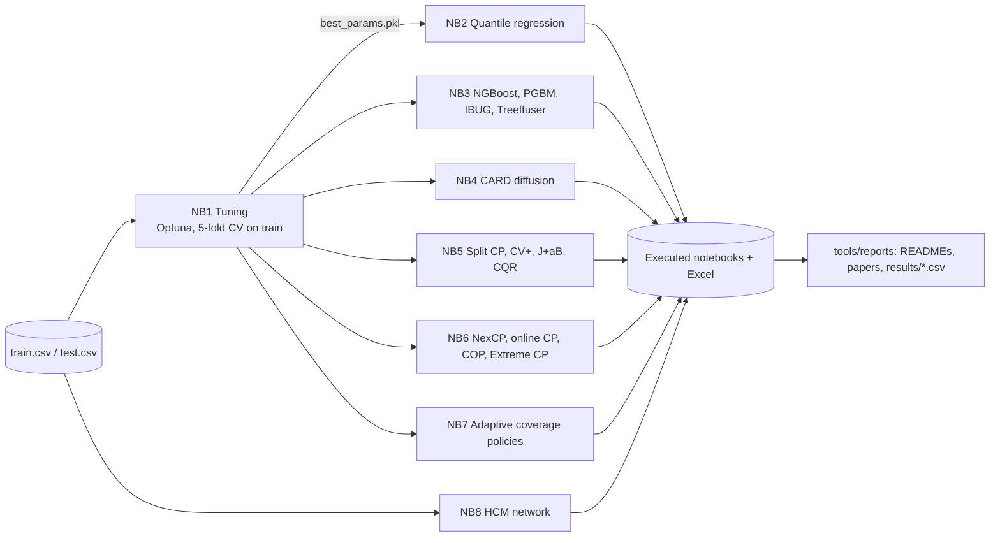
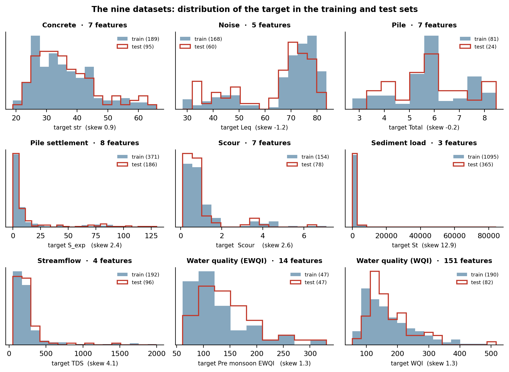
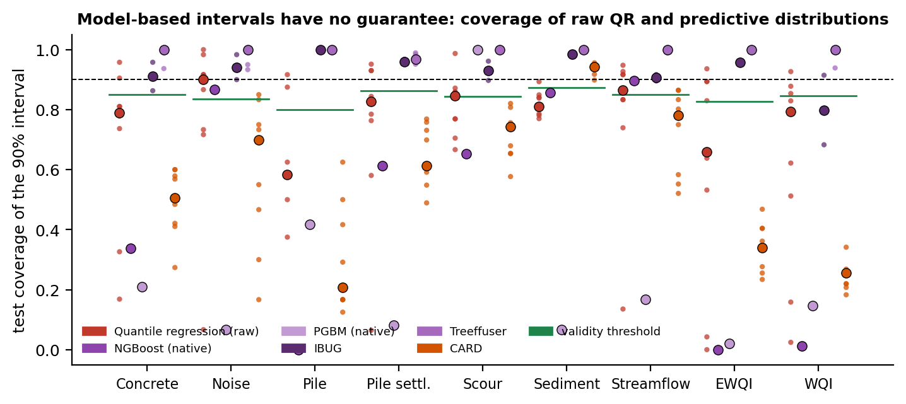
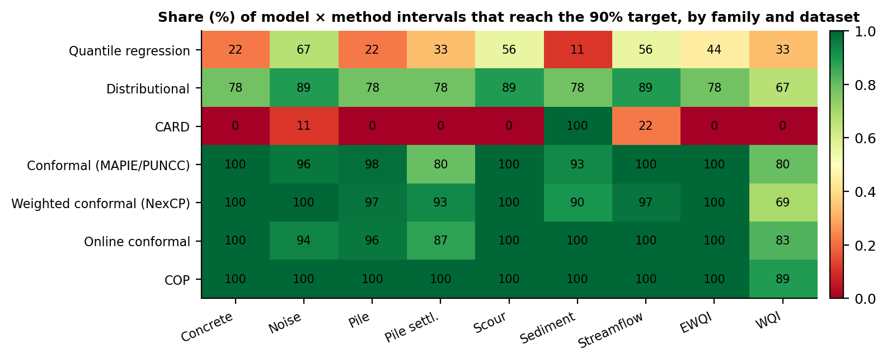
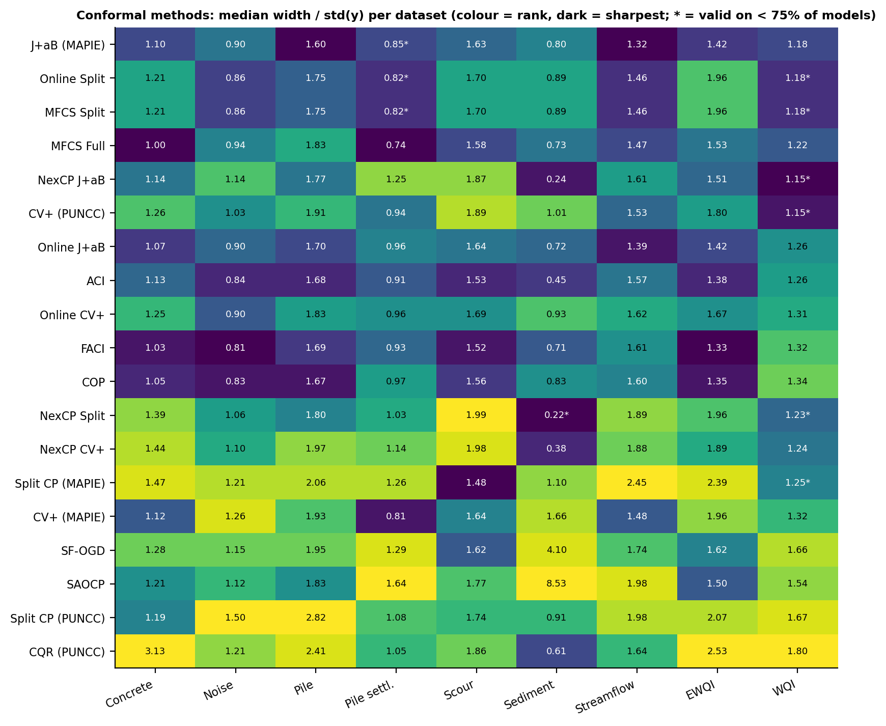
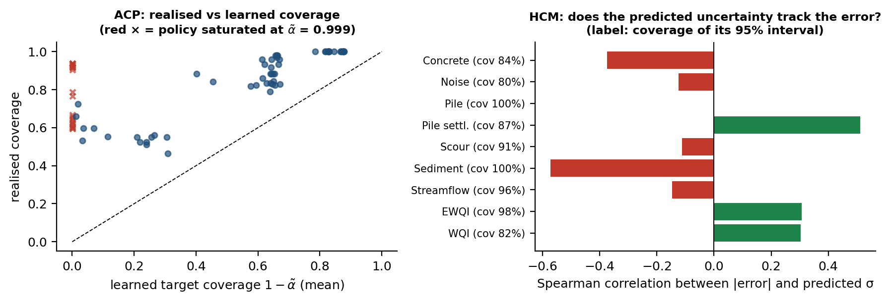

<div align="center">

# How Far Can a Regression Prediction Be Trusted?

### A benchmark of 30+ uncertainty-quantification methods × 9 tuned regressors × 9 engineering and environmental datasets

[](LICENSE)


[](papers/benchmark/paper.pdf)
[](https://github.com/DaneshSelwal/Regression_Uncertainty_Quantification_Analysis/releases)



</div>

> **Abstract.** A regression model always returns a number, even when it should not be trusted. We attach **more than
> thirty uncertainty-quantification (UQ) methods** to **nine tuned regressors** and check every 90% prediction interval on
> held-out data from **nine engineering and environmental datasets** (concrete strength, noise, pile capacity, pile
> settlement, bridge scour, sediment load, streamflow and two water-quality indices). The methods range from quantile
> regression and predictive distributions (NGBoost, PGBM, IBUG, Treeffuser, CARD diffusion) to split, cross, bootstrap,
> weighted and online conformal prediction, learned-coverage policies and single-network uncertainty.
>
> Four findings stand out:
> 1. **Model-based intervals are not reliable.** Raw quantile regression covers a median of only 58–90% of test points, and
>    native NGBoost and PGBM Gaussians are over-confident on most datasets (PGBM: 2–42% on eight of nine).
> 2. **Conformal intervals keep their promise.** They are valid in **1,480 of 1,557** dataset × model × method cases (95%).
> 3. **Validity is easy, sharpness is not.** Valid methods differ in width by a factor of two or more, and the sharpest one
>    changes with the data (J+aB, FACI, MFCS, NexCP J+aB, split CP).
> 4. **Learned coverage and single-network UQ need care.** ACP's policy saturates on two datasets, and HCM's uncertainty is
>    negatively correlated with the error, or not at all, on six of nine.
>
> Every number here is read from executed Kaggle notebooks committed to this repository. The full write-up, with the
> mathematics of every method, is the **[benchmark paper (PDF)](papers/benchmark/paper.pdf)**; each dataset has its own report.

---

## Contents

1. [Key findings](#1-key-findings)
2. [Why uncertainty matters for regression](#2-why-uncertainty-matters-for-regression)
3. [Results at a glance](#3-results-at-a-glance)
4. [The pipeline](#4-the-pipeline)
5. [The nine datasets](#5-the-nine-datasets)
6. [Methods in clear words](#6-methods-in-clear-words)
7. [How the intervals are judged](#7-how-the-intervals-are-judged)
8. [Results, question by question](#8-results-question-by-question)
9. [Worked example: concrete](#9-worked-example-concrete)
10. [Discussion, recommendations and limitations](#10-discussion-recommendations-and-limitations)
11. [Reproducing the results](#11-reproducing-the-results)
12. [Repository map](#12-repository-map)
13. [What changed in version 2.0](#13-what-changed-in-version-20)
14. [Future work: the `reguq` library](#14-future-work-the-reguq-library)
15. [Resources, citation and license](#15-resources-citation-and-license)

---

## 1. Key findings

| # | Finding | Evidence | Details |
|:-:|---|---|---|
| F1 | **Raw quantile regression undercovers.** Median coverage of the 90% interval is 58–90% across datasets; the 13 separately fitted quantiles cross on most test points | [Fig. 5](#81-rq1--do-model-based-intervals-reach-90) | [NB2 guide](notebooks/02_quantile_regression/README.md) |
| F2 | **Native Gaussian distributions are over-confident.** NGBoost is invalid on 7 of 9 datasets, PGBM on 8 of 9 (coverage 2–42%); their PIT histograms are U-shaped | [Fig. 5](#81-rq1--do-model-based-intervals-reach-90) | [NB3 guide](notebooks/03_probabilistic_distribution/README.md) |
| F3 | **A good CRPS is not a good interval.** CARD's diffusion distributions are sharp (median width 0.26 × std(y)) but only 15% of its intervals are valid | [§8.1](#81-rq1--do-model-based-intervals-reach-90) | [NB4 guide](notebooks/04_probabilistic_distribution_card/README.md) |
| F4 | **Conformal methods are valid almost everywhere**: 1,480 of 1,557 cases (95%) | [Fig. 6](#82-rq2--do-conformal-methods-keep-their-promise) | [NB5](notebooks/05_conformal_mapie_puncc/README.md), [NB6](notebooks/06_conformal_nexcp_online/README.md) |
| F5 | **Failures point to the data.** 58 of the 77 conformal misses are on WQI (151 features, 190 rows) and pile settlement (heavy right tail) | [§8.2](#82-rq2--do-conformal-methods-keep-their-promise) | [WQI](examples/water_quality_wqi_uncertainty_analysis/README.md), [pile settl.](examples/pile_settlement_uncertainty_analysis/README.md) |
| F6 | **The sharpest valid method depends on the dataset.** J+aB wins on 3 datasets, FACI and MFCS Full on 2 each, NexCP J+aB and split CP on 1 | [Fig. 7](#83-rq3--which-valid-method-is-the-sharpest) | [§8.3](#83-rq3--which-valid-method-is-the-sharpest) |
| F7 | **Learned coverage can collapse.** ACP's policy saturates at α̃ = 0.999 on sediment load and streamflow for every model | [Fig. 8](#84-rq4--what-do-learned-coverage-and-single-network-methods-add) | [NB7 guide](notebooks/07_adaptive_coverage_policies/README.md) |
| F8 | **Single-network uncertainty is not informative here.** HCM's σ̂ correlates negatively or not at all with the error on 6 of 9 datasets | [Fig. 8](#84-rq4--what-do-learned-coverage-and-single-network-methods-add) | [NB8 guide](notebooks/08_hyperspherical_confidence_mapping/README.md) |

---

## 2. Why uncertainty matters for regression

A design check on a pile, a warning on sediment load or a compliance decision on water quality depends on how wrong the
prediction could be. Uncertainty quantification answers with an **interval** ("the settlement is between 4 and 11 mm, with
90% confidence") or a **distribution**. A useful answer must be:

| Property | Meaning | Who provides it here |
|---|---|---|
| **Valid** | A "90%" interval contains the truth at least 90% of the time | Conformal prediction (§6) |
| **Sharp** | Among valid intervals, the narrowest | Compared in §8.3 |
| **Adaptive** | Wider where the data are noisy, narrower where they are not | CQR, distributional methods, online methods |
| **Robust to change** | Keeps its promise when the data drift | NexCP, online conformal (ACI, FACI, SAOCP, …) |
| **Informative** | Its spread tracks the actual error | Checked for HCM (§8.4) |

---

## 3. Results at a glance

Every interval targets **90%**. *Recommended* = the narrowest method that is valid (§7.3) on at least 75% of the base
models it wraps. Relative width = interval width / standard deviation of the test target.

| Dataset | Train / test | Best model (CV) | Raw QR coverage | Recommended method | Its coverage | Relative width | Report |
|---|---|---|--:|---|--:|--:|---|
| [Concrete](examples/concrete_uncertainty_analysis/README.md) | 189 / 95 | CatBoost | 79.0% | MFCS Full | 90.5% | 1.00 | [PDF](papers/concrete/paper.pdf) |
| [Noise](examples/noise_uncertainty_analysis/README.md) | 168 / 60 | LightGBM | 90.0% | FACI | 85.0% | 0.81 | [PDF](papers/noise/paper.pdf) |
| [Pile](examples/pile_uncertainty_analysis/README.md) | 81 / 24 | LightGBM | 58.3% | J+aB (MAPIE) | 95.8% | 1.60 | [PDF](papers/pile/paper.pdf) |
| [Pile settlement](examples/pile_settlement_uncertainty_analysis/README.md) | 371 / 186 | GPBoost | 82.8% | MFCS Full | 89.8% | 0.74 | [PDF](papers/pile_settlement/paper.pdf) |
| [Scour](examples/scour_uncertainty_analysis/README.md) | 154 / 78 | XGBoost | 84.6% | Split CP (MAPIE) | 93.6% | 1.48 | [PDF](papers/scour/paper.pdf) |
| [Sediment load](examples/sediment_load_uncertainty_analysis/README.md) | 1095 / 365 | TabNet | 81.1% | NexCP J+aB | 89.3% | 0.24 | [PDF](papers/sediment_load/paper.pdf) |
| [Streamflow](examples/streamflow_uncertainty_analysis/README.md) | 192 / 96 | GradientBoosting | 86.5% | J+aB (MAPIE) | 88.5% | 1.32 | [PDF](papers/streamflow/paper.pdf) |
| [Water quality (EWQI)](examples/water_quality_ewqi_uncertainty_analysis/README.md) | 47 / 47 | XGBoost | 66.0% | FACI | 91.5% | 1.33 | [PDF](papers/water_quality_ewqi/paper.pdf) |
| [Water quality (WQI)](examples/water_quality_wqi_uncertainty_analysis/README.md) | 190 / 82 | XGBoost | 79.3% | J+aB (MAPIE) | 89.0% | 1.18 | [PDF](papers/water_quality_wqi/paper.pdf) |

Coverages slightly below 90% (noise, sediment, streamflow, WQI, pile settlement) are still valid: with 60–365 test points a
correct 90% method lands that low by chance (§7.3).

| Median coverage per method and dataset | Median relative width per method and dataset |
|:-:|:-:|
|  |  |

*__Figure 1.__ Left: median coverage (%) of each two-sided method over the base models, per dataset (n/r = not run). Right:
median relative width (lower = sharper).*

---

## 4. The pipeline

<p align="center"></p>

*__Figure 2.__ One fixed pipeline of eight notebooks, applied unchanged (apart from paths and column names) to every dataset.*



| # | Notebook | Method guide | Main outputs |
|---|---|---|---|
| 1 | [`01_hyperparameter_tuning`](notebooks/01_hyperparameter_tuning/) | [guide](notebooks/01_hyperparameter_tuning/README.md) | tuned settings (`best_params.pkl`), CV and test RMSE, SHAP / LIME / EBM |
| 2 | [`02_quantile_regression`](notebooks/02_quantile_regression/) | [guide](notebooks/02_quantile_regression/README.md) | 13 quantiles per point, coverage, width, CRPS, crossing rate |
| 3 | [`03_probabilistic_distribution`](notebooks/03_probabilistic_distribution/) | [guide](notebooks/03_probabilistic_distribution/README.md) | μ̂, σ̂, NLL, CRPS (Hersbach decomposition), PIT, calibration |
| 4 | [`04_probabilistic_distribution_card`](notebooks/04_probabilistic_distribution_card/) | [guide](notebooks/04_probabilistic_distribution_card/README.md) | 1000 diffusion samples per point, CRPS, calibration |
| 5 | [`05_conformal_mapie_puncc`](notebooks/05_conformal_mapie_puncc/) | [guide](notebooks/05_conformal_mapie_puncc/README.md) | intervals, coverage, width, conditional coverage |
| 6 | [`06_conformal_nexcp_online`](notebooks/06_conformal_nexcp_online/) | [guide](notebooks/06_conformal_nexcp_online/README.md) | one sheet per method family; GPD fits for Extreme CP |
| 7 | [`07_adaptive_coverage_policies`](notebooks/07_adaptive_coverage_policies/) | [guide](notebooks/07_adaptive_coverage_policies/README.md) | learned α̃, e-value intervals, λ comparison |
| 8 | [`08_hyperspherical_confidence_mapping`](notebooks/08_hyperspherical_confidence_mapping/) | [guide](notebooks/08_hyperspherical_confidence_mapping/README.md) | coverage at 1/2/3σ, 95% interval, error–uncertainty correlation |

---

## 5. The nine datasets

<p align="center"></p>

*__Figure 3.__ Target distribution on the training (filled) and test (outline) sets.*

| Dataset | Train / test | Features | Target | Target skew | What makes it hard | Folder |
|---|---|--:|---|--:|---|---|
| Concrete | 189 / 95 | 7 | `str` | 0.9 | – (a clean, mid-sized problem) | [README](examples/concrete_uncertainty_analysis/README.md) |
| Noise | 168 / 60 | 5 | `Leq` | −1.2 | bimodal target | [README](examples/noise_uncertainty_analysis/README.md) |
| Pile | 81 / 24 | 7 | `Total` | −0.2 | only 24 test points | [README](examples/pile_uncertainty_analysis/README.md) |
| Pile settlement | 371 / 186 | 8 | `S_exp` | 2.4 | heavy right tail | [README](examples/pile_settlement_uncertainty_analysis/README.md) |
| Scour | 154 / 78 | 7 | `Scour` | 2.6 | heavy right tail | [README](examples/scour_uncertainty_analysis/README.md) |
| Sediment load | 1095 / 365 | 3 | `St` | 12.9 | extreme tail; largest dataset | [README](examples/sediment_load_uncertainty_analysis/README.md) |
| Streamflow | 192 / 96 | 4 | `TDS` | 4.1 | long right tail | [README](examples/streamflow_uncertainty_analysis/README.md) |
| Water quality (EWQI) | 47 / 47 | 14 | `Pre monsoon EWQI` | 1.3 | tiny training set | [README](examples/water_quality_ewqi_uncertainty_analysis/README.md) |
| Water quality (WQI) | 190 / 82 | 151 | `WQI` | 1.3 | more features than rows can support | [README](examples/water_quality_wqi_uncertainty_analysis/README.md) |

Each dataset's README starts with a data analysis (target distribution, train/test comparison, the features most related to the
target), then answers the research questions for that dataset, and links every Kaggle run that produced its numbers.

---

## 6. Methods in clear words

### 6.1 Four families

| Family | Everyday analogy | Output per point | Guarantee? |
|---|---|---|---|
| **Quantile regression** | Ask one model for a "low" guess and another for a "high" guess | interval | no (correct only if both models are) |
| **Predictive distributions**: NGBoost, PGBM, IBUG, Treeffuser, CARD | Describe the whole spread of plausible values | distribution → interval | no (correct only if the noise model is) |
| **Conformal prediction**: split, CV+, J+aB, CQR, NexCP, online (ACI, FACI, SF-OGD, SAOCP, MFCS), COP | A forecaster who keeps score: *"on points like these, my error stayed below q̂ 90% of the time"* | interval | **yes**: ≥ 90% on average, if the data are exchangeable (online: in the long run, for any data) |
| **Learned / single-network**: ACP, HCM | Let a network choose how cautious to be, or read uncertainty off its geometry | interval at a learned level / σ̂ | ACP: at its own learned level; HCM: no |

### 6.2 Conformal prediction in three steps

<p align="center"></p>

*__Box 1.__ Split conformal prediction on synthetic data, for illustration.*

1. **Score.** Fit the model on part of the training data. On the rest (the *calibration set*, $`m`$ points) measure how wrong it is:
   $`s_i = |y_i - \hat f(x_i)|`$.
2. **Cut-off.** Take the score at position $`k=\lceil (m+1)(1-\alpha)\rceil`$ in sorted order:

```math
\hat q = s_{(k)},\qquad k=\bigl\lceil (m+1)(1-\alpha)\bigr\rceil,\qquad \alpha=0.1
```

3. **Interval.** For a new point, $`\hat C(x)=[\hat f(x)-\hat q,\ \hat f(x)+\hat q]`$.

The model never saw the calibration points or the new point, so the new point's score is equally likely to fall anywhere among
the calibration scores, and it is below the cut-off with probability at least 90%. This holds **whatever the model is**: a poor
model gets a valid but wide interval. Every other conformal method changes one ingredient: how many points are reused for
calibration (CV+, J+aB), the score (CQR), the weights of old points (NexCP), or the cut-off itself as labels arrive (online
methods). The [method guides](notebooks/README.md) explain each one with worked examples.

### 6.3 Method map

| Method | What it changes | Guide |
|---|---|---|
| Split CP (MAPIE, PUNCC) | the foundation: one fit, one calibration half | [NB5](notebooks/05_conformal_mapie_puncc/README.md) |
| CV+, J+aB (MAPIE, PUNCC) | reuse every training point for calibration (cross-fitting, bootstrap) | [NB5](notebooks/05_conformal_mapie_puncc/README.md) |
| CQR (PUNCC) | calibrate a quantile-regression band instead of a fixed ± | [NB5](notebooks/05_conformal_mapie_puncc/README.md) |
| NexCP split / full / CV+ / J+aB | weight recent calibration points more (robust to drift) | [NB6](notebooks/06_conformal_nexcp_online/README.md) |
| ACI, FACI | update the requested level after every hit or miss | [NB6](notebooks/06_conformal_nexcp_online/README.md) |
| SF-OGD, SAOCP | learn the radius by online gradient descent | [NB6](notebooks/06_conformal_nexcp_online/README.md) |
| Online split / CV+ / J+aB, MFCS | add revealed test errors to the calibration set; MFCS Full also refits | [NB6](notebooks/06_conformal_nexcp_online/README.md) |
| COP | online update with an optimistic step from recent scores | [NB6](notebooks/06_conformal_nexcp_online/README.md) |
| Extreme CP | one-sided bound with a Pareto tail fit (reported separately) | [NB6](notebooks/06_conformal_nexcp_online/README.md) |
| ACP | a network picks each point's level; e-values give validity | [NB7](notebooks/07_adaptive_coverage_policies/README.md) |
| HCM | uncertainty from the geometry of one network's output | [NB8](notebooks/08_hyperspherical_confidence_mapping/README.md) |

---

## 7. How the intervals are judged

### 7.1 Glossary

| Metric | Meaning | Good value |
|---|---|---|
| **Coverage** | Share of test points inside their interval | ≥ 90% (within sampling tolerance, §7.3) |
| **Width** | Mean of upper − lower bound, in target units | small, given coverage |
| **Relative width** | Width / standard deviation of the test target; comparable across datasets | small |
| **CRPS** | Distance between the predicted distribution and the observed value; the pinball loss averaged over all levels | low |
| **PIT** | Predicted CDF evaluated at the truth; uniform if calibrated, U-shaped if over-confident | flat histogram |
| **Crossing rate** | Share of points whose separately fitted quantiles are out of order | 0 |
| **Spearman(error, σ̂)** | Does the predicted spread rise with the actual error? | > 0 |

### 7.2 Recommended method

A method wraps up to nine base models. It is **recommended** on a dataset if it is the narrowest (median relative width over
models) among methods that are valid on at least 75% of the models they ran on, ran on at least three models, and have no width
that is only a lower bound.

### 7.3 When is a coverage good enough?

<p align="center"></p>

*__Figure 4.__ Lowest coverage accepted as valid, as a function of the number of test points.*

Even a perfect 90% method does not cover exactly 90% of a finite test set: the number of covered points is binomial, so the
coverage has standard error $`\sqrt{0.09/n}`$. A method is called **valid** when its coverage is not significantly below 90% in a
one-sided test at the 5% level:

```math
\hat c\ \ge\ 0.9-1.645\sqrt{\frac{0.09}{n_{\text{test}}}}
```

With 24 test points (pile) the threshold is 79.9%; with 365 (sediment load) it is 87.4%.

---

## 8. Results, question by question

### 8.1 RQ1 · Do model-based intervals reach 90%?

<p align="center"></p>

*__Figure 5.__ Coverage of raw quantile regression and of every predictive distribution's Gaussian 90% interval. Small dots:
base models; large dots: median; green bars: validity threshold of each dataset.*

**How to read it.** Each colour is one method. A method is reliable if its dots sit at or above the green bar on every dataset.

**What it shows.**
- **Raw quantile regression** (red) sits below the bar on most datasets; only 38% of its intervals are valid.
- **NGBoost and PGBM** native Gaussians (purple, lilac) are far below on most datasets: their σ̂ is too small.
- **IBUG** is close to or above 90%; **Treeffuser** covers almost everything, with very wide intervals.
- **CARD** (orange) is sharp but undercovers everywhere except sediment load.

> **Takeaway RQ1.** No model-based method is reliable across datasets. Use them for their predictive distributions (CRPS,
> shape), and calibrate their intervals with a conformal step before trusting them.

### 8.2 RQ2 · Do conformal methods keep their promise?

<p align="center"></p>

*__Figure 6.__ Share of model × method intervals that are valid, by family and dataset.*

| Family | Intervals | Valid | Median width / std(y) |
|---|--:|--:|--:|
| Quantile regression (raw) | 81 | 38% | 0.91 |
| Distributional (NGBoost, PGBM, IBUG, Treeffuser) | 81 | 80% | 2.24 |
| CARD | 81 | 15% | 0.26 |
| Conformal (MAPIE/PUNCC) | 486 | 94% | 1.48 |
| Weighted conformal (NexCP) | 301 | 94% | 1.47 |
| Online conformal | 693 | 96% | 1.40 |
| COP | 77 | 99% | 1.34 |

**What it shows.**
- The four conformal families are valid in **1,480 of 1,557** cases (95%).
- The misses are concentrated: **WQI 37**, **pile settlement 21**, noise 7, sediment load 6, pile 5, streamflow 1. WQI has 151
  features for 190 training rows, so the out-of-fold residuals come from models fitted on even fewer rows; pile settlement has a
  heavy right tail whose few large values are hard to cover.
- Distributional methods look valid 80% of the time only because IBUG and Treeffuser are wide; NGBoost and PGBM are mostly invalid.

> **Takeaway RQ2.** On small real datasets the conformal guarantee holds in practice for 95% of intervals, and its failures point
> to the data (very high dimension, heavy tails), not to the method.

### 8.3 RQ3 · Which valid method is the sharpest?

<p align="center"></p>

*__Figure 7.__ Median relative width of each conformal method on each dataset; colour = rank within the dataset (dark =
sharpest); * = valid on fewer than 75% of models.*

**How to read it.** Read down a column to rank the methods on one dataset; read along a row to see whether a method is
consistently sharp. The figure at the top of this page shows the same widths per dataset, with the recommended method starred.

**What it shows.**

| Method (pooled over datasets and models) | Intervals | Valid | Median width / std(y) | Recommended on |
|---|--:|--:|--:|--:|
| J+aB (MAPIE) | 81 | 91% | 1.27 | 3 datasets |
| FACI | 77 | 96% | 1.29 | 2 |
| MFCS Full | 77 | 100% | 1.32 | 2 |
| ACI | 77 | 97% | 1.32 | – |
| COP | 77 | 99% | 1.34 | – |
| Online J+aB | 77 | 97% | 1.35 | – |
| NexCP J+aB | 77 | 96% | 1.35 | 1 |
| CV+ (PUNCC) | 81 | 95% | 1.40 | – |
| Online split / MFCS Split | 77 | 86% | 1.40 | – |
| Online CV+ | 77 | 100% | 1.43 | – |
| Split CP (MAPIE) | 81 | 91% | 1.44 | 1 |
| NexCP Split | 77 | 90% | 1.45 | – |
| NexCP Full | 70 | 91% | 1.47 | – |
| CV+ (MAPIE) | 81 | 98% | 1.48 | – |
| NexCP CV+ | 77 | 100% | 1.54 | – |
| SF-OGD | 77 | 100% | 1.62 | – |
| SAOCP | 77 | 99% | 1.64 | – |
| Split CP (PUNCC) | 81 | 96% | 1.66 | – |
| CQR (PUNCC) | 81 | 93% | 1.77 | – |

- No method is the sharpest everywhere; the winner changes with the data.
- **J+aB**, which reuses every training point, is usually sharper than split conformal, which calibrates on half the data.
- **Online methods** (FACI, MFCS Full, ACI, COP) are among the sharpest, because they learn from each revealed test label.
- **CQR** is valid but the widest: the conformal step has to repair quantile models fitted on a few hundred points.
- On the large, extremely skewed **sediment load** data, **NexCP J+aB** is sharpest by far (0.24 × std(y)).

> **Takeaway RQ3.** Validity is easy to get; sharpness is not. Run a small panel of valid methods (J+aB and CV+; FACI or MFCS
> if labels arrive one by one) and pick the narrowest on held-out data.

### 8.4 RQ4 · What do learned-coverage and single-network methods add?

<p align="center"></p>

*__Figure 8.__ Left: ACP's realised coverage against its own learned target (red × = saturated policy). Right: Spearman
correlation between HCM's predicted spread and the absolute error, with the coverage of its 95% interval.*

**What it shows.**
- ACP's realised coverage is always **above** its learned target, as its guarantee requires; the learned targets range from almost 0% to about 88%, so ACP intervals are not comparable with fixed 90% intervals.
- On **sediment load and streamflow** (all models) and **EWQI** (4 of 9 models) the policy saturates at α̃ = 0.999: every set
  has the same width and the learned level carries no information.
- **HCM** covers 80–100% with its 95% interval, but its σ̂ is negatively correlated with the error, or not at all, on six of nine
  datasets (Spearman −0.57 to 0.0); it is positive on pile settlement (0.51), EWQI and WQI (0.3).

> **Takeaway RQ4.** These methods answer different questions from a fixed 90% interval. Check ACP for saturation, and check
> whether a single network's uncertainty tracks its error, before relying on either.

### 8.5 Method scorecard

| Method | Valid 90%? | Sharp? | Uses test labels? | Robust to drift? | Extra cost |
|---|:-:|:-:|:-:|:-:|---|
| Raw quantile regression | ❌ (38%) | ✅ looks sharp | no | ❌ | 13 models per regressor |
| NGBoost / PGBM native | ❌ mostly | – | no | ❌ | none |
| IBUG / Treeffuser | ⚠️ usually / ✅ | ❌ wide | no | ❌ | neighbour search / diffusion |
| CARD | ❌ (15%) | ✅ very sharp | no | ❌ | diffusion training, 1000 samples |
| Split CP | ✅ | ⚠️ | no | ❌ | none |
| CV+, J+aB | ✅ | ✅ J+aB | no | ❌ | K or B refits |
| CQR | ✅ | ❌ wide | no | ❌ | 2 quantile models |
| NexCP | ✅ | ⚠️ (✅ on sediment) | no | ✅ by design | refits (Full: very slow) |
| ACI, FACI, SAOCP, SF-OGD, COP | ✅ | ✅ FACI, ACI, COP | **yes** | ✅ | none |
| MFCS Full | ✅ (100%) | ✅ | **yes** (also refits) | ✅ | one refit per test point |
| ACP | at its own level | – | no | – | small network; can saturate |
| HCM | ⚠️ | – | no | – | one network; σ̂ often uninformative |

---

## 9. Worked example: concrete

The concrete dataset (189 training and 95 test rows, 7 features, target `str`) is mid-sized and complete, so it shows every
stage well. The full analysis is in [`papers/concrete/paper.pdf`](papers/concrete/paper.pdf) and
[`examples/concrete_uncertainty_analysis/`](examples/concrete_uncertainty_analysis/README.md).

1. **Point accuracy.** CatBoost has the lowest CV RMSE (3.66); most boosted models reach a test RMSE of 2.8–3.4 against a
   target standard deviation of 10.0.
2. **Model-based intervals.** Raw quantile regression covers 79% (only 2 of 9 models reach the target) and its quantiles cross on
   98% of test points. NGBoost (34%) and PGBM (21%) Gaussians are severely over-confident; CARD covers 51%.
3. **Conformal intervals.** Every conformal method is valid on every model. MFCS Full is the narrowest (90.5% coverage, width
   1.00 × std(y)), as narrow as raw quantile regression but with the target coverage.

| Method (median over 9 models) | Coverage | Width / std(y) |
|---|--:|--:|
| Quantile regression (raw) | 79.0% | 1.06 |
| Split CP (MAPIE) | 94.7% | 1.47 |
| J+aB (MAPIE) | 91.6% | 1.10 |
| CQR (PUNCC) | 95.8% | 3.13 |
| FACI | 90.5% | 1.03 |
| **MFCS Full (recommended)** | **90.5%** | **1.00** |

<p align="center"></p>

*__Figure 9.__ CatBoost CV+ intervals on the concrete test set; misses (red) cluster at the high-strength end, where data are sparse.*

---

## 10. Discussion, recommendations and limitations

**A practical recipe.**
1. Tune the base model by cross-validation on the training set only.
2. Wrap it in **J+aB or CV+**; they are valid on almost every dataset and model here and need no extra data.
3. If outcomes arrive one at a time, add an **online** method (FACI, MFCS) and let it adapt.
4. Judge coverage against the sample-size threshold of §7.3, not against exactly 90%.
5. Use predictive distributions for their CRPS and shape, and conformalise their intervals before trusting them.

| # | Limitation | Effect |
|:-:|---|---|
| 1 | One train/test split, one run per notebook | No confidence intervals across splits or seeds; small test sets detect only large departures from 90% |
| 2 | Online methods use the stored order of the test rows | Their widths partly reflect learning from earlier test labels |
| 3 | All guarantees are marginal | A method can cover 90% overall and much less for large target values |
| 4 | Optuna search is not bit-reproducible; neural models depend on seeds | Re-running gives slightly different numbers; the stored tuning run is the one every notebook used |
| 5 | Kaggle's 12-hour limit | Not run (not enough compute): NB6 TabNet and PGBM on sediment load (and NexCP Full there); NB6 NGBoost and PGBM on pile settlement |

---

## 11. Reproducing the results

All results were computed on **Kaggle CPU sessions**; nothing was trained locally.

1. **Data.** Attach the Kaggle dataset `daneshselwal/reguq-uq-data` or upload `examples/<dataset>_uncertainty_analysis/data/`.
2. **Notebook 1 first.** The `FIX K1` cell detects Kaggle, copies the CSV files into the layout the notebooks expect and installs
   only missing packages at pinned versions.
3. **Notebooks 2–8.** Add the tuning run's output as an input; the `FIX K2` cell finds `best_params.pkl`.
4. **Batch execution.** [`tools/kaggle/`](tools/kaggle/README.md) wraps a notebook into a papermill job, names each run
   `REG<DD>_<MM>_<YYYY>_<HH>_<MM>` and logs it in [`docs/run_registry.tsv`](docs/run_registry.tsv). Notebook 6 runs as one job per
   base model to fit the 12-hour limit.
5. **Reports.** [`tools/reports/`](tools/reports/README.md) rebuilds every README table, figure, paper and `results/*.csv` from the
   stored outputs.

The notebooks also run on **Google Colab**: put the dataset folder at `MyDrive/Regression/<dataset>_uncertainty_analysis/` and run
them in order. **To use your own data:** create `train.csv` and `test.csv` with the target as the last column, copy a folder from
`notebooks/`, and set the dataset folder name, file names, `feature_names` and target label in the first cell
([`docs/DATASET_PARAMETERS.md`](docs/DATASET_PARAMETERS.md)).

---

## 12. Repository map

```
.
├── README.md                     ← you are here
├── papers/
│   ├── benchmark/paper.pdf       ← the cross-dataset paper (all nine datasets)
│   └── <dataset>/paper.pdf       ← one report per dataset (+ LaTeX source, figures)
├── examples/<dataset>_uncertainty_analysis/
│   ├── README.md                 ← data analysis + results by research question + Kaggle links
│   ├── data/                     ← train.csv, test.csv
│   └── <phase>/                  ← README (this phase on this dataset), notebook, results/ (EXECUTED_*.ipynb, *.xlsx)
├── notebooks/                    ← the generalised v2.0 pipeline (no outputs) + a method guide per notebook
├── results/                      ← benchmark_long.csv (every interval), benchmark_methods.csv, benchmark_datasets.csv
├── docs/
│   ├── figures/                  ← cross-dataset figures
│   ├── CHANGELOG_FIXES.md        ← every v2.0 fix: before, why, after
│   ├── DATASET_PARAMETERS.md     ← settings that depend on the dataset
│   ├── KAGGLE_RUNS.md            ← how jobs are built and run on Kaggle
│   └── run_registry.tsv          ← every Kaggle run: code name ↔ notebook ↔ time
├── references/                   ← REFERENCES.md + key papers (PDF)
└── tools/
    ├── kaggle/                   ← job builder and push queue
    └── reports/                  ← builds READMEs, figures, papers and results/*.csv
```

---

## 13. What changed in version 2.0

Version 2.0 is a **correctness release**. Every notebook was checked method by method against the original paper and, where one
exists, the authors' code. Each confirmed problem was fixed with the smallest possible change, approved individually and marked
in the code with `# FIX <id>`; the before / why / after record is [`docs/CHANGELOG_FIXES.md`](docs/CHANGELOG_FIXES.md).

| Area | Change |
|---|---|
| Tuning | Model selection by 5-fold CV on the training set (the test set was used before); tuned settings saved and **loaded** by every later notebook |
| Quantile regression | Crossing measured and removed; CRPS with correct level weights; TabNet early stopping on a validation split |
| Distributions | Hersbach CRPS decomposition; IBUG scale no longer square-rooted twice; Treeffuser score model uses squared error |
| CARD | Re-implemented to follow the official CARD code |
| MAPIE / PUNCC | Correct interval shapes; true split conformal and J+aB; CQR with real quantile models; one α = 0.1 |
| NexCP / online | Out-of-fold calibration residuals; NexCP weighted quantile per the paper; real weighted full, CV+ and J+aB; SF-OGD, SAOCP, FACI ported from the reference code; ACI added; COP and Extreme CP per their official code |
| ACP | λ no longer chosen by comparing losses across λ; coverage reported against the learned level |
| HCM | Silent fallback to synthetic data removed |
| Infrastructure | Runs on Kaggle or Colab; executed notebooks stored with results; one NB6 job per model; run registry; generated reports |

Outputs saved in the v1.2 notebooks were not produced on their own datasets, so v1.2 numbers should not be compared with v2.0.
Earlier versions are kept unchanged on the branches `version1.2`, `version-1.1` and `version-1.0`.

---

## 14. Future work: the `reguq` library

The notebooks are a research pipeline: long, dataset-specific copies of one another whose methods cannot be imported into other
code. The next step of this project is **`reguq`** (regression uncertainty quantification), a Python package that turns the
verified methods of this benchmark into a tested, documented library:

- one interface (`fit` / `calibrate` / `predict_interval` / `predict_distribution`) for every family studied here, wrapping any
  scikit-learn-style regressor;
- the evaluation protocol of §7 (coverage with its sampling tolerance, relative width, CRPS, PIT, crossing rate) and the
  recommendation rule as functions, so a new dataset can be benchmarked in a few lines;
- tests that check each method against the authors' reference code and against its theoretical coverage on synthetic data;
- repeated random splits with confidence intervals, and conditional-coverage diagnostics, which the notebooks do not provide.

---

## 15. Resources, citation and license

| Resource | Link |
|---|---|
| Benchmark paper (all datasets) | [`papers/benchmark/paper.pdf`](papers/benchmark/paper.pdf) |
| Per-dataset reports | [`papers/`](papers/README.md) |
| Machine-readable results | [`results/`](results/) |
| Original Kaggle notebooks | linked in each dataset README (section 2), each `results/README.md`, and each report; full log [`docs/run_registry.tsv`](docs/run_registry.tsv) |
| Kaggle data | `daneshselwal/reguq-uq-data` |
| Reference list (every method, library and paper) | [`references/REFERENCES.md`](references/REFERENCES.md) |
| Key papers (PDF) | [Gentle introduction to conformal prediction](references/papers/Gentle_Intro_to_Conformal_Prediction.pdf) · [Conformal prediction beyond exchangeability](references/papers/NEXCP_beyond_exchangeability.pdf) · [Adaptive conformal inference](references/papers/Adaptive_Conformal_Inference.pdf) |
| Libraries | scikit-learn, XGBoost, LightGBM, CatBoost, GPBoost, NGBoost, PGBM, pytorch-tabnet, Optuna, MAPIE, PUNCC, IBUG, Treeffuser, PyTorch, SHAP, LIME, InterpretML |

**Citation.** If you use this pipeline or its results, please cite it (GitHub's *Cite this repository* button uses
[`CITATION.cff`](CITATION.cff)) and the original papers of the methods you use:

```bibtex
@misc{selwal_pal_regression_uq_2026,
  author       = {Selwal, Danesh and Pal, Mahesh},
  title        = {How Far Can a Regression Prediction Be Trusted? A Benchmark of
                  Uncertainty Quantification Methods on Nine Engineering and
                  Environmental Datasets},
  year         = {2026},
  howpublished = {\url{https://github.com/DaneshSelwal/Regression_Uncertainty_Quantification_Analysis}},
  note         = {Version 2.0}
}
```

**License.** [MIT](LICENSE).

**Authors.** Danesh Selwal and Dr. Mahesh Pal.
