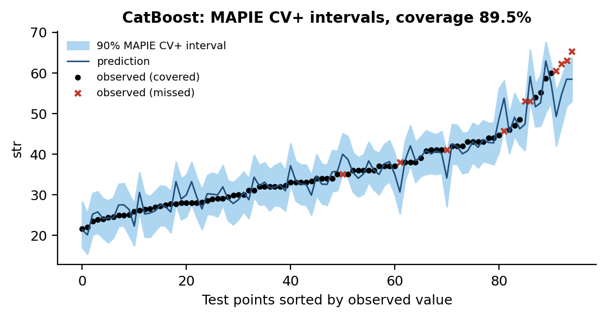
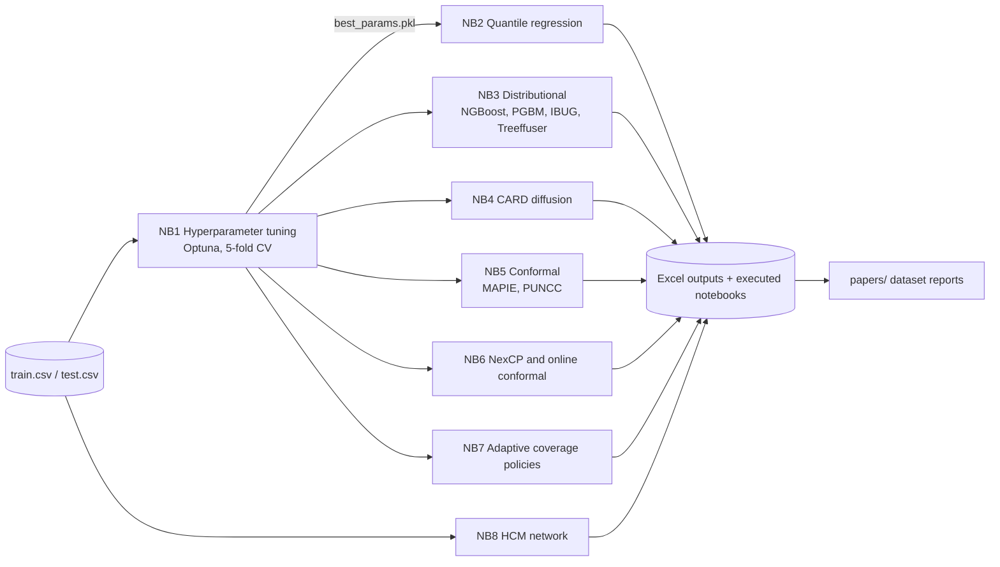

# Regression Uncertainty Quantification Analysis

**A reproducible benchmark of uncertainty quantification (UQ) methods for tabular regression:
10 tuned regressors × 30+ UQ methods × 9 engineering and environmental datasets, all run on Kaggle
with executed notebooks, raw Excel outputs and a research report per dataset.**

[](LICENSE)


A point prediction says nothing about how wrong it might be. This project attaches to every
prediction either a **prediction interval** or a **full predictive distribution**, and then measures
how good that uncertainty is: does a 90% interval really contain the truth 90% of the time
(*coverage*), how narrow is it (*width*), and how good is the whole distribution (*CRPS*,
calibration, PIT)? The same eight-notebook pipeline is applied, unchanged apart from paths and
column names, to nine datasets.

> **Branch:** `version2.0` (default). Earlier releases are kept unchanged on
> [`version1.2`](https://github.com/DaneshSelwal/Regression_Uncertainty_Quantification_Analysis/tree/version1.2),
> `version-1.1` and `version-1.0`.

---

## Contents

1. [Results at a glance](#results-at-a-glance)
2. [Worked example: the concrete dataset](#worked-example-the-concrete-dataset)
3. [Pipeline](#pipeline)
4. [Methods](#methods)
5. [Datasets, results and reports](#datasets-results-and-reports)
6. [Repository layout](#repository-layout)
7. [Reproducing the results](#reproducing-the-results)
8. [Using your own dataset](#using-your-own-dataset)
9. [What changed in version 2.0](#what-changed-in-version-20)
10. [Resources and references](#resources-and-references)
11. [Citation, license and authors](#citation-license-and-authors)

---

## Results at a glance

Every interval below targets **90% coverage** (α = 0.1). A method is called *valid* on a dataset
when its empirical test coverage is at least 0.9 − 1.645·√(0.09 / n_test), i.e. it is not
significantly below 90% given the size of the test set. The **recommended method** is the
narrowest method that is valid for at least 75% of the base models it wraps (median over models).
Relative width = interval width / standard deviation of the test target.

| Dataset | Train / test | Best model (CV) | Raw QR coverage | Recommended method | Its coverage | Relative width | Report |
|---|---|---|---:|---|---:|---:|---|
| [Concrete](examples/concrete_uncertainty_analysis/) | 189 / 95 | CatBoost | 79.0% | MFCS Full | 90.5% | 1.00 | [PDF](papers/concrete/paper.pdf) |
| [Noise](examples/noise_uncertainty_analysis/) | 168 / 60 | LightGBM | 90.0% | FACI | 85.0% | 0.81 | [PDF](papers/noise/paper.pdf) |
| [Pile](examples/pile_uncertainty_analysis/) | 81 / 24 | LightGBM | 58.3% | J+aB (MAPIE) | 95.8% | 1.60 | [PDF](papers/pile/paper.pdf) |
| [Scour](examples/scour_uncertainty_analysis/) | 154 / 78 | XGBoost | 84.6% | Split CP (MAPIE) | 93.6% | 1.48 | [PDF](papers/scour/paper.pdf) |
| [Sediment load](examples/sediment_load_uncertainty_analysis/) | 1095 / 365 | TabNet | 81.1% | NexCP J+aB | 89.3% | 0.24 | [PDF](papers/sediment_load/paper.pdf) |
| [Streamflow](examples/streamflow_uncertainty_analysis/) | 192 / 96 | GradientBoosting | 86.5% | J+aB (MAPIE) | 88.5% | 1.32 | [PDF](papers/streamflow/paper.pdf) |
| [Water quality (EWQI)](examples/water_quality_ewqi_uncertainty_analysis/) | 47 / 47 | XGBoost | 66.0% | FACI | 91.5% | 1.33 | [PDF](papers/water_quality_ewqi/paper.pdf) |
| [Pile settlement](examples/pile_settlement_uncertainty_analysis/) | 371 / 186 | – | – | – | – | – | in progress |
| [Water quality (WQI)](examples/water_quality_wqi_uncertainty_analysis/) | 190 / 82 | XGBoost | 79.3% | J+aB (MAPIE) | 89.0% | 1.18 | [PDF](papers/water_quality_wqi/paper.pdf) |

Pile settlement has results for notebooks 1–5, 7 and 8; its last notebook 6 job is still running
on Kaggle, and its report will be added once that job finishes.

**Findings that hold across datasets**

- **Raw quantile regression is not reliable.** Separately fitted 5% and 95% quantile models
  undercover on almost every dataset, with median coverage between 58% and 90%, and their quantiles
  cross on most test points. Conformalising them (CQR) restores coverage, but the intervals are wide.
- **Native NGBoost and PGBM distributions are usually over-confident.** Their Gaussian 90%
  intervals cover far less than 90% on most datasets (PGBM: 2–42% on seven of eight), while Treeffuser goes the other way (close to 100% coverage with very
  wide intervals). CARD's diffusion intervals are sharp but undercover on most datasets.
- **Conformal methods are valid almost everywhere.** Split CP, CV+, J+aB, CQR, NexCP and the
  online methods (ACI, FACI, SF-OGD, SAOCP, MFCS, COP) reach the target in 1,349 of 1,405
  dataset × model × method cases (96%) on the eight completed datasets. The misses are concentrated on WQI
  (151 features, 190 training rows), the smallest test sets and the weakest models. The methods differ mainly in
  width, and the online and weighted variants are usually the sharpest.
- **The sharpest valid method depends on the data.** It can be an online method (MFCS, FACI), a
  weighted method (NexCP J+aB on the large, heavy-tailed sediment data) or plain J+aB / split CP
  on the smallest sets, so the method should be chosen per dataset.

<p align="center">
  
  
</p>

---

## Worked example: the concrete dataset

The concrete dataset (189 training and 95 test samples, 7 features, target `str`) is
mid-sized and complete, so it shows every stage of the pipeline well. The full analysis, with
methods, maths and all tables, is in [`papers/concrete/paper.pdf`](papers/concrete/paper.pdf).
Raw outputs are in [`examples/concrete_uncertainty_analysis/`](examples/concrete_uncertainty_analysis/).

**1. Point accuracy.** Ten regressors were tuned with Optuna (5-fold CV on the training set
only). CatBoost has the lowest CV RMSE (3.66). On the test set, most boosted models reach an RMSE
of 2.8–3.4 against a target standard deviation of 10.0. TabNet is clearly weaker.

<p align="center"></p>

**2. Quantile regression and predictive distributions.** The raw 90% quantile-regression interval
covers only 79% of test points (median over 9 models; only 2 reach the target), and the separately
fitted quantiles cross on 98% of test points. Among predictive distributions, CARD and IBUG give the
lowest CRPS (≈ 1.6–1.8). However, the CARD intervals cover only 51%, and the native NGBoost (34%)
and PGBM (21%) Gaussian intervals are severely over-confident. Treeffuser is the opposite: it
covers everything with intervals 3.3 standard deviations wide.

**3. Conformal prediction fixes coverage.** Every conformal method reaches the target on every
model. The left panel below shows each method's coverage (median dot, min–max bar) and the right
panel its width:

<p align="center"></p>

| Method (median over 9 models) | Coverage | Width | Width / std(y) |
|---|---:|---:|---:|
| Quantile regression (raw) | 79.0% | 10.63 | 1.06 |
| Split CP (MAPIE) | 94.7% | 14.77 | 1.47 |
| CV+ (MAPIE) | 93.7% | 11.29 | 1.12 |
| J+aB (MAPIE) | 91.6% | 11.05 | 1.10 |
| CQR (PUNCC) | 95.8% | 31.36 | 3.13 |
| NexCP J+aB | 92.6% | 11.42 | 1.14 |
| ACI | 91.6% | 11.33 | 1.13 |
| FACI | 90.5% | 10.34 | 1.03 |
| COP | 90.5% | 10.56 | 1.05 |
| **MFCS Full (recommended)** | **90.5%** | **10.05** | **1.00** |

MFCS Full is as narrow as raw quantile regression and, unlike it, has the target coverage. Below
are the CatBoost CV+ intervals on the test set. The misses (red) are concentrated at the
high-strength end, where the data are sparse:

<p align="center"></p>

**4. Learned coverage (ACP) and HCM.** ACP learns its own per-point level (mean 63%) and its e-value
sets reach 84–98% coverage. HCM, a single network, covers 84% with its 95% interval, and its
predicted uncertainty is negatively correlated with the actual error (Spearman −0.38), so on this
dataset its uncertainty is not informative.

---

## Pipeline



| # | Notebook (`notebooks/`) | What it does | Main outputs |
|---|---|---|---|
| 1 | [`01_hyperparameter_tuning`](notebooks/01_hyperparameter_tuning/) | Optuna AutoSampler with several pruners, 5-fold CV on the training set, 10 models; SHAP / LIME / EBM interpretability | `best_params.pkl` / `.json`, `test_results.xlsx` |
| 2 | [`02_quantile_regression`](notebooks/02_quantile_regression/) | One model per quantile level (0.05–0.95) per regressor | quantiles, coverage, width, pinball loss, CRPS, crossing rate |
| 3 | [`03_probabilistic_distribution`](notebooks/03_probabilistic_distribution/) | NGBoost, PGBM, IBUG, Treeffuser | μ/σ, NLL, CRPS (+ Hersbach decomposition), PIT, calibration |
| 4 | [`04_probabilistic_distribution_card`](notebooks/04_probabilistic_distribution_card/) | CARD diffusion regression guided by each tuned regressor | predictive samples, CRPS, calibration |
| 5 | [`05_conformal_mapie_puncc`](notebooks/05_conformal_mapie_puncc/) | MAPIE split CP, CV+, J+aB; PUNCC split CP, CV+, CQR | intervals, coverage, width, conditional coverage |
| 6 | [`06_conformal_nexcp_online`](notebooks/06_conformal_nexcp_online/) | NexCP (split, full, CV+, J+aB); online split / CV+ / J+aB; ACI, FACI, SF-OGD, SAOCP, MFCS, COP, Extreme CP, AlphaNet | one sheet group per method |
| 7 | [`07_adaptive_coverage_policies`](notebooks/07_adaptive_coverage_policies/) | ACP: learned per-point coverage with e-value conformal sets | intervals, learned α̃, λ comparison, training curves |
| 8 | [`08_hyperspherical_confidence_mapping`](notebooks/08_hyperspherical_confidence_mapping/) | HCM network | Cov@1/2/3σ, 95% interval, ECE, error–uncertainty correlation |

Each folder in `notebooks/` holds the generalised v2.0 notebook (no outputs) and a theory note
(`.md`) for its methods.

---

## Methods

| Family | Methods | Guarantee | Library / source |
|---|---|---|---|
| Base regressors | Random forest, gradient boosting, HistGB, XGBoost, LightGBM, CatBoost, GPBoost, NGBoost, PGBM, TabNet | – | scikit-learn, official packages |
| Quantile regression | Pinball-loss models at 13 levels | asymptotic only | model packages |
| Distributional | NGBoost, PGBM (Gaussian), IBUG, Treeffuser, CARD | model-based | official code |
| Split / cross conformal | Split CP, CV+, jackknife+-after-bootstrap, CQR | finite-sample, marginal (exchangeable data) | MAPIE, PUNCC |
| Weighted conformal | NexCP split, full, CV+, J+aB | coverage gap bounded by distribution drift | Barber et al. (2023) |
| Online conformal | ACI, FACI, SF-OGD, SAOCP, MFCS, online split/CV+/J+aB, COP | long-run average coverage | authors' reference code |
| Tail | Extreme CP (one-sided, GPD tail) | high-level quantiles | `ExtremeConformal` |
| Learned coverage | Adaptive coverage policies (AlphaNet + e-values) | coverage at the learned level | Gauthier, Bach & Jordan (2026) |
| Single-network UQ | Hyperspherical confidence mapping | – | Choi et al. (2026) |

**Metrics:** empirical coverage, mean interval width (absolute and relative to std(y)),
CRPS, NLL, PIT and calibration error, quantile-crossing rate, and RMSE / MAE / r for the point
predictions.

---

## Datasets, results and reports

| Dataset | Train / test | Features | Target | Example folder (README, notebooks, results) | Report |
|---|---|---:|---|---|---|
| Concrete | 189 / 95 | 7 | `str` | [examples/concrete_uncertainty_analysis](examples/concrete_uncertainty_analysis/) | [PDF](papers/concrete/paper.pdf) |
| Noise | 168 / 60 | 5 | `Leq` | [examples/noise_uncertainty_analysis](examples/noise_uncertainty_analysis/) | [PDF](papers/noise/paper.pdf) |
| Pile (v2.0 pilot) | 81 / 24 | 7 | `Total` | [examples/pile_uncertainty_analysis](examples/pile_uncertainty_analysis/) | [PDF](papers/pile/paper.pdf) |
| Pile settlement | 371 / 186 | 8 | `S_exp` | [examples/pile_settlement_uncertainty_analysis](examples/pile_settlement_uncertainty_analysis/) | in progress |
| Scour | 154 / 78 | 7 | `Scour` | [examples/scour_uncertainty_analysis](examples/scour_uncertainty_analysis/) | [PDF](papers/scour/paper.pdf) |
| Sediment load | 1095 / 365 | 3 | `St` | [examples/sediment_load_uncertainty_analysis](examples/sediment_load_uncertainty_analysis/) | [PDF](papers/sediment_load/paper.pdf) |
| Streamflow | 192 / 96 | 4 | `TDS` | [examples/streamflow_uncertainty_analysis](examples/streamflow_uncertainty_analysis/) | [PDF](papers/streamflow/paper.pdf) |
| Water quality (EWQI) | 47 / 47 | 14 | `Pre monsoon EWQI` | [examples/water_quality_ewqi_uncertainty_analysis](examples/water_quality_ewqi_uncertainty_analysis/) | [PDF](papers/water_quality_ewqi/paper.pdf) |
| Water quality (WQI) | 190 / 82 | 151 | `WQI` | [examples/water_quality_wqi_uncertainty_analysis](examples/water_quality_wqi_uncertainty_analysis/) | [PDF](papers/water_quality_wqi/paper.pdf) |

Each example folder has a `README.md` with the dataset's key findings, figures, the full method
table and **links to the original Kaggle notebooks** that produced its results. Each phase folder
contains `results/` with the executed notebook (`EXECUTED_*.ipynb`, every cell output) and the
Excel files.

**Runs that were not completed (not enough compute).** On sediment load (the largest dataset),
NB6 was not run for TabNet and PGBM, and NexCP Full conformal was switched off, because these jobs
exceed Kaggle's 12-hour limit. This is stated in the dataset's README and report.

---

## Repository layout

```
.
├── README.md
├── LICENSE
├── notebooks/                    # the generalised v2.0 pipeline: 8 notebooks (no outputs) + theory notes
│   ├── 01_hyperparameter_tuning/ … 08_hyperspherical_confidence_mapping/
├── examples/
│   └── <dataset>_uncertainty_analysis/
│       ├── README.md             # findings, figures, method table, Kaggle run links
│       ├── data/                 # train.csv, test.csv (last column = target)
│       └── <phase>/              # the notebook for this dataset + results/ (EXECUTED_*.ipynb, *.xlsx, README.md)
├── papers/
│   └── <dataset>/                # paper.pdf, paper.tex, references.bib, figures/
├── docs/
│   ├── CHANGELOG_FIXES.md        # every v2.0 fix: before, why, after, approval
│   ├── DATASET_PARAMETERS.md     # settings that depend on the dataset
│   ├── KAGGLE_RUNS.md            # how jobs are built and run on Kaggle
│   ├── run_registry.tsv          # every Kaggle run: code name ↔ notebook ↔ job ↔ time
│   └── figures/                  # cross-dataset figures
├── references/
│   ├── REFERENCES.md             # all papers, repositories and libraries used
│   └── papers/                   # PDFs of three key papers
└── tools/kaggle/                 # papermill job builder and push queue
```

---

## Reproducing the results

All results were computed on **Kaggle CPU sessions with internet enabled**. Nothing was run
locally.

1. **Data.** Attach the Kaggle dataset `daneshselwal/reguq-uq-data` (train/test CSV files of all
   datasets) or upload `examples/<dataset>_uncertainty_analysis/data/`.
2. **Notebook 1 first.** Run `hyperparameter_tuning/Optuna_autosampler.ipynb`. The `FIX K1` cell
   detects Kaggle, copies the CSV files into the folder layout the notebooks expect
   (`./drive/MyDrive/Regression/<dataset>_uncertainty_analysis/…`) and installs only missing
   packages at pinned versions.
3. **Notebooks 2–8.** Add the tuning run's output as an input. The `FIX K2` cell finds
   `best_params.pkl` automatically.
4. **Batch execution.** `tools/kaggle/make_kernel.py` wraps a notebook into a papermill job so that
   the executed notebook comes back with all its outputs; `tools/kaggle/queue_push.sh` names each
   run `REG<DD>_<MM>_<YYYY>_<HH>_<MM>`, waits for a free CPU slot and logs it in
   `docs/run_registry.tsv`. See [`tools/kaggle/README.md`](tools/kaggle/README.md) and
   [`docs/KAGGLE_RUNS.md`](docs/KAGGLE_RUNS.md).
5. **Long jobs.** Notebook 6 is split into one Kaggle job per base model so that each job fits
   within the 12-hour limit (FIX B15).

The notebooks still run on **Google Colab**: place the dataset folder at
`MyDrive/Regression/<dataset>_uncertainty_analysis/` and run the notebooks in order (the first
cell mounts Drive).

**Known sources of run-to-run variation.** Optuna search is not bit-reproducible between runs.
The stored tuning run is the one every other notebook used. CARD, TabNet, HCM and ACP are neural
and depend on their seeds.

---

## Using your own dataset

1. Create `train.csv` and `test.csv` with the target as the last column.
2. Copy a folder from `notebooks/` (or an `examples/` folder) and set the four values described in
   the first cell of each notebook: dataset folder name, Kaggle input file names, `feature_names`
   and the target label used in plots.
3. Run notebook 1, then 2–8. [`docs/DATASET_PARAMETERS.md`](docs/DATASET_PARAMETERS.md) lists the
   settings whose effect depends on the dataset size (calibration-set sizes, CV folds).

---

## What changed in version 2.0

Version 2.0 is a **correctness release**. Every notebook was checked method by method against the
original paper and, where one exists, the authors' official code. Each confirmed problem was fixed
with the smallest possible change, approved individually, and marked in the code with
`# FIX <id>`. The full before / why / after record for each fix is in
[`docs/CHANGELOG_FIXES.md`](docs/CHANGELOG_FIXES.md).

| Area | Change |
|---|---|
| Hyperparameter tuning | Model selection by 5-fold CV on the training set only (the test set was previously used); pruners receive per-fold reports; tuned settings are saved and **loaded** by every downstream notebook. |
| Quantile regression | Crossing measured and removed by monotone rearrangement; CRPS from quantiles with correct level weights; TabNet early stopping on a validation split. |
| Probabilistic distribution | Hersbach (2000) CRPS decomposition; IBUG scale no longer square-rooted twice; Treeffuser score model uses squared error. |
| CARD | Re-implemented to follow the official CARD code (noise schedule, guided model, full reverse diffusion, EMA). |
| MAPIE / PUNCC | Correct interval shapes; true split conformal and J+aB; CQR with real quantile models; one miscoverage level (`ALPHA = 0.1`). |
| NexCP / online CP | Out-of-fold calibration residuals; NexCP weighted quantile per the paper; real weighted full conformal, CV+ and J+aB; SF-OGD, SAOCP and FACI ported from the reference code; ACI added; COP and Extreme CP per their official code. |
| ACP | λ no longer chosen by comparing losses across λ; coverage reported against the learned level 1 − α̃. |
| HCM | Verified against paper and code; silent fallback to synthetic data removed. |
| Infrastructure | Runs unchanged on Kaggle or Colab; executed notebooks stored with results; per-model NB6 jobs; run registry. |

Outputs saved in the v1.2 example notebooks were not produced on their own datasets, so v1.2
numbers should not be compared with v2.0 results.

---

## Resources and references

- **Complete reference list** (base models, tuning, interpretability, quantile regression,
  probabilistic models, every conformal method, HCM, software):
  [`references/REFERENCES.md`](references/REFERENCES.md). BibTeX:
  [`papers/concrete/references.bib`](papers/concrete/references.bib).
- **Key papers (PDF):**
  - Angelopoulos & Bates (2023), *A gentle introduction to conformal prediction*: [PDF](references/papers/Gentle_Intro_to_Conformal_Prediction.pdf)
  - Barber, Candès, Ramdas & Tibshirani (2023), *Conformal prediction beyond exchangeability*: [PDF](references/papers/NEXCP_beyond_exchangeability.pdf)
  - Gibbs & Candès (2021), *Adaptive conformal inference under distribution shift*: [PDF](references/papers/Adaptive_Conformal_Inference.pdf)
- **Original Kaggle notebooks:** every run used for the results is listed with its link in the
  dataset's README (`examples/<dataset>_uncertainty_analysis/README.md`, section *Folder
  contents*), in each `results/README.md`, and in the report's reproducibility table. The complete
  log of runs is [`docs/run_registry.tsv`](docs/run_registry.tsv).
- **Libraries:** scikit-learn, XGBoost, LightGBM, CatBoost, GPBoost, NGBoost, PGBM,
  pytorch-tabnet, Optuna, MAPIE, PUNCC, IBUG, Treeffuser, PyTorch, SHAP, LIME, InterpretML.

---

## Citation, license and authors

If you use this pipeline or its results, please cite this repository and the original papers of
the methods you use:

```bibtex
@misc{bisht_selwal_regression_uq,
  author       = {Bisht, Prakriti and Selwal, Danesh},
  title        = {Regression Uncertainty Quantification Analysis},
  year         = {2026},
  howpublished = {\url{https://github.com/DaneshSelwal/Regression_Uncertainty_Quantification_Analysis}},
  note         = {Version 2.0}
}
```

Released under the [MIT License](LICENSE).

Developed under the guidance of Dr. Mahesh Pal by Prakriti Bisht and Danesh Selwal.
