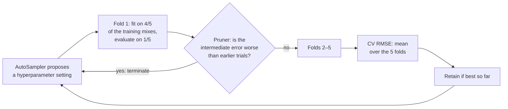
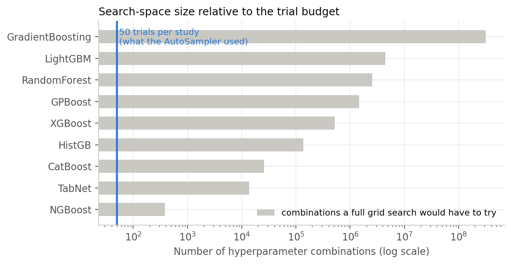
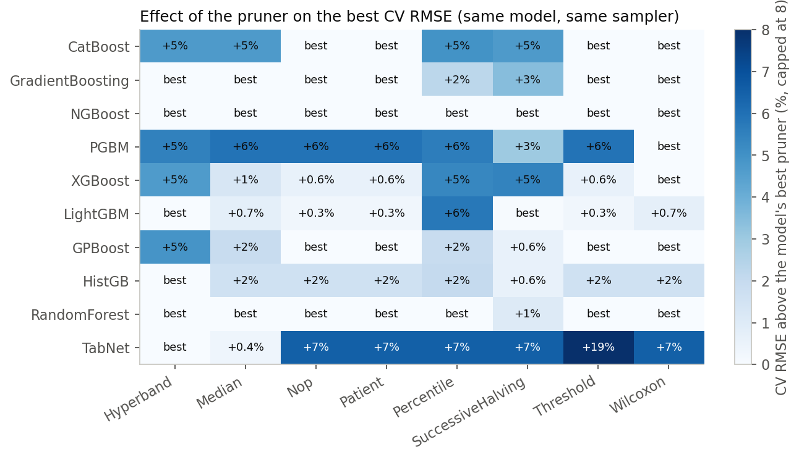
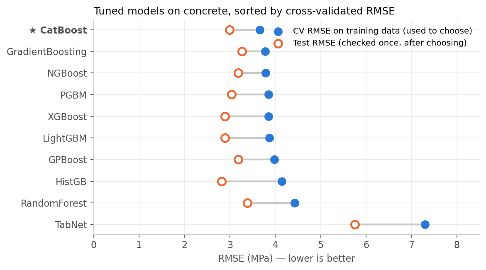
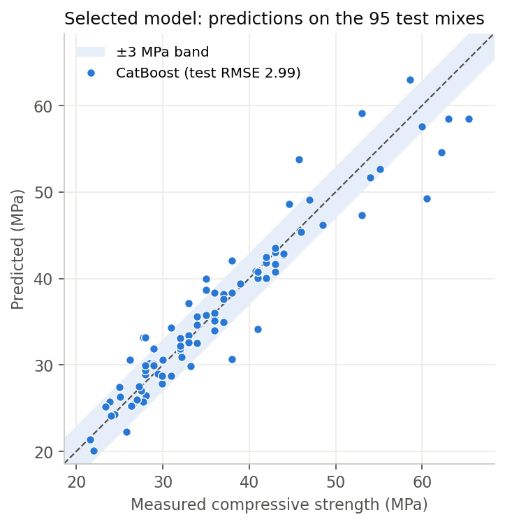
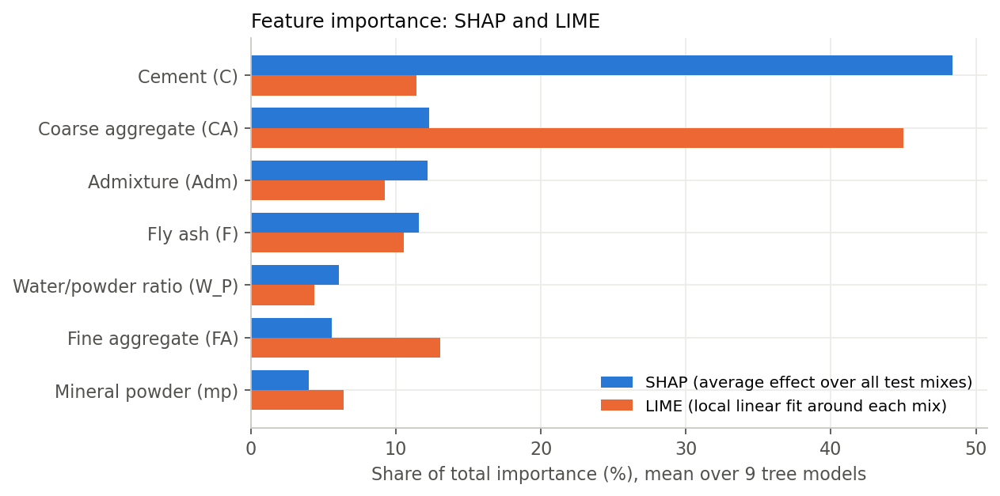

[← Concrete case study](README.md) · next: [Step 2 →](02_quantile_regression.md)

# Step 1 · Hyperparameter tuning and selection of the base models

> **Summary.** Ten regression models were tuned on the 189 training mixes using Optuna's AutoSampler with 5-fold
> cross-validation. **CatBoost** attains the lowest cross-validated error (RMSE 3.66 MPa). Eight of the ten models lie within
> 0.5 MPa of it; all tuned models are therefore carried forward to the uncertainty-quantification steps.

| | |
|---|---|
| **Data** | 189 training mixes, 95 test mixes, 7 inputs: cement `C`, mineral powder `mp`, fine aggregate `FA`, coarse aggregate `CA`, fly ash `F`, water/powder ratio `W_P`, admixture `Adm`; target: compressive strength `str` (test mean 36.2 MPa, standard deviation 10.0 MPa) |
| **Models** | RandomForest, GradientBoosting, XGBoost, LightGBM, GPBoost, CatBoost, NGBoost, TabNet, HistGB, PGBM |
| **Search** | Optuna **AutoSampler** (seed 42), 50 trials per study, 8 pruners per model: 10 × 8 × 50 = 4,000 trials |
| **Objective** | RMSE of 5-fold cross-validation **on the training set only**; the test set is used once, after selection |
| **Notebook** | [`EXECUTED_Optuna_autosampler.ipynb`](../../examples/concrete_uncertainty_analysis/hyperparameter_tuning/results/EXECUTED_Optuna_autosampler.ipynb) · outputs: `best_params.json`, `test_results.xlsx` |

---

## 1.1 Evaluation of a trial



A **trial** is one candidate hyperparameter setting (number of trees, depth, learning rate, regularisation, etc.). It is
evaluated by 5-fold cross-validation: the 189 training mixes are partitioned into five folds, and the model is fitted on four
folds and evaluated on the remaining one, five times in rotation:

```math
\text{CV RMSE}=\frac1{5}\sum_{k=1}^{5}\sqrt{\frac1{|F_k|}\sum_{i\in F_k}\bigl(y_i-\hat f_{-k}(x_i)\bigr)^2}
```

where $`F_k`$ is the $`k`$-th fold and $`\hat f_{-k}`$ the model fitted without it. The test mixes are not used during the
search, so the test RMSE reported afterwards is an unbiased estimate of performance. (In version 1.2 the settings were
selected by their test error, which biases the reported test error downwards; this was corrected by fix F1.)

## 1.2 The AutoSampler and the choice of search strategy

The **sampler** determines which setting is evaluated next. The standard alternatives are compared below.

| Strategy | Selection of the next setting | Limitation for this study |
|---|---|---|
| **Manual tuning** | Expert judgement | Not reproducible; ten models each require separate expertise |
| **Grid search** | Every combination of the candidate values | The search spaces contain between 384 and 3.2 × 10⁸ combinations (Figure 1.1); a budget of 50 trials covers a negligible fraction |
| **Random search** | Independent random combinations | Does not use the results of earlier trials |
| **Bayesian optimisation (TPE, Gaussian process)** | Builds a model of the objective from all earlier trials | Effective, but the appropriate algorithm depends on the type of search space |
| **AutoSampler** (used) | Selects the Bayesian algorithm recommended by the Optuna developers for the given search space | – |

<p align="center"></p>

*__Figure 1.1.__ Number of combinations required by an exhaustive grid search for each model (grey, logarithmic scale), compared
with the 50 trials performed per study (blue line).*

**Algorithm selected.** The AutoSampler inspects the search space before each trial. The first trial is drawn at random. Every
hyperparameter in this notebook is specified as a list of candidate values, i.e. a *categorical* parameter, and for such spaces
the AutoSampler selects the **Tree-structured Parzen Estimator (TPE)** in its multivariate form. All studies were therefore
driven by TPE after the first trial.

**The TPE criterion.** TPE divides the completed trials into a small set with the lowest errors and the remainder, and estimates
the density of the hyperparameter values in each group, $`\ell(x)`$ and $`g(x)`$ respectively. The next setting maximises their ratio:

```math
x_{\text{next}}=\arg\max_x\ \frac{\ell(x)}{g(x)}
```

Settings that are frequent among the best trials and rare among the others are preferred, while values that have rarely been
evaluated retain uncertain densities in both groups and continue to be explored. With 50 trials and search spaces of up to
$`10^8`$ combinations, this adaptive allocation is what makes the search effective.

## 1.3 Effect of the pruner

A **pruner** terminates a trial after its first folds if its intermediate error is worse than that of earlier trials, so that
the budget is spent on more promising settings. Each model was tuned once with each of eight pruners: none (`Nop`), Median,
Patient, Percentile, Threshold, SuccessiveHalving, Hyperband and Wilcoxon. The best of the eight results is retained.

<p align="center"></p>

*__Figure 1.2.__ Increase in the best CV RMSE of each pruner relative to the best pruner for the same model. "best" marks the
lowest value in each row.*

**Reading the figure.** A uniformly light row indicates that the pruner had no influence on that model; darker cells indicate
pruners that terminated good settings and ended with a worse result.

**Findings.**
- For the tree-based models the pruner changes the final CV RMSE by **at most 6%**; for NGBoost it has no effect.
- No pruner is best for every model. Wilcoxon (7 of 10 models) and Hyperband (6 of 10) are most often best or tied.
- **TabNet** is the exception, with an increase of up to 19% under the Threshold pruner. Neural networks improve slowly over
  their early epochs, so aggressive pruning terminates settings that would have performed well.

> **Conclusion 1.3.** Evaluating several pruners is inexpensive and changes the result by a few percent for most models and
> by up to 19% for TabNet.

## 1.4 Comparison of the tuned models

<p align="center"></p>

*__Figure 1.3.__ Best cross-validated RMSE of each model (blue, used for selection) and RMSE on the 95 test mixes (orange,
evaluated once after selection). Models are sorted by CV RMSE; ★ marks the selected model.*

| Rank | Model | Best pruner | CV RMSE (MPa) | Test RMSE (MPa) | Test correlation r |
|:-:|---|---|--:|--:|--:|
| 1 | **CatBoost** | Nop | **3.66** | 2.99 | 0.954 |
| 2 | GradientBoosting | Median | 3.78 | 3.26 | 0.945 |
| 3 | NGBoost | Median | 3.79 | 3.19 | 0.948 |
| 4 | PGBM | Wilcoxon | 3.85 | 3.04 | 0.953 |
| 5 | XGBoost | Wilcoxon | 3.85 | 2.89 | 0.958 |
| 6 | LightGBM | Hyperband | 3.87 | 2.89 | 0.958 |
| 7 | GPBoost | Nop | 3.97 | 3.18 | 0.948 |
| 8 | HistGB | Hyperband | 4.14 | 2.81 | 0.960 |
| 9 | RandomForest | Median | 4.43 | 3.39 | 0.943 |
| 10 | TabNet | Hyperband | 7.29 | 5.75 | 0.826 |

**Findings.**
- **CatBoost attains the lowest CV RMSE** (3.66 MPa). The eight gradient-boosting models lie between 3.66 and 4.14 MPa, a
  range of 0.5 MPa against a target standard deviation of 10 MPa; their accuracy is practically equivalent.
- **The ranking changes on the test set.** HistGB, eighth by CV, has the lowest test RMSE (2.81 MPa). With 95 test mixes,
  differences of a few tenths of an MPa are within sampling variation, which is why selection is based on cross-validation
  and not on the test set.
- **Every model's test RMSE is lower than its CV RMSE.** The final model is fitted on all 189 mixes rather than four fifths of
  them, i.e. on 25% more data than each cross-validation model.
- **RandomForest** is somewhat less accurate, as bagging reduces variance but not bias.
- **TabNet** is clearly less accurate (CV RMSE 7.3 MPa): an attention-based neural network requires substantially more than
  189 observations.

<p align="center"></p>

*__Figure 1.4.__ CatBoost predictions for the 95 test mixes. The dashed line denotes perfect prediction; the shaded band is ±3 MPa.*

Most mixes are predicted within ±3 MPa. The largest errors occur mainly **above 45 MPa**, where the training data are sparse.
These are the mixes for which a point prediction is least reliable, which motivates the prediction intervals of the following
steps.

## 1.5 Feature attribution

<p align="center"></p>

*__Figure 1.5.__ Share of total importance of each input, averaged over the nine tree-based models (TabNet is excluded because
its SHAP and LIME values are on a different scale).*

- **SHAP** decomposes each prediction into additive contributions of the inputs relative to the mean prediction and averages
  their magnitude over the test mixes. It ranks **cement (`C`)** first by a wide margin (48%).
- **LIME** fits a local linear surrogate around each test mix from randomly perturbed copies of it. It ranks **coarse
  aggregate (`CA`)** first (45%).
- Both methods attribute moderate importance to fly ash and admixture, and little to the water/powder ratio and mineral powder.

> **Conclusion 1.5.** The two attribution methods disagree on the most important input. They measure different quantities
> (global additive contribution versus local linear sensitivity), and LIME depends on its perturbation scheme. Conclusions
> about feature importance should therefore not rest on a single attribution method.

---

## Summary of step 1

| Question | Result on the concrete dataset |
|---|---|
| Best model by cross-validation | **CatBoost**, CV RMSE 3.66 MPa (test RMSE 2.99 MPa, r = 0.954) |
| Spread among the other models | 8 boosting models within 0.5 MPa; RandomForest 4.43 MPa; TabNet 7.29 MPa |
| Search strategy | 50 TPE trials per study instead of grids of up to 3 × 10⁸ combinations |
| Influence of the pruner | ≤ 6% for tree-based models; up to 19% for TabNet |
| Location of the largest errors | High-strength mixes (> 45 MPa), where training data are sparse |
| Output passed to later steps | `best_params.json`: tuned settings of all models, **loaded** by notebooks 2–8 |

**Next →** [Step 2: quantile regression](02_quantile_regression.md)
