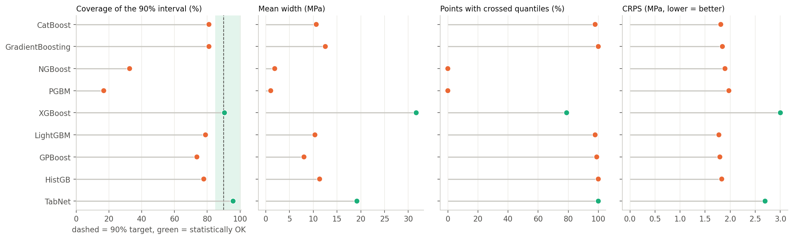

[← Concrete case study](README.md) · previous: [Step 1](01_tuning.md) · next: [Step 3 →](03_predictive_distributions.md)

# Step 2 · Quantile regression

> **Summary.** Raw quantile regression does not provide a reliable 90% interval on the concrete dataset. Seven of the nine
> models cover only 17–81% of the test mixes; the two that reach the target (XGBoost and TabNet) do so with intervals two to
> three times wider than those of the other models.

| | |
|---|---|
| **Principle** | Each model is trained to estimate the conditional 5% and 95% quantiles of strength; the interval between them should contain 90% of the mixes |
| **Applied to** | The 9 tuned models from step 1, at 13 quantile levels (0.05 … 0.95) |
| **Validity criterion** | Coverage ≥ **84.9%**. With 95 test mixes, a correctly calibrated 90% method falls below this value with probability 5% ([validity rule](../../README.md#52-validity-of-a-coverage-value)) |
| **Notebook** | [`EXECUTED_Quantile_Regression.ipynb`](../../examples/concrete_uncertainty_analysis/quantile_regression/results/EXECUTED_Quantile_Regression.ipynb) · method guide: [NB2](../../notebooks/02_quantile_regression/README.md) |

## 2.1 Method

Minimising the squared error yields an estimate of the conditional **mean**. A conditional quantile of level $`\tau`$ is
obtained instead by minimising the **pinball loss**:

```math
\rho_\tau(y-q)=\begin{cases}\tau\,(y-q) & y\ge q\\ (1-\tau)\,(q-y) & y<q\end{cases}
```

For $`\tau=0.95`$, under-prediction is penalised 19 times more heavily than over-prediction, so the minimiser is the value
exceeded by 5% of the mixes. Fitting $`\tau=0.05`$ and $`\tau=0.95`$ gives the interval $`[\hat q_{0.05}(x),\hat q_{0.95}(x)]`$.

- **Tree-based models and TabNet** fit **one separate model per quantile level** (13 models per regressor).
- **NGBoost and PGBM** predict a distribution; their quantiles are taken from it ($`\hat\mu+z_\tau\hat\sigma`$ for NGBoost,
  sample quantiles for PGBM).

Two further metrics are reported:
- **Crossing rate**: the share of test mixes for which the separately fitted quantiles are not monotone in $`\tau`$ (for
  example, $`\hat q_{0.10}>\hat q_{0.15}`$). The quantiles are sorted before use, but a high rate indicates inconsistent models.
- **CRPS** (continuous ranked probability score): twice the pinball loss averaged over the quantile levels, in MPa. It
  evaluates the full set of quantiles rather than the interval end points; lower values are better.

## 2.2 Results by model

<p align="center"></p>

*__Figure 2.1.__ Coverage of the 90% interval (green band: valid; dashed line: 90%), mean width, share of test mixes with
crossed quantiles, and CRPS, for each model. Green markers denote valid intervals, orange markers invalid ones.*

| Model | Coverage | Width (MPa) | Crossed quantiles | CRPS (MPa) | Assessment |
|---|--:|--:|--:|--:|---|
| CatBoost | 81.1% | 10.6 | 98% | 1.81 | undercovers |
| GradientBoosting | 81.1% | 12.5 | 100% | 1.84 | undercovers |
| NGBoost | 32.6% | 1.9 | 0% | 1.90 | severely undercovers |
| PGBM | 16.8% | 1.0 | 0% | 1.97 | severely undercovers |
| XGBoost | **90.5%** | 31.7 | 79% | 3.00 | valid; about three times wider than the others |
| LightGBM | 79.0% | 10.4 | 98% | **1.77** | undercovers (lowest CRPS) |
| GPBoost | 73.7% | 8.0 | 99% | 1.79 | undercovers |
| HistGB | 77.9% | 11.3 | 100% | 1.83 | undercovers |
| TabNet | **95.8%** | 19.2 | 100% | 2.70 | valid; wide |

**Reading the figure.** A satisfactory model combines coverage within the green band with a small width. No model satisfies
both conditions.

**Findings.**
- **The separately fitted tree-based models undercover** (74–81%). The 5% and 95% quantiles are each estimated from the few
  training mixes in the tails (about 9 of 189), and are drawn towards the centre of the distribution.
- **NGBoost and PGBM undercover severely** (17–33%). Their quantiles derive from a Gaussian whose estimated σ is too small,
  i.e. the models are over-confident. Because all quantiles come from a single distribution, they never cross.
- **XGBoost and TabNet reach the target** only with wide intervals (32 and 19 MPa, compared with 8–13 MPa for the other models).
- **Quantile crossing is pervasive**: for seven of the nine models almost every test mix has at least one pair of quantiles out
  of order.
- **CRPS hardly distinguishes the tree-based models** (1.77–1.84 MPa): the centre of the predictive distribution is well
  estimated, but the tails are not.

> **Conclusion step 2.** Raw quantile regression is not a reliable 90% interval on this dataset. The model with the lowest
> CRPS (LightGBM) covers only 79% of the test mixes. A calibration step (CQR, step 5) or a conformal method is required.

**Next →** [Step 3: predictive distributions](03_predictive_distributions.md)
