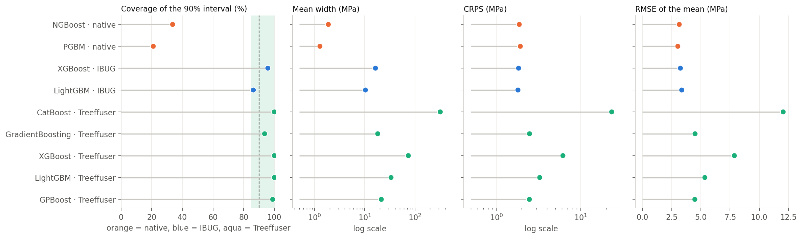
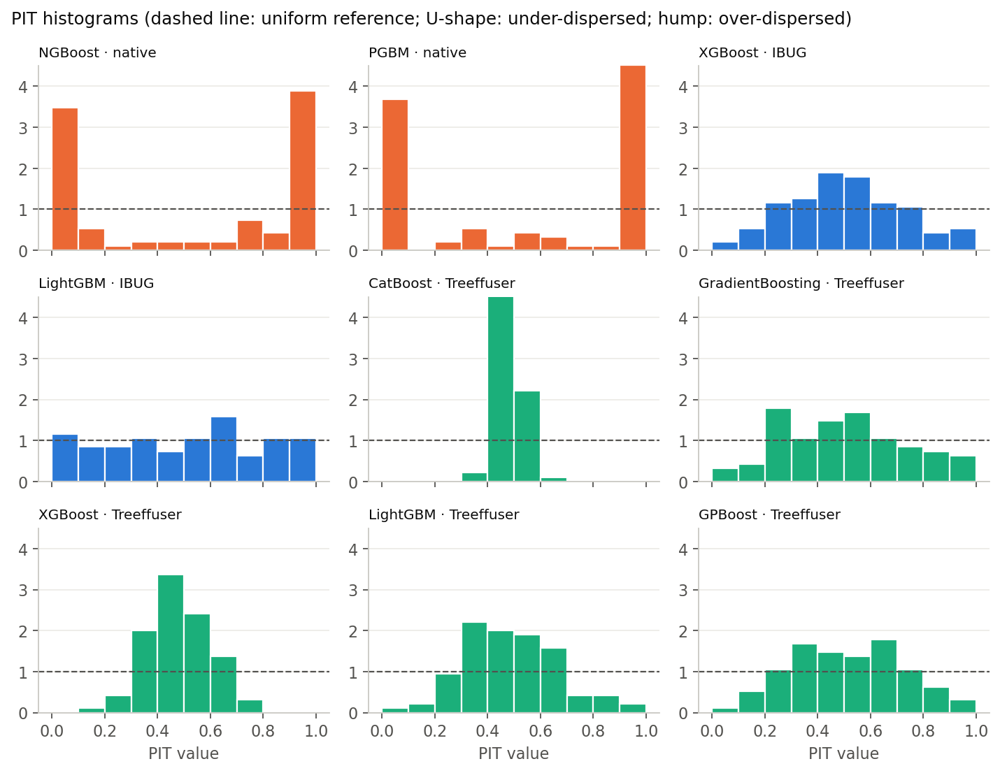

[← Concrete case study](README.md) · previous: [Step 2](02_quantile_regression.md) · next: [Step 4 →](04_card.md)

# Step 3 · Predictive distributions: NGBoost, PGBM, IBUG and Treeffuser

> **Summary.** A predictive distribution yields a reliable interval only if its dispersion is correctly estimated. On the
> concrete dataset the native NGBoost and PGBM Gaussians are strongly over-confident (21–34% coverage), Treeffuser is
> strongly over-dispersed, and **IBUG with LightGBM** is the best-calibrated method (86% coverage, 10.3 MPa width, nearly
> uniform PIT histogram).

| | |
|---|---|
| **Principle** | Estimate a mean $`\hat\mu(x)`$ and a standard deviation $`\hat\sigma(x)`$ for every mix; the 90% interval is $`\hat\mu\pm1.645\,\hat\sigma`$ |
| **Applied to** | 9 model–method pairs: NGBoost and PGBM (native), IBUG on XGBoost and LightGBM, Treeffuser on CatBoost, GradientBoosting, XGBoost, LightGBM and GPBoost |
| **Metrics** | Coverage and width of the 90% interval, CRPS, RMSE of the mean, PIT histogram |
| **Notebook** | [`EXECUTED_Probabilistic__Distribution.ipynb`](../../examples/concrete_uncertainty_analysis/probabilistic_distribution/results/EXECUTED_Probabilistic__Distribution.ipynb) · method guide: [NB3](../../notebooks/03_probabilistic_distribution/README.md) |

## 3.1 Methods

| Method | Estimation of σ̂(x) |
|---|---|
| **NGBoost** | Gradient boosting of both parameters of a Gaussian, $`(\mu,\log\sigma)`$, along the natural gradient of the negative log-likelihood |
| **PGBM** | Leaf values are treated as random variables; their means and variances are accumulated over the trees |
| **IBUG** | The variance of the targets of the $`k`$ training points that share the most leaves with the test point |
| **Treeffuser** | A conditional diffusion model whose score function is learned by gradient-boosted trees; the distribution is represented by samples |

## 3.2 Evaluation of a predictive distribution

**CRPS.** For a Gaussian forecast the continuous ranked probability score has the closed form

```math
\mathrm{CRPS}\bigl(\mathcal N(\hat\mu,\hat\sigma^2),y\bigr)=\hat\sigma\Bigl[z\bigl(2\Phi(z)-1\bigr)+2\varphi(z)-\tfrac{1}{\sqrt\pi}\Bigr],\qquad z=\frac{y-\hat\mu}{\hat\sigma}.
```

It is a proper scoring rule: it is small when the distribution is both centred on the observation and concentrated.

**PIT.** The probability integral transform $`\mathrm{PIT}=\Phi\bigl((y-\hat\mu)/\hat\sigma\bigr)`$ is uniformly distributed on
$`[0,1]`$ when the predictive distributions are correct. The shape of its histogram diagnoses the type of miscalibration:

| Histogram shape | Interpretation |
|---|---|
| Uniform | Calibrated |
| **U-shaped** (mass at 0 and 1) | Observations fall outside the predicted spread: σ̂ too small, **under-dispersed (over-confident)** |
| **Hump-shaped** | Observations concentrate near the centre: σ̂ too large, **over-dispersed (under-confident)** |

## 3.3 Results by model and method

<p align="center"></p>

*__Figure 3.1.__ Coverage of the Gaussian 90% interval, mean width, CRPS and RMSE of the predicted mean for each model–method
pair (width and CRPS on logarithmic scales). Orange: native; blue: IBUG; green: Treeffuser.*

<p align="center"></p>

*__Figure 3.2.__ PIT histograms over the 95 test mixes. The dashed line is the uniform density of a calibrated forecast.*

| Model · method | Coverage | Width (MPa) | CRPS (MPa) | RMSE (MPa) | PIT shape | Assessment |
|---|--:|--:|--:|--:|---|---|
| NGBoost · native | 33.7% | 1.9 | 1.87 | 3.15 | U | over-confident |
| PGBM · native | 21.1% | 1.3 | 1.92 | 3.03 | U | over-confident |
| XGBoost · IBUG | 95.8% | 16.4 | 1.84 | 3.25 | hump | valid; moderately over-dispersed |
| **LightGBM · IBUG** | **86.3%** | **10.3** | **1.80** | 3.37 | **near-uniform** | **best calibrated** |
| CatBoost · Treeffuser | 100% | 320 | 23.3 | 12.04 | spike | estimation failed |
| GradientBoosting · Treeffuser | 93.7% | 18.1 | 2.48 | 4.50 | hump | valid; over-dispersed |
| XGBoost · Treeffuser | 100% | 73.9 | 6.15 | 7.87 | hump | strongly over-dispersed |
| LightGBM · Treeffuser | 100% | 33.4 | 3.27 | 5.34 | hump | strongly over-dispersed |
| GPBoost · Treeffuser | 98.9% | 21.4 | 2.46 | 4.49 | hump | over-dispersed |

**Findings.**
- **NGBoost and PGBM** estimate the mean accurately (RMSE about 3 MPa) but report σ̂ below 1 MPa, whereas the actual errors are
  about 3 MPa. Their PIT histograms are U-shaped: most observations fall in the outer 10% of their own predictive distribution.
- **IBUG** derives the dispersion from similar training mixes, which yields a realistic σ̂. With LightGBM the PIT histogram is
  close to uniform and the interval is valid with a width of 10.3 MPa; with XGBoost it is moderately too wide.
- **Treeffuser** produces strongly over-dispersed distributions with less accurate means (RMSE 4.5–12 MPa). With CatBoost the
  estimation failed (mean error 12 MPa, interval width 320 MPa). With 189 training mixes, the diffusion model has insufficient
  data.
- **CRPS and coverage lead to different conclusions.** NGBoost and PGBM have CRPS values close to IBUG (1.87–1.92 versus
  1.80 MPa), yet cover only 21–34%. A concentrated distribution centred near the observation obtains a good CRPS even when its
  tails are misspecified.

> **Conclusion step 3.** The reliability of a predictive distribution depends on its dispersion. Only IBUG with LightGBM is
> well calibrated on this dataset. The native NGBoost and PGBM Gaussians must not be used as 90% intervals without
> calibration, and Treeffuser requires more data than the concrete dataset provides.

**Next →** [Step 4: CARD](04_card.md)
