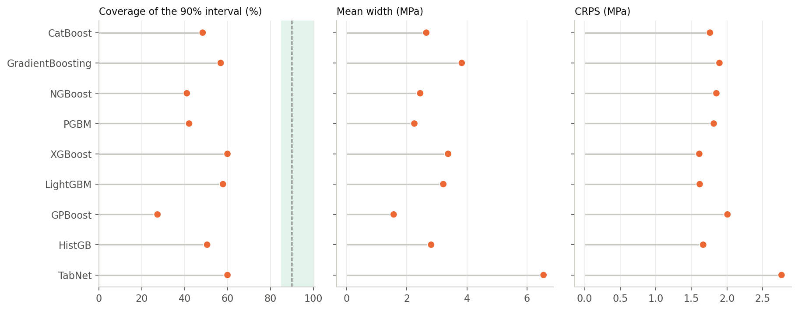
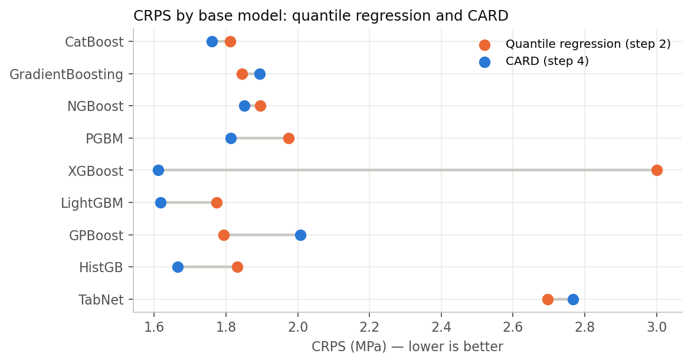
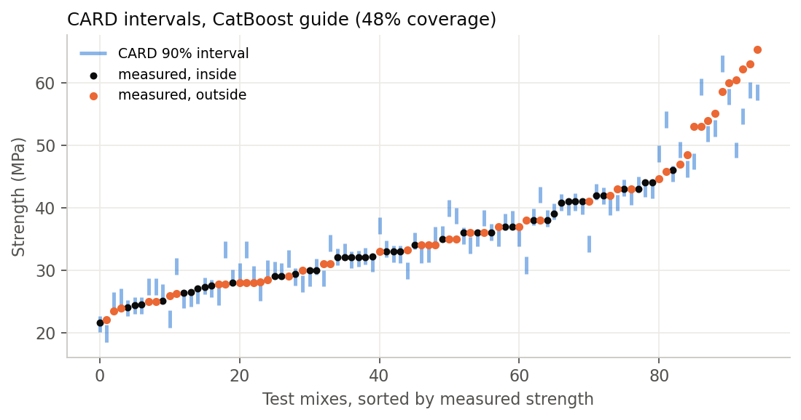

[← Concrete case study](README.md) · previous: [Step 3](03_predictive_distributions.md) · next: [Step 5 →](05_conformal_split_cv_jab.md)

# Step 4 · CARD: diffusion-based distributions guided by each regressor

> **Summary.** CARD yields the most concentrated distributions and the **lowest CRPS** in the study (1.61 MPa with XGBoost as
> guide). Its 90% intervals, however, are only 2–7 MPa wide and cover **27–60%** of the test mixes; none is valid.

| | |
|---|---|
| **Principle** | A diffusion model learns the conditional distribution of strength around the prediction $`\hat f(x)`$ of a tuned regressor |
| **Applied to** | The 9 tuned models from step 1, each used as the guide model |
| **Output** | 1,000 samples per test mix, from which the mean, standard deviation, 90% interval, CRPS and PIT are computed |
| **Notebook** | [`EXECUTED_Probabilistic__Distribution(CARD).ipynb`](<../../examples/concrete_uncertainty_analysis/probabilistic_distribution_card/results/EXECUTED_Probabilistic__Distribution(CARD).ipynb>) · method guide: [NB4](../../notebooks/04_probabilistic_distribution_card/README.md) |

## 4.1 Method

**Forward process.** Gaussian noise is added to the observed strength $`y_0`$ over $`T=1000`$ steps, while the mean is shifted
towards the guide prediction:

```math
y_t=\sqrt{\bar\alpha_t}\,y_0+\bigl(1-\sqrt{\bar\alpha_t}\bigr)\hat f(x)+\sqrt{1-\bar\alpha_t}\,\varepsilon,\qquad \varepsilon\sim\mathcal N(0,1),\quad \bar\alpha_t=\prod_{s\le t}(1-\beta_s),
```

with $`\beta_t`$ increasing linearly from $`10^{-4}`$ to $`0.02`$. At $`t=T`$, $`y_T`$ is Gaussian noise centred on $`\hat f(x)`$.
A network $`\varepsilon_\theta(x,y_t,\hat f(x),t)`$ is trained to predict the added noise.

**Reverse process.** Starting from noise centred on $`\hat f(x)`$, the learned network removes the noise step by step; the end
point is one sample from the predictive distribution. Repeating this 1,000 times yields the distribution for each test mix.

The guide model therefore determines the location of the distribution, and the diffusion model determines its shape and
dispersion.

## 4.2 Results by guide model

<p align="center"></p>

*__Figure 4.1.__ CARD with each guide model: coverage of the 90% interval (green band: valid), mean width and CRPS.*

| Guide model | Coverage | Width (MPa) | CRPS (MPa) | CRPS of quantile regression (step 2) |
|---|--:|--:|--:|--:|
| CatBoost | 48.4% | 2.6 | 1.76 | 1.81 |
| GradientBoosting | 56.8% | 3.8 | 1.89 | 1.84 |
| NGBoost | 41.1% | 2.4 | 1.85 | 1.90 |
| PGBM | 42.1% | 2.2 | 1.81 | 1.97 |
| **XGBoost** | 60.0% | 3.4 | **1.61** | 3.00 |
| LightGBM | 57.9% | 3.2 | 1.62 | 1.77 |
| GPBoost | 27.4% | 1.6 | 2.01 | 1.79 |
| HistGB | 50.5% | 2.8 | 1.67 | 1.83 |
| TabNet | 60.0% | 6.6 | 2.77 | 2.70 |

<p align="center"></p>

*__Figure 4.2.__ CRPS for the same base model from quantile regression (step 2, orange) and CARD (blue).*

<p align="center"></p>

*__Figure 4.3.__ CARD 90% intervals with CatBoost as guide; test mixes sorted by measured strength. Orange markers lie outside
the interval.*

**Findings.**
- **CARD attains a lower CRPS than quantile regression for six of the nine models** (Figure 4.2), and the lowest CRPS of the
  study, 1.61 MPa with XGBoost.
- **Its intervals are far too narrow.** The typical prediction error is about 3 MPa (step 1), whereas the CARD 90% intervals
  are 2–4 MPa wide in total, i.e. approximately ±1.5 MPa. Consequently about half of the test mixes lie outside (Figure 4.3).
- **All nine PIT histograms are U-shaped**, and every workbook reports the diagnosis "under-dispersed (over-confident)".
- With 189 training mixes, the diffusion model learns the location of the distribution but underestimates its dispersion.

> **Conclusion step 4.** A low CRPS does not imply a valid interval. CARD's distributions are the most concentrated and best
> centred in the study, but they are over-confident for every guide model and require calibration before their intervals can
> be used.

**Next →** [Step 5: split, cross-validation and bootstrap conformal prediction](05_conformal_split_cv_jab.md)
