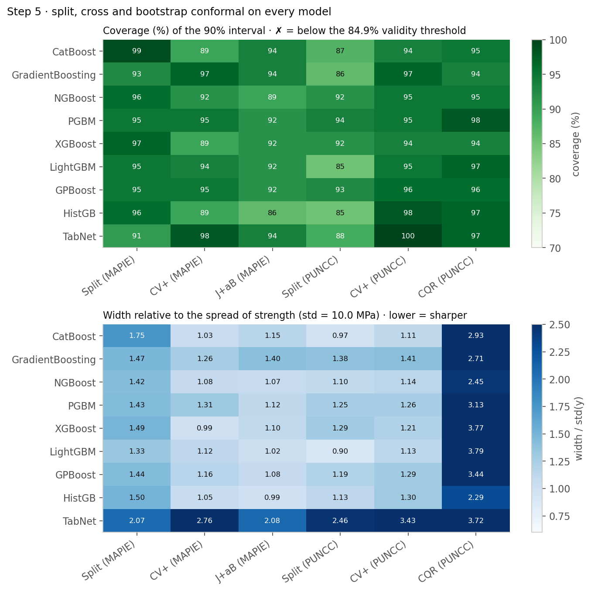
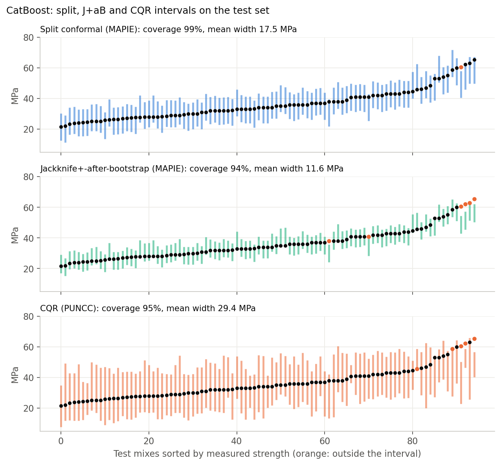

[← Concrete case study](README.md) · previous: [Step 4](04_card.md) · next: [Step 6 →](06_conformal_weighted_online.md)

# Step 5 · Conformal prediction: split, CV+, J+aB and CQR

> **Summary.** Applying conformal prediction to the same nine models yields **valid intervals in all 54 model–method
> combinations** (coverage 85–100%). J+aB is the sharpest method (median width 1.10 standard deviations of strength). CQR
> corrects the coverage of the quantile models of step 2, at roughly three times the width.

| | |
|---|---|
| **Principle** | The interval radius is calibrated on residuals of observations not used to fit the model, so that it exceeds 90% of them |
| **Applied to** | The 9 tuned models × 6 methods: split, CV+ and J+aB (MAPIE); split, CV+ and CQR (PUNCC) |
| **Guarantee** | Marginal coverage of at least 90% in finite samples, for any model, provided the data are exchangeable |
| **Notebook** | [`EXECUTED_Conformal Predictions(MAPIE,PUNCC).ipynb`](<../../examples/concrete_uncertainty_analysis/conformal_predictions_mapie_puncc/results/EXECUTED_Conformal Predictions(MAPIE,PUNCC).ipynb>) · method guide: [NB5](../../notebooks/05_conformal_mapie_puncc/README.md) |

## 5.1 Method

**Split conformal prediction** proceeds in three steps:
1. Fit the model on part of the training data. On the remaining $`m`$ observations (the *calibration set*), compute the
   absolute residuals $`s_i=|y_i-\hat f(x_i)|`$.
2. Let $`\hat q`$ be the $`k`$-th smallest residual, with $`k=\lceil(m+1)(1-\alpha)\rceil`$ and $`\alpha=0.1`$.
3. The interval for a new mix is $`\hat C(x)=[\hat f(x)-\hat q,\ \hat f(x)+\hat q]`$.

**Coverage guarantee.** If the calibration and test observations are exchangeable, the residual of a new observation is equally
likely to occupy any rank among the $`m+1`$ residuals. Hence

```math
\Pr\bigl(Y_{\text{new}}\in\hat C(X_{\text{new}})\bigr)=\Pr\bigl(s_{\text{new}}\le\hat q\bigr)\ge\frac{k}{m+1}\ge1-\alpha .
```

The result requires no assumption about the model: an inaccurate model produces a wider, but still valid, interval.

| Variant | Modification | Number of fits |
|---|---|---|
| **Split** | One model; part of the training data reserved for calibration | 1 |
| **CV+** | Out-of-fold residuals from 5-fold cross-validation, so that all 189 mixes contribute to calibration | 5 |
| **J+aB** (jackknife+-after-bootstrap) | An ensemble of bootstrap models; each mix is scored by the models that did not include it | B (bootstrap replicates) |
| **CQR** (conformalised quantile regression) | Calibrates the quantile band of step 2: $`[\hat q_{0.05}(x)-\hat q,\ \hat q_{0.95}(x)+\hat q]`$ | 2 quantile models |

## 5.2 Results by model and method

<p align="center"></p>

*__Figure 5.1.__ Top: coverage for each model × method (✗ would mark an invalid interval; none occurs). Bottom: mean width
divided by the standard deviation of strength (10.0 MPa); lower values indicate sharper intervals.*

<p align="center"></p>

*__Figure 5.2.__ Split, J+aB and CQR intervals for the CatBoost predictions; test mixes sorted by measured strength. Orange
markers lie outside the interval.*

| Method (median over the 9 models) | Valid | Coverage | Width / std | Width (MPa) |
|---|--:|--:|--:|--:|
| **J+aB (MAPIE)** | 9 / 9 | 91.6% | **1.10** | 11.0 |
| CV+ (MAPIE) | 9 / 9 | 93.7% | 1.13 | 11.3 |
| Split (PUNCC) | 9 / 9 | 88.4% | 1.19 | 11.9 |
| CV+ (PUNCC) | 9 / 9 | 94.7% | 1.26 | 12.6 |
| Split (MAPIE) | 9 / 9 | 94.7% | 1.47 | 14.8 |
| CQR (PUNCC) | 9 / 9 | 95.8% | 3.13 | 31.4 |

**Reading the figure.** All cells of the coverage heatmap lie above the validity threshold. In the width heatmap, the
lightest cells correspond to the sharpest valid intervals.

**Findings.**
- **All 54 intervals are valid.** The guarantee holds for every model, including NGBoost and PGBM, whose own intervals covered
  only 17–34% in steps 2 and 3.
- **Methods that reuse the training data are sharper.** J+aB and CV+ calibrate on all 189 mixes rather than about half of
  them; the quantile $`\hat q`$ is estimated more precisely and the intervals are narrower than with split conformal (1.10–1.13
  versus 1.47 standard deviations in MAPIE).
- **The two implementations of split conformal differ** (1.47 in MAPIE, 1.19 in PUNCC) because each draws a different random
  calibration subset. With 189 mixes, split conformal is sensitive to this partition.
- **CQR is valid but wide** (31 MPa, Figure 5.2). It inherits the poorly estimated tail quantiles of step 2 and requires a
  large correction to reach 90%.
- **The accuracy of the base model still matters.** TabNet's intervals are about twice as wide as those of the boosting
  models, in proportion to its larger errors. Conformal prediction guarantees coverage, not sharpness.
- The narrowest valid interval is LightGBM with PUNCC split conformal (9.1 MPa, 85.3% coverage), which lies just above the
  validity threshold.

> **Conclusion step 5.** Conformal prediction converts every model into a valid 90% interval. For sharp intervals, a variant
> that uses all training data for calibration (**J+aB** or **CV+**) should be combined with an accurate base model.

**Next →** [Step 6: weighted and online conformal prediction](06_conformal_weighted_online.md)
