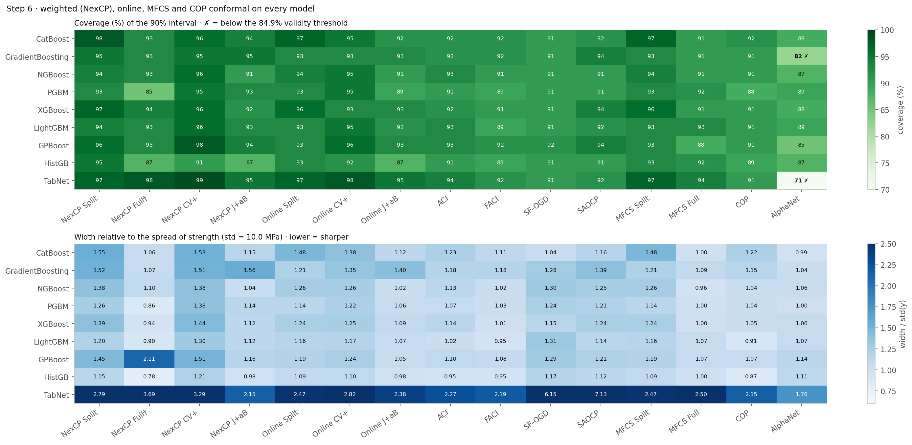
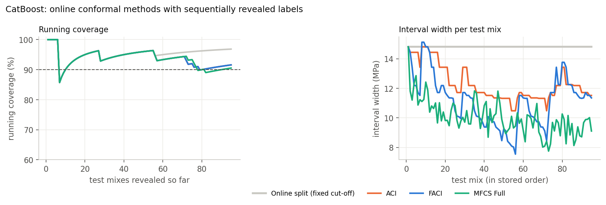

[← Concrete case study](README.md) · previous: [Step 5](05_conformal_split_cv_jab.md) · next: [Step 7 →](07_adaptive_coverage_policies.md)

# Step 6 · Weighted, online and optimistic conformal prediction

> **Summary.** All 117 ranked intervals of the weighted (NexCP), online, MFCS and COP methods are valid. The online methods
> that learn from each revealed label are the sharpest: **MFCS Full** (median width 1.00 standard deviation, coverage 90.5%),
> FACI (1.03) and COP (1.05). They are slightly sharper than J+aB in step 5 (1.10). The learned-level variant AlphaNet is
> invalid for two models.

| | |
|---|---|
| **Principle** | Conformal methods that relax exchangeability: weighting of calibration residuals (NexCP) or sequential updating as test labels are revealed (online methods) |
| **Applied to** | The 9 tuned models × 15 two-sided methods, plus the one-sided Extreme CP; one Kaggle job per model |
| **Guarantees** | NexCP: $`1-\alpha`$ minus a term that vanishes under exchangeability. Online methods: the long-run miscoverage rate converges to $`\alpha`$ for any sequence of observations |
| **Notebooks** | [`results/`](../../examples/concrete_uncertainty_analysis/conformal_predictions_nexcp_adaptivecp_mfcs/results/) (one executed notebook per model) · method guide: [NB6](../../notebooks/06_conformal_nexcp_online/README.md) |

## 6.1 Methods

All methods start from **out-of-fold** residuals of the training set (5-fold cross-validation), so that each training residual
comes from a model that did not see that observation.

**NexCP (non-exchangeable conformal prediction)** replaces the empirical quantile of split conformal by a weighted quantile in
which older residuals receive geometrically decreasing weights ($`\rho=0.99`$):

```math
\hat q=\mathrm{Quantile}_{1-\alpha}\Bigl(\sum_{i=1}^n\tilde w_i\,\delta_{s_i}+\tilde w_{n+1}\,\delta_{+\infty}\Bigr),\qquad
\tilde w_i=\frac{w_i}{\sum_j w_j+1},\quad w_i=\rho^{\,n+1-i}.
```

Barber et al. (2023) show that the coverage is at least $`1-\alpha-\sum_i\tilde w_i\,d_{\mathrm{TV}}(Z,Z^i)`$, which reduces to
the usual guarantee under exchangeability. NexCP is applied to split, full, CV+ and J+aB conformal prediction.

**Online methods** process the test set as a sequence: the interval for mix $`t`$ is issued, then its label is revealed and
used to update the method. Adaptive conformal inference (**ACI**) adjusts the requested miscoverage level:

```math
\alpha_{t+1}=\alpha_t+\gamma\,(\alpha-\mathrm{err}_t),\qquad \mathrm{err}_t=\mathbb 1\{y_t\notin\hat C_t\},\qquad \gamma=0.005,
```

so that a miss widens the next interval. Summing the update gives
$`\bigl|\tfrac1T\sum_t\mathrm{err}_t-\alpha\bigr|\le\frac{\max(\alpha_1,1-\alpha_1)+\gamma}{\gamma T}`$ for any data sequence.

| Method | Update rule |
|---|---|
| **FACI** | Eight ACI instances with step sizes $`\gamma=0.001\cdot2^k`$, aggregated by exponential weights on their pinball loss |
| **SF-OGD** | Scale-free online gradient descent on the radius |
| **SAOCP** | SF-OGD experts started at different times, combined by coin betting (strongly adaptive regret) |
| **Online split / CV+ / J+aB** | Calibration set extended with each revealed test residual (online split and MFCS split coincide in the code) |
| **MFCS Full** | Refits the model on the training data and the revealed test points; radius from the refit's out-of-fold residuals |
| **COP** | Online quantile update with an optimistic correction from the empirical distribution of recent scores |
| **AlphaNet** | A small network learns the miscoverage level from the calibration scores (the learned-level approach of step 7, as implemented in this notebook) |
| **Extreme CP** | Generalised Pareto fit to the residual tail; returns a **one-sided** upper bound and is reported separately |

## 6.2 Results by model and method

<p align="center"></p>

*__Figure 6.1.__ Top: coverage for each model × method (✗: below the 84.9% validity threshold). Bottom: mean width divided by
the standard deviation of strength. † NexCP Full: intervals reach the boundary of the candidate grid for some mixes, so the
widths are lower bounds and are not ranked.*

| Method (median over the 9 models) | Valid | Coverage | Width / std |
|---|--:|--:|--:|
| **MFCS Full** | 9 / 9 | 90.5% | **1.00** |
| FACI | 9 / 9 | 90.5% | 1.03 |
| COP | 9 / 9 | 90.5% | 1.05 |
| Online J+aB | 9 / 9 | 91.6% | 1.07 |
| ACI | 9 / 9 | 91.6% | 1.13 |
| NexCP J+aB | 9 / 9 | 92.6% | 1.14 |
| SAOCP | 9 / 9 | 91.6% | 1.21 |
| Online split / MFCS split | 9 / 9 | 92.6% | 1.22 |
| Online CV+ | 9 / 9 | 94.7% | 1.25 |
| SF-OGD | 9 / 9 | 90.5% | 1.28 |
| NexCP split | 9 / 9 | 94.7% | 1.39 |
| NexCP CV+ | 9 / 9 | 95.8% | 1.44 |
| AlphaNet | **7 / 9** | 87.4% | 1.06 |
| NexCP Full† | 9 / 9 | 92.6% | (lower bound) |

<p align="center"></p>

*__Figure 6.2.__ CatBoost: running coverage (left) and interval width for each test mix (right) for the fixed online split
radius and three adaptive methods, with the test mixes processed in their stored order.*

**Findings.**
- **Every ranked method is valid on every model.** The only invalid intervals are AlphaNet on GradientBoosting (82.1%) and
  TabNet (70.5%).
- **Sequential updating yields the sharpest intervals.** MFCS Full, FACI and COP attain a median width of 1.00–1.05 standard
  deviations with coverage close to the nominal 90%, compared with 1.10 for J+aB in step 5.
- **Adaptive methods track the target coverage closely** (Figure 6.2). With the fixed radius the running coverage drifts
  upwards to 96.8%; ACI, FACI and MFCS Full narrow their intervals after a sequence of hits and end at 90.5–91.6%. The widths
  of FACI and MFCS Full vary between about 8 and 15 MPa from one mix to the next.
- **NexCP is valid but wider** than unweighted conformal prediction (NexCP split 1.39 versus split 1.19–1.47). Without drift in
  the data, down-weighting older residuals reduces the effective calibration sample and enlarges the quantile.
- **Extreme CP** (one-sided) reaches 90.5–93.7% coverage for all models, with an upper margin of 6.8–8.7 MPa above the
  prediction for the boosting models (15.0 MPa for TabNet).

> **Conclusion step 6.** When outcomes become available sequentially, online methods (MFCS Full, FACI, COP) provide the
> sharpest valid intervals on this dataset. On a static test set their advantage relies on the order of the test mixes and on
> the use of earlier test labels, which should be stated when they are compared with the methods of step 5.

**Next →** [Step 7: adaptive coverage policies](07_adaptive_coverage_policies.md)
