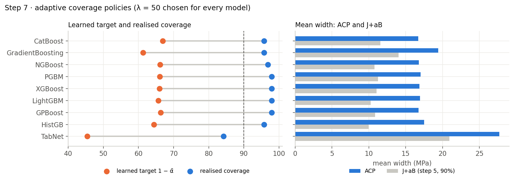
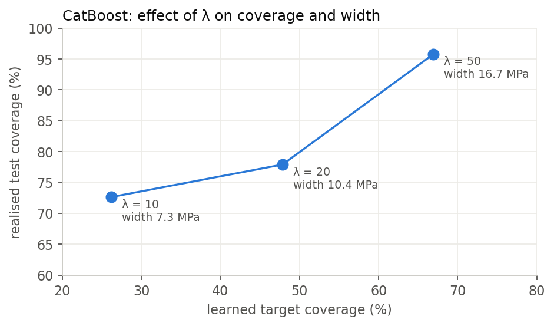

[← Concrete case study](README.md) · previous: [Step 6](06_conformal_weighted_online.md) · next: [Step 8 →](08_hcm.md)

# Step 7 · Adaptive coverage policies (ACP)

> **Summary.** ACP learns its own coverage level instead of fixing it at 90%. With λ = 50 the learned target is 61–67% for
> the boosting models, and the realised coverage (96–98%) exceeds it by a wide margin, as the guarantee requires. The
> resulting intervals (16.7–19.4 MPa) are about 50% wider than J+aB intervals at a comparable coverage.

| | |
|---|---|
| **Principle** | A small network (AlphaNet) selects the miscoverage level $`\tilde\alpha`$; conformal e-values guarantee validity at that learned level |
| **Applied to** | The 9 tuned models from step 1; λ = 10, 20 and 50 compared, λ = 50 reported |
| **Guarantee** | $`\mathbb E\bigl[\mathbb 1\{Y\notin\hat C\}/\tilde\alpha\bigr]\le1`$: coverage must be compared with the learned target, not with 90% |
| **Notebook** | [`EXECUTED_Adaptive_Coverage_Policies(ACP).ipynb`](<../../examples/concrete_uncertainty_analysis/conformal_predictions_adaptive_coverage_policies/results/EXECUTED_Adaptive_Coverage_Policies(ACP).ipynb>) · method guide: [NB7](../../notebooks/07_adaptive_coverage_policies/README.md) |

## 7.1 Method

**Interval at a given level.** With calibration scores $`s_1,\dots,s_n`$, a candidate value $`y`$ is excluded when its conformal
e-value exceeds $`1/\tilde\alpha`$:

```math
e(y)=\frac{(n+1)\,s(x,y)}{\sum_{i}s_i+s(x,y)}\ \ge\ \frac{1}{\tilde\alpha}
\quad\Longleftrightarrow\quad s(x,y)\ \ge\ \frac{\sum_i s_i}{\tilde\alpha\,(n+1)-1},
```

so the interval is $`\hat f(x)\pm\sum_i s_i/\bigl(\tilde\alpha(n+1)-1\bigr)`$. A smaller $`\tilde\alpha`$ (higher target coverage)
produces a wider interval.

**Learning the level.** AlphaNet (one hidden layer of 32 ReLU units, sigmoid output) maps the scaled sum of leave-one-out
scores to $`\tilde\alpha`$ and is trained on the objective $`\text{width}+\lambda\,\tilde\alpha`$. The parameter λ is the cost
assigned to miscoverage: a larger λ favours a lower $`\tilde\alpha`$ and therefore a higher coverage.

## 7.2 Results by model

<p align="center"></p>

*__Figure 7.1.__ Left: learned target coverage $`1-\tilde\alpha`$ (orange) and realised test coverage (blue) for each model.
Right: mean width of the ACP interval and of the J+aB interval from step 5.*

| Model | Learned target | Realised coverage | ACP width (MPa) | J+aB width (MPa) |
|---|--:|--:|--:|--:|
| CatBoost | 66.9% | 95.8% | 16.7 | 11.6 |
| GradientBoosting | 61.3% | 95.8% | 19.4 | 14.0 |
| NGBoost | 66.1% | 96.8% | 16.8 | 10.8 |
| PGBM | 66.1% | 97.9% | 17.0 | 11.2 |
| XGBoost | 66.0% | 97.9% | 16.9 | 11.1 |
| LightGBM | 65.7% | 97.9% | 17.0 | 10.3 |
| GPBoost | 66.3% | 97.9% | 16.8 | 10.9 |
| HistGB | 64.4% | 95.8% | 17.5 | 10.0 |
| TabNet | 45.5% | 84.2% | 27.7 | 20.9 |

<p align="center"></p>

*__Figure 7.2.__ CatBoost: learned target and realised coverage for λ = 10, 20 and 50, with the corresponding mean widths.*

**Findings.**
- **The guarantee holds at the learned level.** For every model the realised coverage is well above the learned target
  (e.g. 95.8% against 66.9% for CatBoost). The policy did not saturate ($`\tilde\alpha`$ remained well below its upper limit
  of 0.999) on any model.
- **The bound is conservative.** The e-value construction controls $`\mathbb E[\mathrm{err}/\tilde\alpha]`$ rather than the
  coverage itself, so the realised coverage exceeds the target by about 30 percentage points.
- **The intervals are wider than those of fixed-level conformal methods.** At a comparable realised coverage (96–98% versus
  92% for J+aB), ACP intervals are 5–7.5 MPa wider for the boosting models.
- **λ controls the trade-off** (Figure 7.2). For CatBoost, λ = 10 gives a target of 26% and a realised coverage of 72.6% with a
  width of 7.3 MPa; λ = 50 gives 67%, 95.8% and 16.7 MPa.

> **Conclusion step 7.** ACP addresses a different question from a fixed 90% interval: the method chooses how much coverage
> to offer. On the concrete dataset it is valid at its learned level and does not saturate, but it is conservative and less
> sharp than J+aB or the online methods. Its results should be reported against the learned target and checked for saturation.

**Next →** [Step 8: hyperspherical confidence mapping](08_hcm.md)
