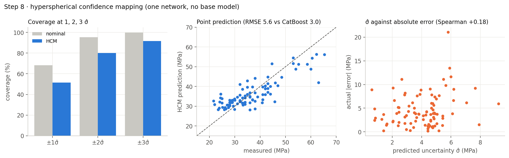

[← Concrete case study](README.md) · previous: [Step 7](07_adaptive_coverage_policies.md) · next: [Summary →](09_summary.md)

# Step 8 · Hyperspherical confidence mapping (HCM)

> **Summary.** With the extended training schedule (fix H1), the HCM network converges and predicts strength with an RMSE of
> 5.6 MPa, against 3.0 MPa for CatBoost. Its uncertainty estimate σ̂ is positively but weakly related to the actual error
> (Spearman +0.18), and its intervals undercover at every level (78.9% for the nominal 95% interval).

| | |
|---|---|
| **Principle** | A single neural network predicts the target and its uncertainty in one forward pass, using the geometry of its output |
| **Applied to** | Its own network (3 hidden layers of 20 LeakyReLU units); no base model from step 1 |
| **Guarantee** | None; one scale factor is calibrated on a validation split |
| **Notebook** | [`EXECUTED_Hyperspherical_Confidence_Mapping(HCM).ipynb`](<../../examples/concrete_uncertainty_analysis/hyperspherical_confidence_mapping_hcm/results/EXECUTED_Hyperspherical_Confidence_Mapping(HCM).ipynb>) · method guide: [NB8](../../notebooks/08_hyperspherical_confidence_mapping/README.md) |

## 8.1 Method

The scalar target is lifted to $`\mathbf y=(y,y)\in\mathbb R^2`$ and decomposed into a magnitude $`R=\|\mathbf y\|`$ and a unit
direction $`\mathbf d=\mathbf y/R`$. The network predicts $`\hat R`$ and $`\hat{\mathbf d}`$ and is trained with

```math
\mathcal L=\mathrm{MSE}\bigl(\hat R\,\mathbf d,\ \mathbf y\bigr)+\mathrm{MSE}\bigl(R\,\hat{\mathbf d},\ \mathbf y\bigr).
```

A correct direction lies on the unit circle; deviation of the predicted direction from unit norm is interpreted as uncertainty:

```math
\hat\sigma_{\text{raw}}(x)=\sqrt{\bigl|\,\|\hat{\mathbf d}(x)\|^2-1\bigr|}\ \,|\hat R(x)|,
```

and a single scale factor, fitted on a validation split, maps $`\hat\sigma_{\text{raw}}`$ to $`\hat\sigma`$ so that $`\pm1,2,3\hat\sigma`$
should cover 68.3%, 95.4% and 99.7% of observations.

## 8.2 Training

The original configuration (200 epochs, patience 40) stopped long before convergence: the validation MSE (standardised target)
fell only from 0.623 to 0.552 and was still decreasing at epoch 200, and the network predicted almost the same value for every
mix (standard deviation 0.44 MPa across the 95 test mixes, RMSE 9.8 MPa). Fix H1 raises the upper limit to 5,000 epochs with
patience 200; learning rate, batch size, weight decay and architecture are unchanged. Training now ends by early stopping at
epoch 912, with the best validation MSE (0.164) at epoch 712. The run took about one minute on a Kaggle CPU
([`REG24_11_2026_15_14`](https://www.kaggle.com/code/daneshselwal/reg24-11-2026-15-14)).

## 8.3 Results

<p align="center"></p>

*__Figure 8.1.__ Left: coverage at ±1, 2 and 3 σ̂ compared with the nominal Gaussian values. Centre: HCM predictions against
measured strength. Right: predicted uncertainty σ̂ against the absolute error.*

| Metric | HCM (H1) | HCM (200 epochs) | Reference |
|---|--:|--:|---|
| Coverage at ±1σ̂ | 51.6% | 56.8% | nominal 68.3% |
| Coverage at ±2σ̂ (95% interval) | 78.9% | 84.2% | nominal 95.4%; valid if ≥ 91.3% with 95 mixes |
| Coverage at ±3σ̂ | 91.6% | 94.7% | nominal 99.7% |
| Mean width of the 95% interval | 15.7 MPa | 31.0 MPa | J+aB 90% interval (CatBoost): 11.6 MPa |
| RMSE | 5.62 MPa | 9.83 MPa | CatBoost 2.99 MPa; standard deviation of strength 10.0 MPa |
| Spearman (σ̂, absolute error) | +0.18 | −0.38 | positive if σ̂ is informative |
| CRPS | 3.22 MPa | 5.70 MPa | CARD (CatBoost guide): 1.76 MPa |

**Findings.**
- **The network now learns the relation between mix and strength** (Figure 8.1, centre): predictions range from 28 to 56 MPa
  and the RMSE falls from 9.8 to 5.6 MPa. It remains about twice the error of the tuned boosting models, which is expected for a
  small network trained on 189 mixes.
- **The uncertainty estimate is weakly informative.** The rank correlation between σ̂ and the absolute error changes from
  −0.38 to +0.18; larger σ̂ tends to accompany larger errors, but the relation is weak.
- **The intervals undercover at every level** (51.6%, 80.0% and 91.6% against 68.3%, 95.4% and 99.7%). The single scale
  factor fitted on the validation split does not transfer to the test mixes; the 95% interval is not valid.

> **Conclusion step 8.** After convergence, HCM gives usable point predictions and an uncertainty estimate that is weakly
> related to the error, from a single network and without a base model. Its intervals are not calibrated, however, and its
> predictions are less accurate than those of the boosting models. On this dataset it does not replace conformal prediction;
> its σ̂ could serve as a normalising score inside a conformal method.

**Next →** [Summary of the case study](09_summary.md)
