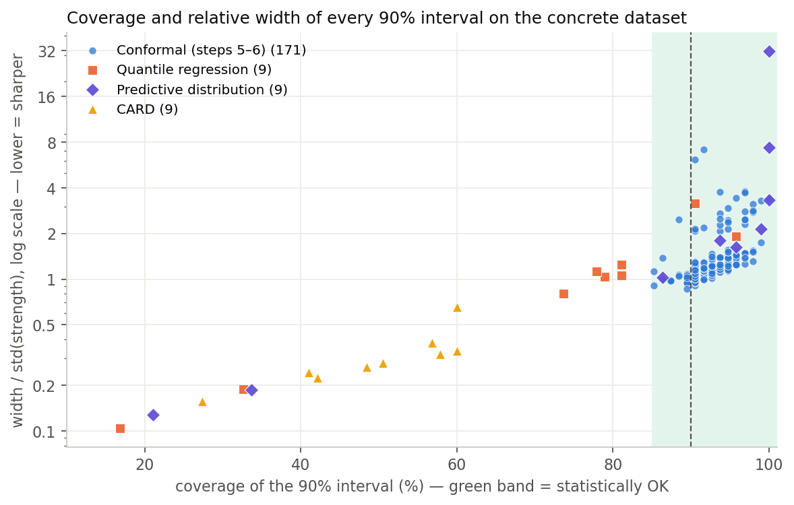

[← Concrete case study](README.md) · previous: [Step 8](08_hcm.md)

# Summary of the concrete case study

> **Summary.** On the concrete dataset, only conformal methods deliver intervals that are both valid and sharp. All 171
> ranked conformal intervals reach the 90% target within sampling tolerance, whereas quantile regression, the native
> predictive distributions and CARD undercover for most models. The sharpest valid intervals come from online conformal
> methods (MFCS Full, FACI, COP) and, among methods that do not use test labels, from J+aB.

*__Figure 9.1.__ Coverage and relative width (width divided by the standard deviation of strength, logarithmic scale) of every
90% interval in steps 2–6. The green band marks statistically valid coverage (≥ 84.9% with 95 test mixes).*

**Reading the figure.** The preferred region is the lower part of the green band: valid coverage with a small width. The
conformal intervals (blue) form a compact cluster in this region. The intervals of the other families lie either to the left of
the band (undercoverage) or high above it (excessive width).

## Results by step

| Step | Method family | Valid intervals | Best result on concrete | Main limitation |
|:-:|---|--:|---|---|
| 1 | Hyperparameter tuning | – | **CatBoost**, CV RMSE 3.66 MPa (8 boosting models within 0.5 MPa) | Test ranking differs from CV ranking (sampling variation) |
| 2 | Quantile regression | 2 / 9 | XGBoost, 90.5% coverage at 31.7 MPa | Tail quantiles undercover; quantiles cross for most mixes |
| 3 | Predictive distributions | 7 / 9 | LightGBM · IBUG, 86.3% at 10.3 MPa, near-uniform PIT | NGBoost and PGBM over-confident; Treeffuser over-dispersed |
| 4 | CARD | 0 / 9 | Lowest CRPS of the study (1.61 MPa, XGBoost guide) | Intervals cover 27–60% |
| 5 | Split, CV+, J+aB, CQR | 54 / 54 | J+aB, median 91.6% at 1.10 × std | CQR valid but about three times wider |
| 6 | NexCP, online, MFCS, COP | 117 / 117 ranked | MFCS Full, median 90.5% at 1.00 × std | Uses revealed test labels; NexCP wider without drift |
| 7 | ACP | 9 / 9 at the learned level | Learned target 61–67%, realised 96–98% | Conservative; wider than J+aB |
| 8 | HCM | 0 / 1 (95% interval) | RMSE 5.6 MPa; Spearman(σ̂, error) +0.18 | 95% interval covers 78.9%; less accurate than boosting |

## Recommendations for this dataset

1. **Point prediction:** CatBoost, or any of the tuned gradient-boosting models; their accuracy is practically equivalent.
2. **Prediction interval on a fixed test set:** J+aB or CV+ conformal prediction on a boosting model (about 11 MPa wide at
   90–94% coverage).
3. **Sequential prediction** (labels revealed after each prediction): MFCS Full or FACI (about 10 MPa wide at 90.5% coverage).
4. **Predictive distribution:** IBUG with LightGBM is the best-calibrated distribution; CARD has the lowest CRPS but must be
   calibrated before its intervals are used.
5. **Not recommended without calibration:** raw quantile regression, the native NGBoost and PGBM Gaussians, CARD intervals,
   Treeffuser and HCM intervals.

## Points requiring attention

- **HCM** (step 8) required a longer training schedule (fix H1) to converge. Its uncertainty estimate is weakly informative,
  but its intervals are not calibrated.
- **Treeffuser with CatBoost** (step 3) produced a degenerate distribution (RMSE 12 MPa, width 320 MPa).
- **Online methods** (step 6) use the order of the test mixes and their revealed labels; their sharpness is not directly
  comparable with that of the methods in step 5.
- All conclusions rest on a single train/test split with 95 test mixes; differences in coverage of a few percentage points are
  within sampling variation.
