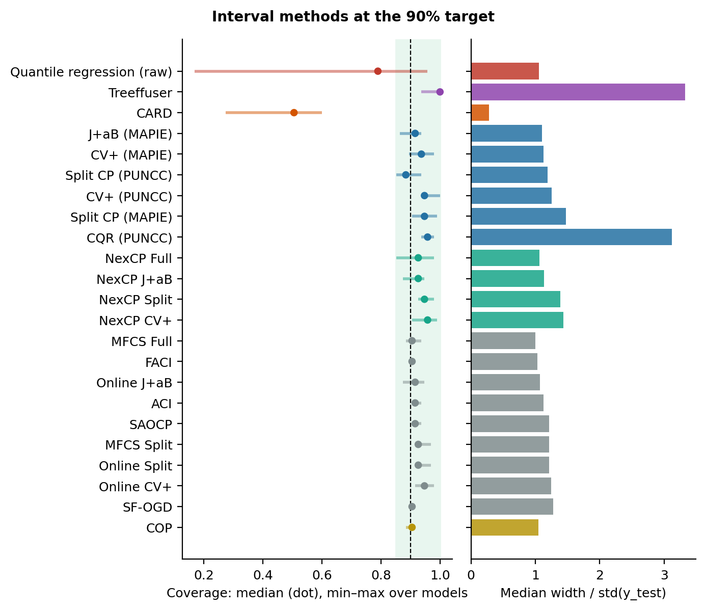
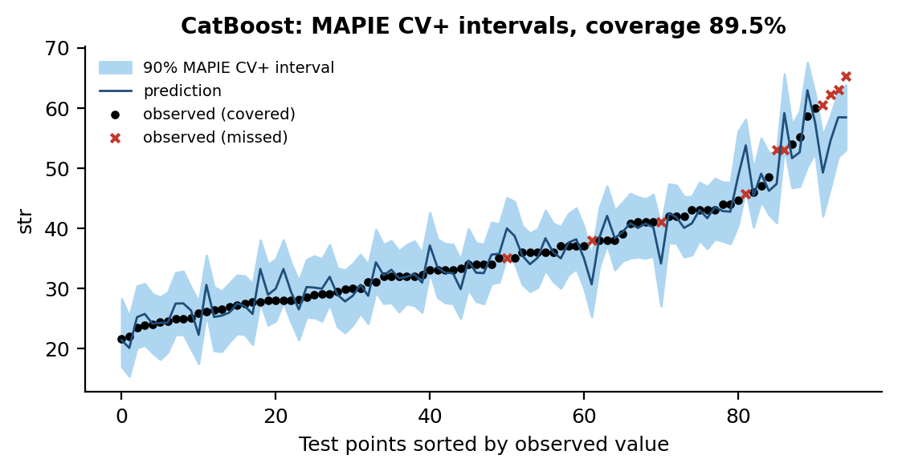

# Concrete dataset: uncertainty quantification results

Results of the full v2.0 pipeline (8 notebooks) on the concrete dataset. The full write-up with the methods, maths and all tables is the paper [`papers/concrete/paper.pdf`](../../papers/concrete/paper.pdf).

| | |
|---|---|
| Training set | `data/` – 189 rows |
| Test set | 95 rows |
| Features (7) | `C`, `mp`, `FA`, `CA`, `F`, `W_P`, `Adm` |
| Target | `str` (test mean 36.24, std 10.03) |
| Nominal level | 90% (α = 0.1); HCM reports 95% |

## Key findings

- Point accuracy: CatBoost has the lowest 5-fold CV RMSE (3.66); on the test set the lowest RMSE is HistGB (2.81, target std 10.03).
- Raw quantile regression undercovers: median 90%-interval coverage 79.0% (range 16.8%–95.8%); 2 of 9 models reach the target. Quantile crossing occurs on a median 97.9% of test points.
- Best probabilistic score: XGBoost (CARD) with CRPS 1.61.
- NGBoost (native) predictive distributions are over-confident here: the Gaussian 90% interval covers only 33.7%.
- PGBM (native) predictive distributions are over-confident here: the Gaussian 90% interval covers only 21.1%.
- CARD (diffusion) intervals: median coverage 50.5% at 0.28× the target std.
- Recommended interval method: **MFCS Full** – the narrowest method that reaches the 90% target (within sampling tolerance, n=95) on ≥75% of models: median coverage 90.5%, median width 10.05 (1.0× target std).
- Narrowest single valid interval (coverage within tolerance of 90%): COP on HistGB, coverage 89.5%, mean width 8.69.
- Among valid intervals, median width / target std by family: COP 1.05; Online conformal 1.17; Weighted conformal (NexCP) 1.28; Conformal (MAPIE/PUNCC) 1.30; Distributional 2.13; Quantile regression 2.53.
- ACP learns its own coverage level (mean learned target 63.1%); realised coverage of its e-value sets is 84.2%–97.9% across models.
- HCM (single network, 95% interval): coverage 84.2%, RMSE 9.83, error–uncertainty Spearman correlation -0.38.

## Figures

Point accuracy and CRPS

## Interval methods at the 90% target

Aggregated over the base models each method wraps. *Valid* = share of models with coverage ≥ 0.849 (90% minus the one-sided 95% sampling tolerance for n = 95). Relative width = width / std of the test target. † = some intervals hit the edge of the label grid, so the width is a lower bound (not ranked).

| Family | Method | Models | Coverage (median) | Coverage range | Width (median) | Relative width | Valid |
|---|---|---:|---:|---:|---:|---:|---:|
| Quantile regression | Quantile regression (raw) | 9 | 79.0% | 16.8%–95.8% | 10.63 | 1.06 | 22% |
| Distributional | PGBM (native) | 1 | 21.1% | 21.1%–21.1% | 1.28 | 0.13 | 0% |
| Distributional | NGBoost (native) | 1 | 33.7% | 33.7%–33.7% | 1.88 | 0.19 | 0% |
| Distributional | IBUG | 2 | 91.1% | 86.3%–95.8% | 13.34 | 1.33 | 100% |
| Distributional | Treeffuser | 5 | 100.0% | 93.7%–100.0% | 33.41 | 3.33 | 100% |
| CARD | CARD | 9 | 50.5% | 27.4%–60.0% | 2.81 | 0.28 | 0% |
| Conformal (MAPIE/PUNCC) | J+aB (MAPIE) | 9 | 91.6% | 86.3%–93.7% | 11.05 | 1.10 | 100% |
| Conformal (MAPIE/PUNCC) | CV+ (MAPIE) | 9 | 93.7% | 89.5%–97.9% | 11.29 | 1.12 | 100% |
| Conformal (MAPIE/PUNCC) | Split CP (PUNCC) | 9 | 88.4% | 85.3%–93.7% | 11.92 | 1.19 | 100% |
| Conformal (MAPIE/PUNCC) | CV+ (PUNCC) | 9 | 94.7% | 93.7%–100.0% | 12.62 | 1.26 | 100% |
| Conformal (MAPIE/PUNCC) | Split CP (MAPIE) | 9 | 94.7% | 90.5%–98.9% | 14.77 | 1.47 | 100% |
| Conformal (MAPIE/PUNCC) | CQR (PUNCC) | 9 | 95.8% | 93.7%–97.9% | 31.36 | 3.13 | 100% |
| Weighted conformal (NexCP) | NexCP Full † | 9 | 92.6% | 85.3%–97.9% | 10.67 | 1.06 | 100% |
| Weighted conformal (NexCP) | NexCP J+aB | 9 | 92.6% | 87.4%–94.7% | 11.42 | 1.14 | 100% |
| Weighted conformal (NexCP) | NexCP Split | 9 | 94.7% | 92.6%–97.9% | 13.90 | 1.39 | 100% |
| Weighted conformal (NexCP) | NexCP CV+ | 9 | 95.8% | 90.5%–98.9% | 14.45 | 1.44 | 100% |
| Online conformal | MFCS Full | 9 | 90.5% | 88.4%–93.7% | 10.05 | 1.00 | 100% |
| Online conformal | FACI | 9 | 90.5% | 89.5%–91.6% | 10.34 | 1.03 | 100% |
| Online conformal | Online J+aB | 9 | 91.6% | 87.4%–94.7% | 10.77 | 1.07 | 100% |
| Online conformal | ACI | 9 | 91.6% | 90.5%–93.7% | 11.33 | 1.13 | 100% |
| Online conformal | SAOCP | 9 | 91.6% | 90.5%–93.7% | 12.15 | 1.21 | 100% |
| Online conformal | MFCS Split | 9 | 92.6% | 92.6%–96.8% | 12.19 | 1.21 | 100% |
| Online conformal | Online Split | 9 | 92.6% | 92.6%–96.8% | 12.19 | 1.21 | 100% |
| Online conformal | Online CV+ | 9 | 94.7% | 91.6%–97.9% | 12.52 | 1.25 | 100% |
| Online conformal | SF-OGD | 9 | 90.5% | 90.5%–91.6% | 12.84 | 1.28 | 100% |
| COP | COP | 9 | 90.5% | 88.4%–91.6% | 10.56 | 1.05 | 100% |

## Tuned models

| Model | CV RMSE | Test RMSE | Test r |
|---|---:|---:|---:|
| CatBoost | 3.66 | 2.99 | 0.954 |
| GradientBoosting | 3.78 | 3.26 | 0.945 |
| NGBoost | 3.79 | 3.19 | 0.948 |
| PGBM | 3.85 | 3.04 | 0.953 |
| XGBoost | 3.85 | 2.89 | 0.958 |
| LightGBM | 3.87 | 2.89 | 0.958 |
| GPBoost | 3.97 | 3.18 | 0.948 |
| HistGB | 4.14 | 2.81 | 0.960 |
| RandomForest | 4.43 | 3.39 | 0.943 |
| TabNet | 7.29 | 5.75 | 0.826 |

## Folder contents

| Folder | Notebook | Kaggle run(s) |
|---|---|---|
| [`hyperparameter_tuning/`](hyperparameter_tuning/) | NB1 Hyperparameter tuning (Optuna) | [REG22_11_2026_17_57](https://www.kaggle.com/code/daneshjangra/reg22-11-2026-17-57) |
| [`quantile_regression/`](quantile_regression/) | NB2 Quantile regression | [REG22_11_2026_19_52](https://www.kaggle.com/code/daneshjangra/reg22-11-2026-19-52) |
| [`probabilistic_distribution/`](probabilistic_distribution/) | NB3 Distributional (NGBoost, PGBM, IBUG, Treeffuser) | [REG22_11_2026_19_59](https://www.kaggle.com/code/daneshjangra/reg22-11-2026-19-59) |
| [`probabilistic_distribution_card/`](probabilistic_distribution_card/) | NB4 Distributional (CARD diffusion) | [REG22_11_2026_20_08](https://www.kaggle.com/code/daneshjangra/reg22-11-2026-20-08) |
| [`conformal_predictions_mapie_puncc/`](conformal_predictions_mapie_puncc/) | NB5 Conformal (MAPIE, PUNCC) | [REG22_11_2026_20_15](https://www.kaggle.com/code/daneshjangra/reg22-11-2026-20-15) |
| [`conformal_predictions_nexcp_adaptivecp_mfcs/`](conformal_predictions_nexcp_adaptivecp_mfcs/) | NB6 NexCP and online conformal | [REG23_11_2026_07_27](https://www.kaggle.com/code/daneshjangra/reg23-11-2026-07-27), [REG23_11_2026_06_07](https://www.kaggle.com/code/daneshjangra/reg23-11-2026-06-07), [REG23_11_2026_08_52](https://www.kaggle.com/code/daneshjangra/reg23-11-2026-08-52), [REG23_11_2026_11_54](https://www.kaggle.com/code/daneshjangra/reg23-11-2026-11-54), [REG23_11_2026_06_08](https://www.kaggle.com/code/daneshjangra/reg23-11-2026-06-08), [REG23_11_2026_13_09](https://www.kaggle.com/code/daneshjangra/reg23-11-2026-13-09), [REG23_11_2026_06_09](https://www.kaggle.com/code/daneshjangra/reg23-11-2026-06-09), [REG23_11_2026_14_44](https://www.kaggle.com/code/daneshjangra/reg23-11-2026-14-44), [REG23_11_2026_15_02](https://www.kaggle.com/code/daneshjangra/reg23-11-2026-15-02) |
| [`conformal_predictions_adaptive_coverage_policies/`](conformal_predictions_adaptive_coverage_policies/) | NB7 Adaptive coverage policies (ACP) | [REG22_11_2026_20_52](https://www.kaggle.com/code/daneshjangra/reg22-11-2026-20-52) |
| [`hyperspherical_confidence_mapping_hcm/`](hyperspherical_confidence_mapping_hcm/) | NB8 Hyperspherical confidence mapping (HCM) | [REG22_11_2026_21_44](https://www.kaggle.com/code/daneshjangra/reg22-11-2026-21-44) |

Each phase folder contains:

- the notebook: the current v2.0 code for this dataset (same code as `notebooks/`, with this dataset's paths, file names and feature names);
- `results/`: what the Kaggle run produced – `EXECUTED_*.ipynb` (the exact notebook that ran, with all cell outputs), the Excel files with every prediction, interval and metric, and a `README.md` naming the run.

`data/` holds the train and test CSV files. To reproduce, run the eight notebooks in order (see the main README); notebooks 2–7 read `hyperparameter_tuning/best_params.pkl` written by notebook 1.
