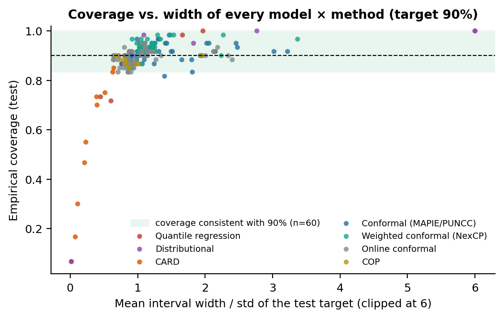
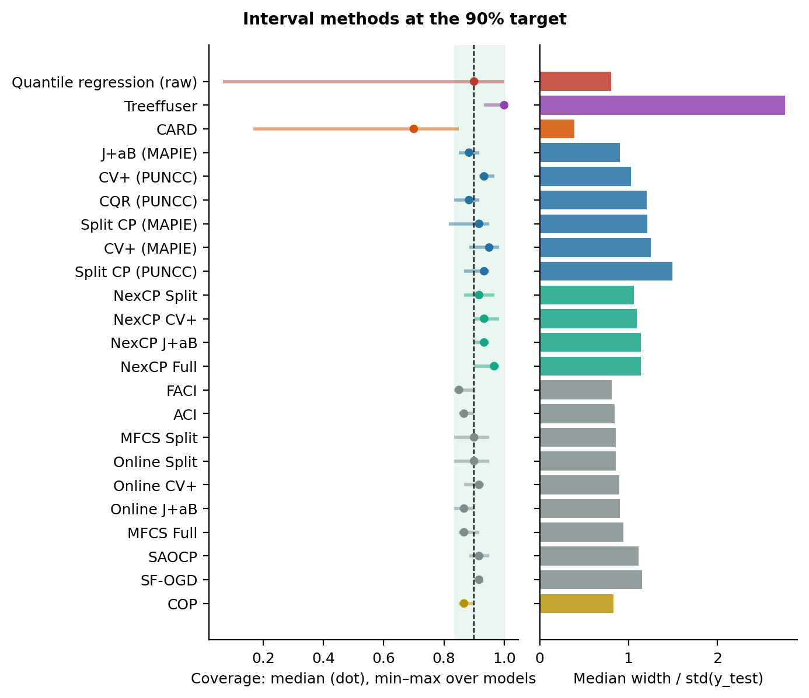

# Noise dataset: uncertainty quantification results

Results of the full v2.0 pipeline (8 notebooks) on the noise dataset. The full write-up with the methods, maths and all tables is the paper [`papers/noise/paper.pdf`](../../papers/noise/paper.pdf).

| | |
|---|---|
| Training set | `data/` – 168 rows |
| Test set | 60 rows |
| Features (5) | `A`, `B`, `C`, `D`, `O` |
| Target | `Leq` (test mean 64.30, std 15.02) |
| Nominal level | 90% (α = 0.1); HCM reports 95% |

## Key findings

- Point accuracy: LightGBM has the lowest 5-fold CV RMSE (3.97); on the test set the lowest RMSE is GPBoost (3.39, target std 15.02).
- Raw quantile regression undercovers: median 90%-interval coverage 90.0% (range 6.7%–100.0%); 6 of 9 models reach the target. Quantile crossing occurs on a median 100.0% of test points.
- Best probabilistic score: GPBoost (Quantile regression) with CRPS 1.78.
- PGBM (native) predictive distributions are over-confident here: the Gaussian 90% interval covers only 6.7%.
- CARD (diffusion) intervals: median coverage 70.0% at 0.39× the target std.
- Recommended interval method: **FACI** – the narrowest method that reaches the 90% target (within sampling tolerance, n=60) on ≥75% of models: median coverage 85.0%, median width 12.17 (0.81× target std).
- Narrowest single valid interval (coverage within tolerance of 90%): ACI on GPBoost, coverage 88.3%, mean width 9.58.
- Among valid intervals, median width / target std by family: CARD 0.65; COP 0.83; Online conformal 0.93; Weighted conformal (NexCP) 1.12; Conformal (MAPIE/PUNCC) 1.13; Quantile regression 1.27; Distributional 1.46.
- ACP learns its own coverage level (mean learned target 61.6%); realised coverage of its e-value sets is 83.3%–93.3% across models.
- HCM (single network, 95% interval): coverage 80.0%, RMSE 15.26, error–uncertainty Spearman correlation -0.12.

## Figures

Point accuracy and CRPS

## Interval methods at the 90% target

Aggregated over the base models each method wraps. *Valid* = share of models with coverage ≥ 0.836 (90% minus the one-sided 95% sampling tolerance for n = 60). Relative width = width / std of the test target. † = some intervals hit the edge of the label grid, so the width is a lower bound (not ranked).

| Family | Method | Models | Coverage (median) | Coverage range | Width (median) | Relative width | Valid |
|---|---|---:|---:|---:|---:|---:|---:|
| Quantile regression | Quantile regression (raw) | 9 | 90.0% | 6.7%–100.0% | 12.11 | 0.81 | 67% |
| Distributional | PGBM (native) | 1 | 6.7% | 6.7%–6.7% | 0.272 | 0.02 | 0% |
| Distributional | NGBoost (native) | 1 | 86.7% | 86.7%–86.7% | 11.48 | 0.76 | 100% |
| Distributional | IBUG | 2 | 94.2% | 90.0%–98.3% | 15.32 | 1.02 | 100% |
| Distributional | Treeffuser | 5 | 100.0% | 93.3%–100.0% | 41.57 | 2.77 | 100% |
| CARD | CARD | 9 | 70.0% | 16.7%–85.0% | 5.89 | 0.39 | 11% |
| Conformal (MAPIE/PUNCC) | J+aB (MAPIE) | 9 | 88.3% | 85.0%–91.7% | 13.58 | 0.90 | 100% |
| Conformal (MAPIE/PUNCC) | CV+ (PUNCC) | 9 | 93.3% | 91.7%–96.7% | 15.45 | 1.03 | 100% |
| Conformal (MAPIE/PUNCC) | CQR (PUNCC) | 9 | 88.3% | 83.3%–91.7% | 18.14 | 1.21 | 89% |
| Conformal (MAPIE/PUNCC) | Split CP (MAPIE) | 9 | 91.7% | 81.7%–95.0% | 18.19 | 1.21 | 89% |
| Conformal (MAPIE/PUNCC) | CV+ (MAPIE) | 9 | 95.0% | 88.3%–98.3% | 18.87 | 1.26 | 100% |
| Conformal (MAPIE/PUNCC) | Split CP (PUNCC) | 9 | 93.3% | 86.7%–95.0% | 22.49 | 1.50 | 100% |
| Weighted conformal (NexCP) | NexCP Split | 9 | 91.7% | 86.7%–96.7% | 15.91 | 1.06 | 100% |
| Weighted conformal (NexCP) | NexCP CV+ | 9 | 93.3% | 90.0%–98.3% | 16.47 | 1.10 | 100% |
| Weighted conformal (NexCP) | NexCP J+aB | 9 | 93.3% | 90.0%–95.0% | 17.19 | 1.14 | 100% |
| Weighted conformal (NexCP) | NexCP Full † | 9 | 96.7% | 90.0%–98.3% | 17.19 | 1.14 | 100% |
| Online conformal | FACI | 9 | 85.0% | 83.3%–90.0% | 12.17 | 0.81 | 78% |
| Online conformal | ACI | 9 | 86.7% | 85.0%–90.0% | 12.67 | 0.84 | 100% |
| Online conformal | MFCS Split | 9 | 90.0% | 83.3%–95.0% | 12.88 | 0.86 | 89% |
| Online conformal | Online Split | 9 | 90.0% | 83.3%–95.0% | 12.88 | 0.86 | 89% |
| Online conformal | Online CV+ | 9 | 91.7% | 86.7%–93.3% | 13.53 | 0.90 | 100% |
| Online conformal | Online J+aB | 9 | 86.7% | 83.3%–90.0% | 13.56 | 0.90 | 89% |
| Online conformal | MFCS Full | 9 | 86.7% | 85.0%–91.7% | 14.18 | 0.94 | 100% |
| Online conformal | SAOCP | 9 | 91.7% | 88.3%–95.0% | 16.78 | 1.12 | 100% |
| Online conformal | SF-OGD | 9 | 91.7% | 90.0%–91.7% | 17.33 | 1.15 | 100% |
| COP | COP | 9 | 86.7% | 85.0%–90.0% | 12.52 | 0.83 | 100% |

## Tuned models

| Model | CV RMSE | Test RMSE | Test r |
|---|---:|---:|---:|
| LightGBM | 3.97 | 4.06 | 0.962 |
| XGBoost | 4.15 | 3.95 | 0.965 |
| GradientBoosting | 4.15 | 4.34 | 0.962 |
| CatBoost | 4.17 | 4.26 | 0.959 |
| RandomForest | 4.24 | 3.92 | 0.966 |
| PGBM | 4.29 | 4.44 | 0.958 |
| NGBoost | 4.35 | 4.32 | 0.958 |
| GPBoost | 4.46 | 3.39 | 0.974 |
| HistGB | 4.57 | 3.94 | 0.968 |
| TabNet | 7.44 | 9.12 | 0.933 |

## Folder contents

| Folder | Notebook | Kaggle run(s) |
|---|---|---|
| [`hyperparameter_tuning/`](hyperparameter_tuning/) | NB1 Hyperparameter tuning (Optuna) | [REG22_11_2026_17_59](https://www.kaggle.com/code/daneshselwal/reg22-11-2026-17-59) |
| [`quantile_regression/`](quantile_regression/) | NB2 Quantile regression | [REG22_11_2026_20_53](https://www.kaggle.com/code/daneshselwal/reg22-11-2026-20-53) |
| [`probabilistic_distribution/`](probabilistic_distribution/) | NB3 Distributional (NGBoost, PGBM, IBUG, Treeffuser) | [REG22_11_2026_21_02](https://www.kaggle.com/code/daneshselwal/reg22-11-2026-21-02) |
| [`probabilistic_distribution_card/`](probabilistic_distribution_card/) | NB4 Distributional (CARD diffusion) | [REG23_11_2026_01_19](https://www.kaggle.com/code/daneshselwal/reg23-11-2026-01-19) |
| [`conformal_predictions_mapie_puncc/`](conformal_predictions_mapie_puncc/) | NB5 Conformal (MAPIE, PUNCC) | [REG22_11_2026_21_25](https://www.kaggle.com/code/daneshselwal/reg22-11-2026-21-25) |
| [`conformal_predictions_nexcp_adaptivecp_mfcs/`](conformal_predictions_nexcp_adaptivecp_mfcs/) | NB6 NexCP and online conformal | [REG23_11_2026_06_10](https://www.kaggle.com/code/daneshselwal/reg23-11-2026-06-10), [REG23_11_2026_11_26](https://www.kaggle.com/code/daneshselwal/reg23-11-2026-11-26), [REG23_11_2026_12_12](https://www.kaggle.com/code/daneshselwal/reg23-11-2026-12-12), [REG23_11_2026_13_13](https://www.kaggle.com/code/daneshselwal/reg23-11-2026-13-13), [REG23_11_2026_13_52](https://www.kaggle.com/code/daneshselwal/reg23-11-2026-13-52), [REG23_11_2026_14_02](https://www.kaggle.com/code/daneshselwal/reg23-11-2026-14-02), [REG23_11_2026_14_12](https://www.kaggle.com/code/daneshselwal/reg23-11-2026-14-12), [REG23_11_2026_14_23](https://www.kaggle.com/code/daneshselwal/reg23-11-2026-14-23), [REG23_11_2026_14_40](https://www.kaggle.com/code/daneshselwal/reg23-11-2026-14-40) |
| [`conformal_predictions_adaptive_coverage_policies/`](conformal_predictions_adaptive_coverage_policies/) | NB7 Adaptive coverage policies (ACP) | [REG22_11_2026_21_46](https://www.kaggle.com/code/daneshselwal/reg22-11-2026-21-46) |
| [`hyperspherical_confidence_mapping_hcm/`](hyperspherical_confidence_mapping_hcm/) | NB8 Hyperspherical confidence mapping (HCM) | [REG22_11_2026_21_59](https://www.kaggle.com/code/daneshselwal/reg22-11-2026-21-59) |

Each phase folder contains:

- the notebook: the current v2.0 code for this dataset (same code as `notebooks/`, with this dataset's paths, file names and feature names);
- `results/`: what the Kaggle run produced – `EXECUTED_*.ipynb` (the exact notebook that ran, with all cell outputs), the Excel files with every prediction, interval and metric, and a `README.md` naming the run.

`data/` holds the train and test CSV files. To reproduce, run the eight notebooks in order (see the main README); notebooks 2–7 read `hyperparameter_tuning/best_params.pkl` written by notebook 1.
