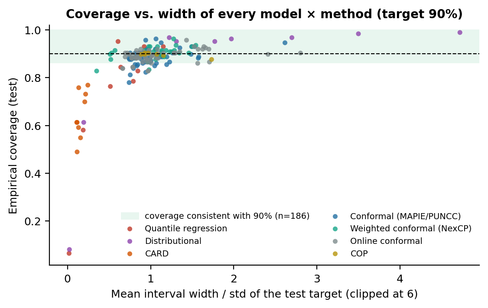
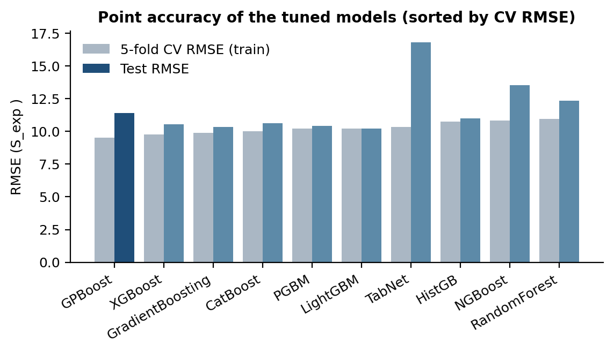

# Pile settlement dataset: uncertainty quantification results

Results of the full v2.0 pipeline (8 notebooks) on the pile settlement dataset. The full write-up with the methods, maths and all tables is the paper [`papers/pile_settlement/paper.pdf`](../../papers/pile_settlement/paper.pdf).

| | |
|---|---|
| Training set | `data/` – 371 rows |
| Test set | 186 rows |
| Features (8) | `D`, `L`, `N30_Ava`, `Cu_Ava`, `N30_Base`, `Cu_Base`, `UL`, `Q ` |
| Target | `S_exp ` (test mean 14.97, std 27.20) |
| Nominal level | 90% (α = 0.1); HCM reports 95% |

## Key findings

- Point accuracy: GPBoost has the lowest 5-fold CV RMSE (9.53); on the test set the lowest RMSE is LightGBM (10.24, target std 27.20).
- Raw quantile regression undercovers: median 90%-interval coverage 82.8% (range 6.5%–95.2%); 3 of 9 models reach the target. Quantile crossing occurs on a median 99.5% of test points.
- Best probabilistic score: TabNet (CARD) with CRPS 2.08.
- NGBoost (native) predictive distributions are over-confident here: the Gaussian 90% interval covers only 61.3%.
- PGBM (native) predictive distributions are over-confident here: the Gaussian 90% interval covers only 8.1%.
- CARD (diffusion) intervals: median coverage 61.3% at 0.13× the target std.
- Recommended interval method: **MFCS Full** – the narrowest method that reaches the 90% target (within sampling tolerance, n=186) on ≥75% of models: median coverage 89.8%, median width 20.22 (0.74× target std).
- Narrowest single valid interval (coverage within tolerance of 90%): Quantile regression (raw) on TabNet, coverage 95.2%, mean width 16.53.
- Among valid intervals, median width / target std by family: Quantile regression 0.92; Online conformal 0.96; COP 0.97; Conformal (MAPIE/PUNCC) 0.98; Weighted conformal (NexCP) 1.12; Distributional 1.97.
- ACP learns its own coverage level (mean learned target 63.2%); realised coverage of its e-value sets is 79.0%–86.0% across models.
- HCM (single network, 95% interval): coverage 86.6%, RMSE 23.07, error–uncertainty Spearman correlation 0.51.
- Not run (out of compute, Kaggle 12-hour limit): NB6 for NGBoost, PGBM.

## Figures

Point accuracy and CRPS

## Interval methods at the 90% target

Aggregated over the base models each method wraps. *Valid* = share of models with coverage ≥ 0.864 (90% minus the one-sided 95% sampling tolerance for n = 186). Relative width = width / std of the test target. † = some intervals hit the edge of the label grid, so the width is a lower bound (not ranked).

| Family | Method | Models | Coverage (median) | Coverage range | Width (median) | Relative width | Valid |
|---|---|---:|---:|---:|---:|---:|---:|
| Quantile regression | Quantile regression (raw) | 9 | 82.8% | 6.5%–95.2% | 17.42 | 0.64 | 33% |
| Distributional | PGBM (native) | 1 | 8.1% | 8.1%–8.1% | 0.626 | 0.02 | 0% |
| Distributional | NGBoost (native) | 1 | 61.3% | 61.3%–61.3% | 5.30 | 0.19 | 0% |
| Distributional | IBUG | 2 | 96.0% | 95.2%–96.8% | 34.46 | 1.27 | 100% |
| Distributional | Treeffuser | 5 | 96.8% | 95.2%–98.9% | 73.40 | 2.70 | 100% |
| CARD | CARD | 9 | 61.3% | 48.9%–76.9% | 3.67 | 0.13 | 0% |
| Conformal (MAPIE/PUNCC) | CV+ (MAPIE) | 9 | 88.2% | 86.6%–96.2% | 22.17 | 0.81 | 100% |
| Conformal (MAPIE/PUNCC) | J+aB (MAPIE) | 9 | 85.5% | 82.3%–90.3% | 22.99 | 0.85 | 33% |
| Conformal (MAPIE/PUNCC) | CV+ (PUNCC) | 9 | 90.3% | 87.1%–95.7% | 25.58 | 0.94 | 100% |
| Conformal (MAPIE/PUNCC) | CQR (PUNCC) | 9 | 88.7% | 81.2%–94.6% | 28.52 | 1.05 | 78% |
| Conformal (MAPIE/PUNCC) | Split CP (PUNCC) | 9 | 88.2% | 85.5%–89.8% | 29.25 | 1.08 | 78% |
| Conformal (MAPIE/PUNCC) | Split CP (MAPIE) | 9 | 91.9% | 78.0%–94.6% | 34.37 | 1.26 | 89% |
| Weighted conformal (NexCP) | NexCP Full † | 7 | 90.3% | 82.8%–93.0% | 14.44 | 0.53 | 86% |
| Weighted conformal (NexCP) | NexCP Split | 7 | 90.9% | 83.3%–93.0% | 28.13 | 1.03 | 86% |
| Weighted conformal (NexCP) | NexCP CV+ | 7 | 91.9% | 90.9%–96.2% | 30.90 | 1.14 | 100% |
| Weighted conformal (NexCP) | NexCP J+aB | 7 | 90.9% | 87.6%–93.5% | 34.11 | 1.25 | 100% |
| Online conformal | MFCS Full | 7 | 89.8% | 88.7%–90.3% | 20.22 | 0.74 | 100% |
| Online conformal | MFCS Split | 7 | 88.2% | 82.8%–91.4% | 22.42 | 0.82 | 57% |
| Online conformal | Online Split | 7 | 88.2% | 82.8%–91.4% | 22.42 | 0.82 | 57% |
| Online conformal | ACI | 7 | 89.2% | 86.0%–90.9% | 24.84 | 0.91 | 86% |
| Online conformal | FACI | 7 | 89.2% | 86.6%–90.3% | 25.41 | 0.93 | 100% |
| Online conformal | Online J+aB | 7 | 87.6% | 86.0%–91.4% | 26.13 | 0.96 | 86% |
| Online conformal | Online CV+ | 7 | 90.3% | 89.8%–95.7% | 26.16 | 0.96 | 100% |
| Online conformal | SF-OGD | 7 | 90.3% | 89.8%–90.9% | 35.04 | 1.29 | 100% |
| Online conformal | SAOCP | 7 | 91.9% | 90.3%–93.0% | 44.62 | 1.64 | 100% |
| COP | COP | 7 | 89.8% | 87.6%–90.3% | 26.44 | 0.97 | 100% |

## Tuned models

| Model | CV RMSE | Test RMSE | Test r |
|---|---:|---:|---:|
| GPBoost | 9.53 | 11.41 | 0.909 |
| XGBoost | 9.77 | 10.53 | 0.926 |
| GradientBoosting | 9.89 | 10.33 | 0.931 |
| CatBoost | 10.03 | 10.62 | 0.924 |
| PGBM | 10.21 | 10.41 | 0.927 |
| LightGBM | 10.23 | 10.24 | 0.933 |
| TabNet | 10.34 | 16.81 | 0.854 |
| HistGB | 10.74 | 10.99 | 0.919 |
| NGBoost | 10.83 | 13.54 | 0.874 |
| RandomForest | 10.97 | 12.33 | 0.911 |

## Folder contents

| Folder | Notebook | Kaggle run(s) |
|---|---|---|
| [`hyperparameter_tuning/`](hyperparameter_tuning/) | NB1 Hyperparameter tuning (Optuna) | [REG22_11_2026_17_56](https://www.kaggle.com/code/daneshjangra/reg22-11-2026-17-56) |
| [`quantile_regression/`](quantile_regression/) | NB2 Quantile regression | [REG22_11_2026_21_09](https://www.kaggle.com/code/daneshjangra/reg22-11-2026-21-09) |
| [`probabilistic_distribution/`](probabilistic_distribution/) | NB3 Distributional (NGBoost, PGBM, IBUG, Treeffuser) | [REG22_11_2026_21_39](https://www.kaggle.com/code/daneshjangra/reg22-11-2026-21-39) |
| [`probabilistic_distribution_card/`](probabilistic_distribution_card/) | NB4 Distributional (CARD diffusion) | [REG22_11_2026_21_49](https://www.kaggle.com/code/daneshjangra/reg22-11-2026-21-49) |
| [`conformal_predictions_mapie_puncc/`](conformal_predictions_mapie_puncc/) | NB5 Conformal (MAPIE, PUNCC) | [REG22_11_2026_22_02](https://www.kaggle.com/code/daneshjangra/reg22-11-2026-22-02) |
| [`conformal_predictions_nexcp_adaptivecp_mfcs/`](conformal_predictions_nexcp_adaptivecp_mfcs/) | NB6 NexCP and online conformal | [REG23_11_2026_06_12](https://www.kaggle.com/code/daneshjangra/reg23-11-2026-06-12), [REG23_11_2026_12_28](https://www.kaggle.com/code/daneshjangra/reg23-11-2026-12-28), [REG23_11_2026_13_04](https://www.kaggle.com/code/daneshjangra/reg23-11-2026-13-04), [REG23_11_2026_13_20](https://www.kaggle.com/code/daneshjangra/reg23-11-2026-13-20), [REG23_11_2026_13_36](https://www.kaggle.com/code/daneshjangra/reg23-11-2026-13-36), [REG23_11_2026_14_51](https://www.kaggle.com/code/daneshjangra/reg23-11-2026-14-51), [REG23_11_2026_06_19](https://www.kaggle.com/code/daneshjangra/reg23-11-2026-06-19) |
| [`conformal_predictions_adaptive_coverage_policies/`](conformal_predictions_adaptive_coverage_policies/) | NB7 Adaptive coverage policies (ACP) | [REG22_11_2026_22_21](https://www.kaggle.com/code/daneshjangra/reg22-11-2026-22-21) |
| [`hyperspherical_confidence_mapping_hcm/`](hyperspherical_confidence_mapping_hcm/) | NB8 Hyperspherical confidence mapping (HCM) | [REG22_11_2026_22_24](https://www.kaggle.com/code/daneshjangra/reg22-11-2026-22-24) |

Each phase folder contains:

- the notebook: the current v2.0 code for this dataset (same code as `notebooks/`, with this dataset's paths, file names and feature names);
- `results/`: what the Kaggle run produced – `EXECUTED_*.ipynb` (the exact notebook that ran, with all cell outputs), the Excel files with every prediction, interval and metric, and a `README.md` naming the run.

`data/` holds the train and test CSV files. To reproduce, run the eight notebooks in order (see the main README); notebooks 2–7 read `hyperparameter_tuning/best_params.pkl` written by notebook 1.

## Not run (not enough compute)

- NB6 for NGBoost, PGBM: the jobs exceed Kaggle's 12-hour limit.
