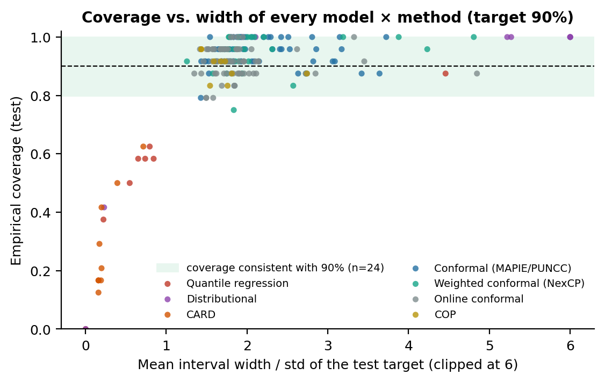
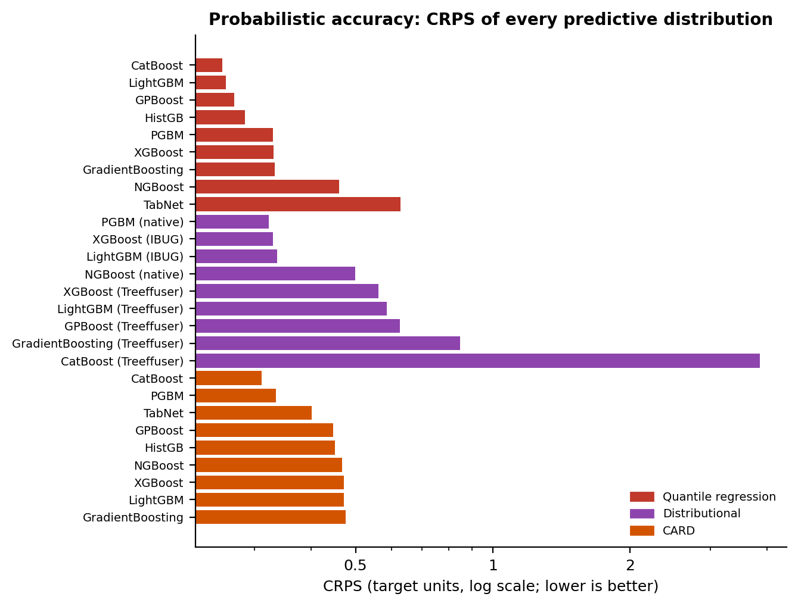

# Pile dataset: uncertainty quantification results

Results of the full v2.0 pipeline (8 notebooks) on the pile dataset. The full write-up with the methods, maths and all tables is the paper [`papers/pile/paper.pdf`](../../papers/pile/paper.pdf).

| | |
|---|---|
| Training set | `data/` – 81 rows |
| Test set | 24 rows |
| Features (7) | `F1`, `F2`, `Zv1`, `Zv2`, `phi`, `Th`, `L` |
| Target | `Total` (test mean 5.87, std 1.33) |
| Nominal level | 90% (α = 0.1); HCM reports 95% |

## Key findings

- Point accuracy: LightGBM has the lowest 5-fold CV RMSE (0.567); on the test set the lowest RMSE is RandomForest (0.439, target std 1.33).
- Raw quantile regression undercovers: median 90%-interval coverage 58.3% (range 0.0%–91.7%); 2 of 9 models reach the target. Quantile crossing occurs on a median 100.0% of test points.
- Best probabilistic score: CatBoost (Quantile regression) with CRPS 0.255.
- NGBoost (native) predictive distributions are over-confident here: the Gaussian 90% interval covers only 0.0%.
- PGBM (native) predictive distributions are over-confident here: the Gaussian 90% interval covers only 41.7%.
- CARD (diffusion) intervals: median coverage 20.8% at 0.19× the target std.
- Recommended interval method: **J+aB (MAPIE)** – the narrowest method that reaches the 90% target (within sampling tolerance, n=24) on ≥75% of models: median coverage 95.8%, median width 2.12 (1.6× target std).
- Narrowest single valid interval (coverage within tolerance of 90%): NexCP Full on PGBM, coverage 91.7%, mean width 1.67.
- Among valid intervals, median width / target std by family: COP 1.67; Online conformal 1.79; Weighted conformal (NexCP) 1.86; Conformal (MAPIE/PUNCC) 1.96; Quantile regression 3.11; Distributional 5.27.
- ACP learns its own coverage level (mean learned target 82.1%); realised coverage of its e-value sets is 100.0%–100.0% across models.
- HCM (single network, 95% interval): coverage 100.0%, RMSE 1.30, error–uncertainty Spearman correlation -0.00.

## Figures

Point accuracy and CRPS

## Interval methods at the 90% target

Aggregated over the base models each method wraps. *Valid* = share of models with coverage ≥ 0.799 (90% minus the one-sided 95% sampling tolerance for n = 24). Relative width = width / std of the test target. † = some intervals hit the edge of the label grid, so the width is a lower bound (not ranked).

| Family | Method | Models | Coverage (median) | Coverage range | Width (median) | Relative width | Valid |
|---|---|---:|---:|---:|---:|---:|---:|
| Quantile regression | Quantile regression (raw) | 9 | 58.3% | 0.0%–91.7% | 0.980 | 0.74 | 22% |
| Distributional | NGBoost (native) | 1 | 0.0% | 0.0%–0.0% | 0.004 | 0.00 | 0% |
| Distributional | PGBM (native) | 1 | 41.7% | 41.7%–41.7% | 0.306 | 0.23 | 0% |
| Distributional | IBUG | 2 | 100.0% | 100.0%–100.0% | 2.68 | 2.02 | 100% |
| Distributional | Treeffuser | 5 | 100.0% | 100.0%–100.0% | 8.13 | 6.13 | 100% |
| CARD | CARD | 9 | 20.8% | 12.5%–62.5% | 0.255 | 0.19 | 0% |
| Conformal (MAPIE/PUNCC) | J+aB (MAPIE) | 9 | 95.8% | 91.7%–95.8% | 2.12 | 1.60 | 100% |
| Conformal (MAPIE/PUNCC) | CV+ (PUNCC) | 9 | 100.0% | 95.8%–100.0% | 2.53 | 1.91 | 100% |
| Conformal (MAPIE/PUNCC) | CV+ (MAPIE) | 9 | 95.8% | 91.7%–100.0% | 2.55 | 1.93 | 100% |
| Conformal (MAPIE/PUNCC) | Split CP (MAPIE) | 9 | 91.7% | 79.2%–100.0% | 2.73 | 2.06 | 89% |
| Conformal (MAPIE/PUNCC) | CQR (PUNCC) | 9 | 100.0% | 87.5%–100.0% | 3.19 | 2.41 | 100% |
| Conformal (MAPIE/PUNCC) | Split CP (PUNCC) | 9 | 91.7% | 87.5%–95.8% | 3.74 | 2.82 | 100% |
| Weighted conformal (NexCP) | NexCP J+aB | 9 | 95.8% | 91.7%–100.0% | 2.35 | 1.77 | 100% |
| Weighted conformal (NexCP) | NexCP Split | 9 | 91.7% | 87.5%–95.8% | 2.38 | 1.80 | 100% |
| Weighted conformal (NexCP) | NexCP CV+ | 9 | 95.8% | 91.7%–100.0% | 2.61 | 1.97 | 100% |
| Weighted conformal (NexCP) | NexCP Full † | 9 | 91.7% | 75.0%–100.0% | 2.77 | 2.09 | 89% |
| Online conformal | ACI | 9 | 91.7% | 83.3%–95.8% | 2.23 | 1.68 | 100% |
| Online conformal | FACI | 9 | 91.7% | 83.3%–95.8% | 2.24 | 1.69 | 100% |
| Online conformal | Online J+aB | 9 | 95.8% | 91.7%–95.8% | 2.25 | 1.70 | 100% |
| Online conformal | MFCS Split | 9 | 91.7% | 79.2%–95.8% | 2.33 | 1.75 | 89% |
| Online conformal | Online Split | 9 | 91.7% | 79.2%–95.8% | 2.33 | 1.75 | 89% |
| Online conformal | SAOCP | 9 | 87.5% | 79.2%–91.7% | 2.42 | 1.83 | 89% |
| Online conformal | Online CV+ | 9 | 95.8% | 91.7%–100.0% | 2.43 | 1.83 | 100% |
| Online conformal | MFCS Full | 9 | 95.8% | 91.7%–100.0% | 2.43 | 1.83 | 100% |
| Online conformal | SF-OGD | 9 | 87.5% | 87.5%–91.7% | 2.59 | 1.95 | 100% |
| COP | COP | 9 | 91.7% | 83.3%–95.8% | 2.22 | 1.67 | 100% |

## Tuned models

| Model | CV RMSE | Test RMSE | Test r |
|---|---:|---:|---:|
| LightGBM | 0.567 | 0.761 | 0.901 |
| XGBoost | 0.567 | 0.715 | 0.921 |
| GPBoost | 0.582 | 0.674 | 0.908 |
| CatBoost | 0.604 | 0.506 | 0.938 |
| GradientBoosting | 0.609 | 0.682 | 0.925 |
| NGBoost | 0.611 | 0.712 | 0.923 |
| PGBM | 0.623 | 0.492 | 0.951 |
| HistGB | 0.636 | 0.692 | 0.915 |
| RandomForest | 0.643 | 0.439 | 0.955 |
| TabNet | 0.817 | 1.14 | 0.836 |

## Folder contents

| Folder | Notebook | Kaggle run(s) |
|---|---|---|
| [`hyperparameter_tuning/`](hyperparameter_tuning/) | NB1 Hyperparameter tuning (Optuna) | [REG22_11_2026_01_58](https://www.kaggle.com/code/daneshselwal/reg22-11-2026-01-58) |
| [`quantile_regression/`](quantile_regression/) | NB2 Quantile regression | [REG22_11_2026_13_18](https://www.kaggle.com/code/daneshjangra/reg22-11-2026-13-18) |
| [`probabilistic_distribution/`](probabilistic_distribution/) | NB3 Distributional (NGBoost, PGBM, IBUG, Treeffuser) | [REG22_11_2026_13_25](https://www.kaggle.com/code/daneshjangra/reg22-11-2026-13-25) |
| [`probabilistic_distribution_card/`](probabilistic_distribution_card/) | NB4 Distributional (CARD diffusion) | [REG22_11_2026_13_26](https://www.kaggle.com/code/daneshjangra/reg22-11-2026-13-26) |
| [`conformal_predictions_mapie_puncc/`](conformal_predictions_mapie_puncc/) | NB5 Conformal (MAPIE, PUNCC) | [REG22_11_2026_13_33](https://www.kaggle.com/code/daneshjangra/reg22-11-2026-13-33) |
| [`conformal_predictions_nexcp_adaptivecp_mfcs/`](conformal_predictions_nexcp_adaptivecp_mfcs/) | NB6 NexCP and online conformal | [REG22_11_2026_13_17](https://www.kaggle.com/code/daneshjangra/reg22-11-2026-13-17) |
| [`conformal_predictions_adaptive_coverage_policies/`](conformal_predictions_adaptive_coverage_policies/) | NB7 Adaptive coverage policies (ACP) | [REG22_11_2026_13_34](https://www.kaggle.com/code/daneshjangra/reg22-11-2026-13-34) |
| [`hyperspherical_confidence_mapping_hcm/`](hyperspherical_confidence_mapping_hcm/) | NB8 Hyperspherical confidence mapping (HCM) | [REG22_11_2026_14_03](https://www.kaggle.com/code/daneshjangra/reg22-11-2026-14-03) |

Each phase folder contains:

- the notebook: the current v2.0 code for this dataset (same code as `notebooks/`, with this dataset's paths, file names and feature names);
- `results/`: what the Kaggle run produced – `EXECUTED_*.ipynb` (the exact notebook that ran, with all cell outputs), the Excel files with every prediction, interval and metric, and a `README.md` naming the run.

`data/` holds the train and test CSV files. To reproduce, run the eight notebooks in order (see the main README); notebooks 2–7 read `hyperparameter_tuning/best_params.pkl` written by notebook 1.
