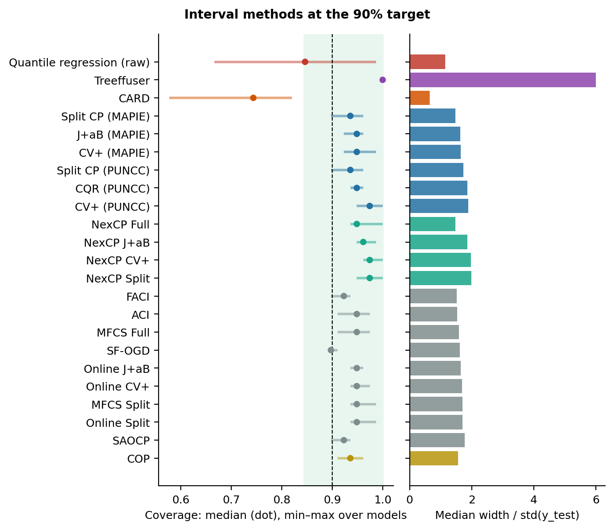
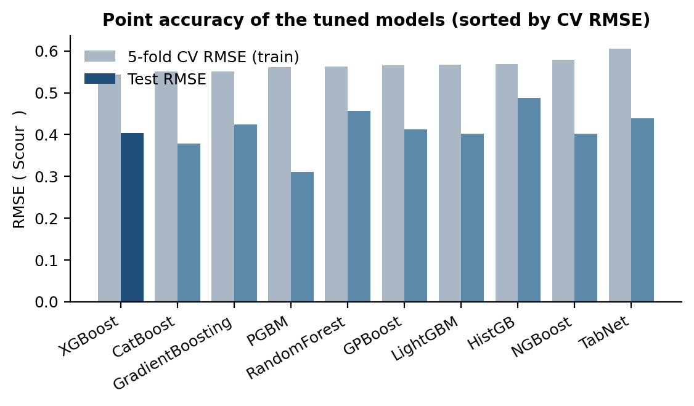

# Scour dataset: uncertainty quantification results

Results of the full v2.0 pipeline (8 notebooks) on the scour dataset. The full write-up with the methods, maths and all tables is the paper [`papers/scour/paper.pdf`](../../papers/scour/paper.pdf).

| | |
|---|---|
| Training set | `data/` – 154 rows |
| Test set | 78 rows |
| Features (7) | `Ps`, `Pw`, ` Skew  `, ` Velocity  `, ` Depth  `, ` D50  `, ` Gradation  ` |
| Target | ` Scour  ` (test mean 0.938, std 1.06) |
| Nominal level | 90% (α = 0.1); HCM reports 95% |

## Key findings

- Point accuracy: XGBoost has the lowest 5-fold CV RMSE (0.544); on the test set the lowest RMSE is PGBM (0.311, target std 1.06).
- Raw quantile regression undercovers: median 90%-interval coverage 84.6% (range 66.7%–98.7%); 5 of 9 models reach the target. Quantile crossing occurs on a median 97.4% of test points.
- Best probabilistic score: PGBM (CARD) with CRPS 0.186.
- NGBoost (native) predictive distributions are over-confident here: the Gaussian 90% interval covers only 65.4%.
- CARD (diffusion) intervals: median coverage 74.4% at 0.65× the target std.
- Recommended interval method: **Split CP (MAPIE)** – the narrowest method that reaches the 90% target (within sampling tolerance, n=78) on ≥75% of models: median coverage 93.6%, median width 1.56 (1.5× target std).
- Narrowest single valid interval (coverage within tolerance of 90%): Quantile regression (raw) on HistGB, coverage 85.9%, mean width 1.21.
- Among valid intervals, median width / target std by family: Quantile regression 1.18; COP 1.56; Online conformal 1.64; Conformal (MAPIE/PUNCC) 1.68; Weighted conformal (NexCP) 1.94; Distributional 4.61.
- ACP learns its own coverage level (mean learned target 87.1%); realised coverage of its e-value sets is 100.0%–100.0% across models.
- HCM (single network, 95% interval): coverage 91.0%, RMSE 1.04, error–uncertainty Spearman correlation -0.11.

## Figures

Point accuracy and CRPS

## Interval methods at the 90% target

Aggregated over the base models each method wraps. *Valid* = share of models with coverage ≥ 0.844 (90% minus the one-sided 95% sampling tolerance for n = 78). Relative width = width / std of the test target. † = some intervals hit the edge of the label grid, so the width is a lower bound (not ranked).

| Family | Method | Models | Coverage (median) | Coverage range | Width (median) | Relative width | Valid |
|---|---|---:|---:|---:|---:|---:|---:|
| Quantile regression | Quantile regression (raw) | 9 | 84.6% | 66.7%–98.7% | 1.21 | 1.14 | 56% |
| Distributional | NGBoost (native) | 1 | 65.4% | 65.4%–65.4% | 0.586 | 0.55 | 0% |
| Distributional | IBUG | 2 | 92.9% | 89.7%–96.2% | 1.81 | 1.71 | 100% |
| Distributional | PGBM (native) | 1 | 100.0% | 100.0%–100.0% | 1.98 | 1.87 | 100% |
| Distributional | Treeffuser | 5 | 100.0% | 100.0%–100.0% | 7.21 | 6.81 | 100% |
| CARD | CARD | 9 | 74.4% | 57.7%–82.1% | 0.687 | 0.65 | 0% |
| Conformal (MAPIE/PUNCC) | Split CP (MAPIE) | 9 | 93.6% | 89.7%–96.2% | 1.56 | 1.48 | 100% |
| Conformal (MAPIE/PUNCC) | J+aB (MAPIE) | 9 | 94.9% | 92.3%–96.2% | 1.72 | 1.63 | 100% |
| Conformal (MAPIE/PUNCC) | CV+ (MAPIE) | 9 | 94.9% | 92.3%–98.7% | 1.74 | 1.64 | 100% |
| Conformal (MAPIE/PUNCC) | Split CP (PUNCC) | 9 | 93.6% | 89.7%–96.2% | 1.84 | 1.74 | 100% |
| Conformal (MAPIE/PUNCC) | CQR (PUNCC) | 9 | 94.9% | 93.6%–96.2% | 1.97 | 1.86 | 100% |
| Conformal (MAPIE/PUNCC) | CV+ (PUNCC) | 9 | 97.4% | 94.9%–100.0% | 2.00 | 1.89 | 100% |
| Weighted conformal (NexCP) | NexCP Full † | 9 | 94.9% | 93.6%–100.0% | 1.56 | 1.47 | 100% |
| Weighted conformal (NexCP) | NexCP J+aB | 9 | 96.2% | 94.9%–98.7% | 1.98 | 1.87 | 100% |
| Weighted conformal (NexCP) | NexCP CV+ | 9 | 97.4% | 96.2%–100.0% | 2.10 | 1.98 | 100% |
| Weighted conformal (NexCP) | NexCP Split | 9 | 97.4% | 94.9%–100.0% | 2.11 | 1.99 | 100% |
| Online conformal | FACI | 9 | 92.3% | 89.7%–93.6% | 1.61 | 1.52 | 100% |
| Online conformal | ACI | 9 | 94.9% | 91.0%–97.4% | 1.62 | 1.53 | 100% |
| Online conformal | MFCS Full | 9 | 94.9% | 91.0%–97.4% | 1.68 | 1.58 | 100% |
| Online conformal | SF-OGD | 9 | 89.7% | 89.7%–91.0% | 1.71 | 1.62 | 100% |
| Online conformal | Online J+aB | 9 | 94.9% | 93.6%–96.2% | 1.74 | 1.64 | 100% |
| Online conformal | Online CV+ | 9 | 94.9% | 93.6%–97.4% | 1.79 | 1.69 | 100% |
| Online conformal | MFCS Split | 9 | 94.9% | 93.6%–98.7% | 1.80 | 1.70 | 100% |
| Online conformal | Online Split | 9 | 94.9% | 93.6%–98.7% | 1.80 | 1.70 | 100% |
| Online conformal | SAOCP | 9 | 92.3% | 89.7%–93.6% | 1.88 | 1.77 | 100% |
| COP | COP | 9 | 93.6% | 91.0%–96.2% | 1.65 | 1.56 | 100% |

## Tuned models

| Model | CV RMSE | Test RMSE | Test r |
|---|---:|---:|---:|
| XGBoost | 0.544 | 0.404 | 0.929 |
| CatBoost | 0.550 | 0.378 | 0.934 |
| GradientBoosting | 0.551 | 0.425 | 0.917 |
| PGBM | 0.561 | 0.311 | 0.956 |
| RandomForest | 0.563 | 0.457 | 0.903 |
| GPBoost | 0.566 | 0.413 | 0.924 |
| LightGBM | 0.568 | 0.401 | 0.927 |
| HistGB | 0.568 | 0.488 | 0.890 |
| NGBoost | 0.579 | 0.402 | 0.925 |
| TabNet | 0.606 | 0.438 | 0.937 |

## Folder contents

| Folder | Notebook | Kaggle run(s) |
|---|---|---|
| [`hyperparameter_tuning/`](hyperparameter_tuning/) | NB1 Hyperparameter tuning (Optuna) | [REG22_11_2026_14_35](https://www.kaggle.com/code/daneshjangra/reg22-11-2026-14-35) |
| [`quantile_regression/`](quantile_regression/) | NB2 Quantile regression | [REG22_11_2026_21_03](https://www.kaggle.com/code/daneshjangra/reg22-11-2026-21-03) |
| [`probabilistic_distribution/`](probabilistic_distribution/) | NB3 Distributional (NGBoost, PGBM, IBUG, Treeffuser) | [REG23_11_2026_01_48](https://www.kaggle.com/code/daneshjangra/reg23-11-2026-01-48) |
| [`probabilistic_distribution_card/`](probabilistic_distribution_card/) | NB4 Distributional (CARD diffusion) | [REG22_11_2026_21_11](https://www.kaggle.com/code/daneshjangra/reg22-11-2026-21-11) |
| [`conformal_predictions_mapie_puncc/`](conformal_predictions_mapie_puncc/) | NB5 Conformal (MAPIE, PUNCC) | [REG22_11_2026_21_20](https://www.kaggle.com/code/daneshjangra/reg22-11-2026-21-20) |
| [`conformal_predictions_nexcp_adaptivecp_mfcs/`](conformal_predictions_nexcp_adaptivecp_mfcs/) | NB6 NexCP and online conformal | [REG23_11_2026_06_40](https://www.kaggle.com/code/daneshselwal/reg23-11-2026-06-40), [REG23_11_2026_11_31](https://www.kaggle.com/code/daneshselwal/reg23-11-2026-11-31), [REG23_11_2026_12_35](https://www.kaggle.com/code/daneshselwal/reg23-11-2026-12-35), [REG23_11_2026_13_26](https://www.kaggle.com/code/daneshselwal/reg23-11-2026-13-26), [REG23_11_2026_06_14](https://www.kaggle.com/code/daneshselwal/reg23-11-2026-06-14), [REG23_11_2026_06_15](https://www.kaggle.com/code/daneshselwal/reg23-11-2026-06-15), [REG23_11_2026_14_19](https://www.kaggle.com/code/daneshselwal/reg23-11-2026-14-19), [REG23_11_2026_14_30](https://www.kaggle.com/code/daneshselwal/reg23-11-2026-14-30), [REG23_11_2026_14_41](https://www.kaggle.com/code/daneshselwal/reg23-11-2026-14-41) |
| [`conformal_predictions_adaptive_coverage_policies/`](conformal_predictions_adaptive_coverage_policies/) | NB7 Adaptive coverage policies (ACP) | [REG22_11_2026_21_45](https://www.kaggle.com/code/daneshjangra/reg22-11-2026-21-45) |
| [`hyperspherical_confidence_mapping_hcm/`](hyperspherical_confidence_mapping_hcm/) | NB8 Hyperspherical confidence mapping (HCM) | [REG22_11_2026_21_48](https://www.kaggle.com/code/daneshjangra/reg22-11-2026-21-48) |

Each phase folder contains:

- the notebook: the current v2.0 code for this dataset (same code as `notebooks/`, with this dataset's paths, file names and feature names);
- `results/`: what the Kaggle run produced – `EXECUTED_*.ipynb` (the exact notebook that ran, with all cell outputs), the Excel files with every prediction, interval and metric, and a `README.md` naming the run.

`data/` holds the train and test CSV files. To reproduce, run the eight notebooks in order (see the main README); notebooks 2–7 read `hyperparameter_tuning/best_params.pkl` written by notebook 1.
