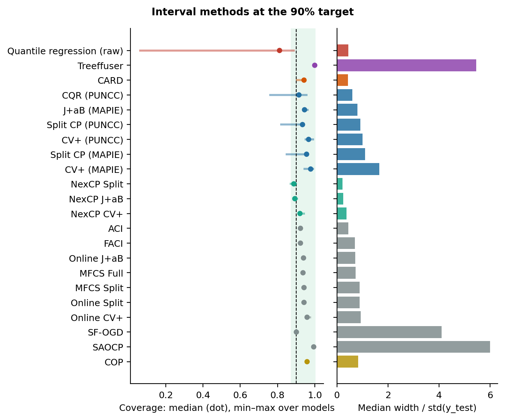
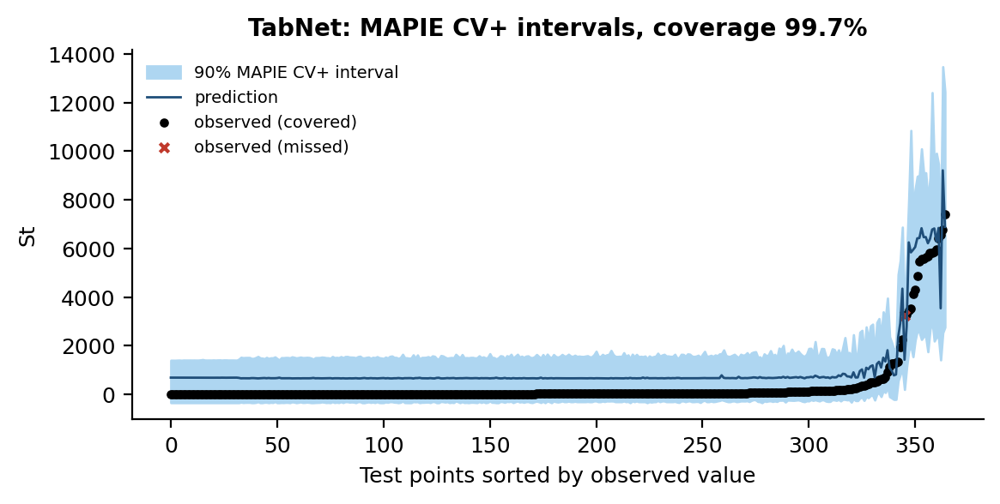

# Sediment load dataset: uncertainty quantification results

Results of the full v2.0 pipeline (8 notebooks) on the sediment load dataset. The full write-up with the methods, maths and all tables is the paper [`papers/sediment_load/paper.pdf`](../../papers/sediment_load/paper.pdf).

| | |
|---|---|
| Training set | `data/` – 1095 rows |
| Test set | 365 rows |
| Features (3) | `Qt`, `Qt-1`, `St-1` |
| Target | `St` (test mean 369.0, std 1,235) |
| Nominal level | 90% (α = 0.1); HCM reports 95% |

## Key findings

- Point accuracy: TabNet has the lowest 5-fold CV RMSE (1,925); on the test set the lowest RMSE is GradientBoosting (328.6, target std 1,235).
- Raw quantile regression undercovers: median 90%-interval coverage 81.1% (range 5.8%–89.3%); 1 of 9 models reach the target. Quantile crossing occurs on a median 89.9% of test points.
- Best probabilistic score: GPBoost (CARD) with CRPS 64.54.
- NGBoost (native) predictive distributions are over-confident here: the Gaussian 90% interval covers only 85.8%.
- PGBM (native) predictive distributions are over-confident here: the Gaussian 90% interval covers only 6.6%.
- CARD (diffusion) intervals: median coverage 94.2% at 0.43× the target std.
- Recommended interval method: **NexCP J+aB** – the narrowest method that reaches the 90% target (within sampling tolerance, n=365) on ≥75% of models: median coverage 89.3%, median width 298.8 (0.24× target std).
- Narrowest single valid interval (coverage within tolerance of 90%): NexCP Split on GradientBoosting, coverage 89.0%, mean width 162.8.
- Among valid intervals, median width / target std by family: Weighted conformal (NexCP) 0.24; CARD 0.43; Quantile regression 0.48; Online conformal 0.81; COP 0.83; Conformal (MAPIE/PUNCC) 0.99; Distributional 4.58.
- ACP policy saturated at the boundary α̃ = 0.999 for 9 of 9 models (CatBoost, GPBoost, GradientBoosting, HistGB, LightGBM, NGBoost, PGBM, TabNet, XGBoost): the sets have constant width and the learned level carries no information; realised coverage 90.4%–93.7%.
- HCM (single network, 95% interval): coverage 100.0%, RMSE 911.4, error–uncertainty Spearman correlation -0.57.
- Not run (out of compute, Kaggle 12-hour limit): NB6 for TabNet, PGBM.
- NexCP Full conformal was not run on this dataset (out of compute).

## Figures

Point accuracy and CRPS

## Interval methods at the 90% target

Aggregated over the base models each method wraps. *Valid* = share of models with coverage ≥ 0.874 (90% minus the one-sided 95% sampling tolerance for n = 365). Relative width = width / std of the test target. † = some intervals hit the edge of the label grid, so the width is a lower bound (not ranked).

| Family | Method | Models | Coverage (median) | Coverage range | Width (median) | Relative width | Valid |
|---|---|---:|---:|---:|---:|---:|---:|
| Quantile regression | Quantile regression (raw) | 9 | 81.1% | 5.8%–89.3% | 559.6 | 0.45 | 11% |
| Distributional | PGBM (native) | 1 | 6.6% | 6.6%–6.6% | 8.65 | 0.01 | 0% |
| Distributional | NGBoost (native) | 1 | 85.8% | 85.8%–85.8% | 297.1 | 0.24 | 0% |
| Distributional | IBUG | 2 | 98.5% | 98.4%–98.6% | 2,163 | 1.75 | 100% |
| Distributional | Treeffuser | 5 | 100.0% | 99.7%–100.0% | 6,735 | 5.45 | 100% |
| CARD | CARD | 9 | 94.2% | 89.9%–95.6% | 536.6 | 0.43 | 100% |
| Conformal (MAPIE/PUNCC) | CQR (PUNCC) | 9 | 91.5% | 75.6%–96.2% | 748.1 | 0.61 | 78% |
| Conformal (MAPIE/PUNCC) | J+aB (MAPIE) | 9 | 94.5% | 93.2%–96.7% | 988.0 | 0.80 | 100% |
| Conformal (MAPIE/PUNCC) | Split CP (PUNCC) | 9 | 93.4% | 81.4%–93.7% | 1,127 | 0.91 | 89% |
| Conformal (MAPIE/PUNCC) | CV+ (PUNCC) | 9 | 96.7% | 94.5%–99.7% | 1,242 | 1.01 | 100% |
| Conformal (MAPIE/PUNCC) | Split CP (MAPIE) | 9 | 95.6% | 84.4%–97.0% | 1,364 | 1.10 | 89% |
| Conformal (MAPIE/PUNCC) | CV+ (MAPIE) | 9 | 97.8% | 94.0%–99.7% | 2,046 | 1.66 | 100% |
| Weighted conformal (NexCP) | NexCP Split | 7 | 88.8% | 86.6%–90.4% | 270.6 | 0.22 | 71% |
| Weighted conformal (NexCP) | NexCP J+aB | 7 | 89.3% | 87.9%–91.0% | 298.8 | 0.24 | 100% |
| Weighted conformal (NexCP) | NexCP CV+ | 7 | 92.1% | 91.2%–94.8% | 467.1 | 0.38 | 100% |
| Online conformal | ACI | 7 | 92.3% | 92.1%–93.4% | 551.6 | 0.45 | 100% |
| Online conformal | FACI | 7 | 92.3% | 91.0%–92.6% | 871.5 | 0.71 | 100% |
| Online conformal | Online J+aB | 7 | 94.0% | 93.7%–95.3% | 885.5 | 0.72 | 100% |
| Online conformal | MFCS Full | 7 | 93.7% | 92.9%–94.2% | 903.3 | 0.73 | 100% |
| Online conformal | MFCS Split | 7 | 94.2% | 92.9%–95.6% | 1,104 | 0.89 | 100% |
| Online conformal | Online Split | 7 | 94.2% | 92.9%–95.6% | 1,104 | 0.89 | 100% |
| Online conformal | Online CV+ | 7 | 95.9% | 94.8%–98.1% | 1,153 | 0.93 | 100% |
| Online conformal | SF-OGD | 7 | 90.1% | 89.9%–90.1% | 5,064 | 4.10 | 100% |
| Online conformal | SAOCP | 7 | 99.5% | 99.5%–100.0% | 10,539 | 8.53 | 100% |
| COP | COP | 7 | 95.9% | 94.8%–96.7% | 1,029 | 0.83 | 100% |

## Tuned models

| Model | CV RMSE | Test RMSE | Test r |
|---|---:|---:|---:|
| TabNet | 1,925 | 728.5 | 0.962 |
| GradientBoosting | 2,364 | 328.6 | 0.965 |
| RandomForest | 2,476 | 543.8 | 0.956 |
| GPBoost | 2,586 | 338.2 | 0.965 |
| LightGBM | 2,596 | 454.0 | 0.963 |
| PGBM | 2,620 | 440.9 | 0.938 |
| HistGB | 2,631 | 420.2 | 0.965 |
| NGBoost | 2,640 | 673.3 | 0.932 |
| XGBoost | 2,723 | 696.3 | 0.958 |
| CatBoost | 2,762 | 482.7 | 0.925 |

## Folder contents

| Folder | Notebook | Kaggle run(s) |
|---|---|---|
| [`hyperparameter_tuning/`](hyperparameter_tuning/) | NB1 Hyperparameter tuning (Optuna) | [REG22_11_2026_17_58](https://www.kaggle.com/code/daneshselwal/reg22-11-2026-17-58) |
| [`quantile_regression/`](quantile_regression/) | NB2 Quantile regression | [REG23_11_2026_01_24](https://www.kaggle.com/code/daneshjangra/reg23-11-2026-01-24) |
| [`probabilistic_distribution/`](probabilistic_distribution/) | NB3 Distributional (NGBoost, PGBM, IBUG, Treeffuser) | [REG23_11_2026_01_25](https://www.kaggle.com/code/daneshjangra/reg23-11-2026-01-25) |
| [`probabilistic_distribution_card/`](probabilistic_distribution_card/) | NB4 Distributional (CARD diffusion) | [REG23_11_2026_01_34](https://www.kaggle.com/code/daneshjangra/reg23-11-2026-01-34) |
| [`conformal_predictions_mapie_puncc/`](conformal_predictions_mapie_puncc/) | NB5 Conformal (MAPIE, PUNCC) | [REG23_11_2026_01_37](https://www.kaggle.com/code/daneshjangra/reg23-11-2026-01-37) |
| [`conformal_predictions_nexcp_adaptivecp_mfcs/`](conformal_predictions_nexcp_adaptivecp_mfcs/) | NB6 NexCP and online conformal | [REG23_11_2026_13_40](https://www.kaggle.com/code/daneshjangra/reg23-11-2026-13-40), [REG23_11_2026_14_42](https://www.kaggle.com/code/daneshselwal/reg23-11-2026-14-42), [REG23_11_2026_14_49](https://www.kaggle.com/code/daneshselwal/reg23-11-2026-14-49), [REG23_11_2026_14_54](https://www.kaggle.com/code/daneshselwal/reg23-11-2026-14-54), [REG23_11_2026_15_01](https://www.kaggle.com/code/daneshselwal/reg23-11-2026-15-01), [REG23_11_2026_15_04](https://www.kaggle.com/code/daneshselwal/reg23-11-2026-15-04), [REG23_11_2026_15_09](https://www.kaggle.com/code/daneshselwal/reg23-11-2026-15-09) |
| [`conformal_predictions_adaptive_coverage_policies/`](conformal_predictions_adaptive_coverage_policies/) | NB7 Adaptive coverage policies (ACP) | [REG23_11_2026_01_38](https://www.kaggle.com/code/daneshjangra/reg23-11-2026-01-38) |
| [`hyperspherical_confidence_mapping_hcm/`](hyperspherical_confidence_mapping_hcm/) | NB8 Hyperspherical confidence mapping (HCM) | [REG23_11_2026_01_45](https://www.kaggle.com/code/daneshjangra/reg23-11-2026-01-45) |

Each phase folder contains:

- the notebook: the current v2.0 code for this dataset (same code as `notebooks/`, with this dataset's paths, file names and feature names);
- `results/`: what the Kaggle run produced – `EXECUTED_*.ipynb` (the exact notebook that ran, with all cell outputs), the Excel files with every prediction, interval and metric, and a `README.md` naming the run.

`data/` holds the train and test CSV files. To reproduce, run the eight notebooks in order (see the main README); notebooks 2–7 read `hyperparameter_tuning/best_params.pkl` written by notebook 1.

## Not run (not enough compute)

- NB6 for TabNet, PGBM: the jobs exceed Kaggle's 12-hour limit.
- NexCP Full conformal (switch `RUN_NEXCP_FULL = False`, FIX B16): same reason.
