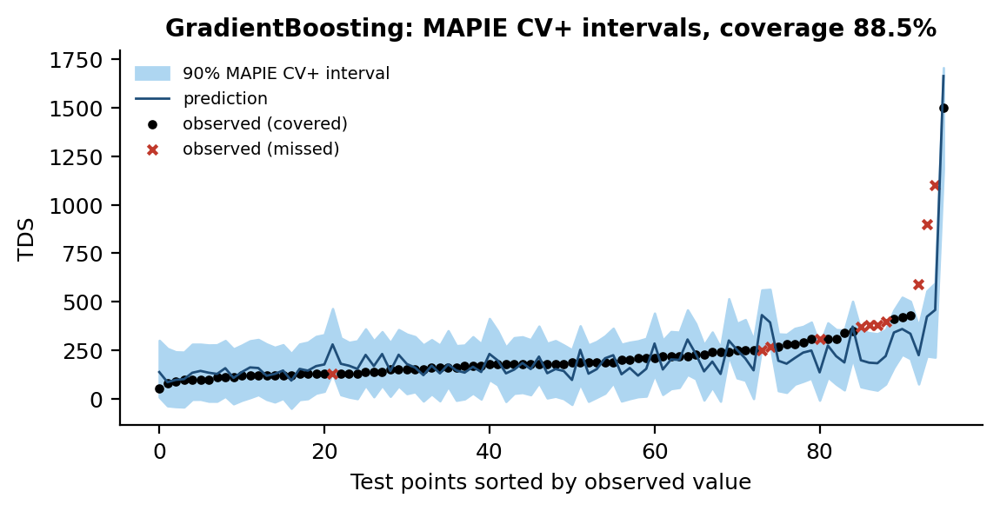
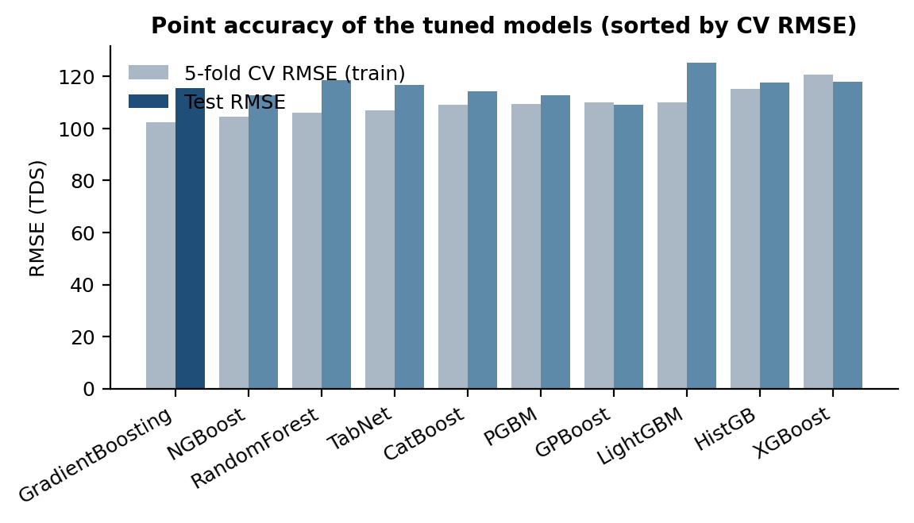

# Streamflow dataset: uncertainty quantification results

Results of the full v2.0 pipeline (8 notebooks) on the streamflow dataset. The full write-up with the methods, maths and all tables is the paper [`papers/streamflow/paper.pdf`](../../papers/streamflow/paper.pdf).

| | |
|---|---|
| Training set | `data/` – 192 rows |
| Test set | 96 rows |
| Features (4) | `pH`, `Salinity`, `Turbidity `, `Water Temperature` |
| Target | `TDS` (test mean 233.1, std 197.1) |
| Nominal level | 90% (α = 0.1); HCM reports 95% |

## Key findings

- Point accuracy: GradientBoosting has the lowest 5-fold CV RMSE (102.4); on the test set the lowest RMSE is GPBoost (109.2, target std 197.1).
- Raw quantile regression undercovers: median 90%-interval coverage 86.5% (range 13.5%–94.8%); 5 of 9 models reach the target. Quantile crossing occurs on a median 57.3% of test points.
- Best probabilistic score: CatBoost (Quantile regression) with CRPS 48.76.
- PGBM (native) predictive distributions are over-confident here: the Gaussian 90% interval covers only 16.7%.
- CARD (diffusion) intervals: median coverage 78.1% at 0.99× the target std.
- Recommended interval method: **J+aB (MAPIE)** – the narrowest method that reaches the 90% target (within sampling tolerance, n=96) on ≥75% of models: median coverage 88.5%, median width 260.4 (1.3× target std).
- Narrowest single valid interval (coverage within tolerance of 90%): Quantile regression (raw) on TabNet, coverage 86.5%, mean width 218.4.
- Among valid intervals, median width / target std by family: CARD 1.19; Quantile regression 1.52; Online conformal 1.57; COP 1.60; Conformal (MAPIE/PUNCC) 1.62; Weighted conformal (NexCP) 1.72; Distributional 6.56.
- ACP policy saturated at the boundary α̃ = 0.999 for 9 of 9 models (CatBoost, GPBoost, GradientBoosting, HistGB, LightGBM, NGBoost, PGBM, TabNet, XGBoost): the sets have constant width and the learned level carries no information; realised coverage 59.4%–66.7%.
- HCM (single network, 95% interval): coverage 95.8%, RMSE 192.4, error–uncertainty Spearman correlation -0.15.

## Figures

Point accuracy and CRPS

## Interval methods at the 90% target

Aggregated over the base models each method wraps. *Valid* = share of models with coverage ≥ 0.850 (90% minus the one-sided 95% sampling tolerance for n = 96). Relative width = width / std of the test target. † = some intervals hit the edge of the label grid, so the width is a lower bound (not ranked).

| Family | Method | Models | Coverage (median) | Coverage range | Width (median) | Relative width | Valid |
|---|---|---:|---:|---:|---:|---:|---:|
| Quantile regression | Quantile regression (raw) | 9 | 86.5% | 13.5%–94.8% | 243.5 | 1.24 | 56% |
| Distributional | PGBM (native) | 1 | 16.7% | 16.7%–16.7% | 25.51 | 0.13 | 0% |
| Distributional | NGBoost (native) | 1 | 89.6% | 89.6%–89.6% | 251.8 | 1.28 | 100% |
| Distributional | IBUG | 2 | 90.6% | 89.6%–91.7% | 374.0 | 1.90 | 100% |
| Distributional | Treeffuser | 5 | 100.0% | 99.0%–100.0% | 2,872 | 14.57 | 100% |
| CARD | CARD | 9 | 78.1% | 52.1%–86.5% | 194.4 | 0.99 | 22% |
| Conformal (MAPIE/PUNCC) | J+aB (MAPIE) | 9 | 88.5% | 87.5%–89.6% | 260.4 | 1.32 | 100% |
| Conformal (MAPIE/PUNCC) | CV+ (MAPIE) | 9 | 89.6% | 86.5%–95.8% | 291.4 | 1.48 | 100% |
| Conformal (MAPIE/PUNCC) | CV+ (PUNCC) | 9 | 91.7% | 88.5%–96.9% | 302.1 | 1.53 | 100% |
| Conformal (MAPIE/PUNCC) | CQR (PUNCC) | 9 | 91.7% | 87.5%–96.9% | 322.6 | 1.64 | 100% |
| Conformal (MAPIE/PUNCC) | Split CP (PUNCC) | 9 | 94.8% | 91.7%–96.9% | 389.8 | 1.98 | 100% |
| Conformal (MAPIE/PUNCC) | Split CP (MAPIE) | 9 | 96.9% | 89.6%–96.9% | 483.5 | 2.45 | 100% |
| Weighted conformal (NexCP) | NexCP Full † | 9 | 87.5% | 83.3%–96.9% | 269.2 | 1.37 | 89% |
| Weighted conformal (NexCP) | NexCP J+aB | 9 | 92.7% | 91.7%–95.8% | 317.5 | 1.61 | 100% |
| Weighted conformal (NexCP) | NexCP CV+ | 9 | 94.8% | 91.7%–97.9% | 371.0 | 1.88 | 100% |
| Weighted conformal (NexCP) | NexCP Split | 9 | 94.8% | 86.5%–96.9% | 373.3 | 1.89 | 100% |
| Online conformal | Online J+aB | 9 | 89.6% | 87.5%–91.7% | 274.6 | 1.39 | 100% |
| Online conformal | MFCS Split | 9 | 89.6% | 85.4%–96.9% | 288.6 | 1.46 | 100% |
| Online conformal | Online Split | 9 | 89.6% | 85.4%–96.9% | 288.6 | 1.46 | 100% |
| Online conformal | MFCS Full | 9 | 89.6% | 88.5%–92.7% | 290.5 | 1.47 | 100% |
| Online conformal | ACI | 9 | 89.6% | 87.5%–90.6% | 309.9 | 1.57 | 100% |
| Online conformal | FACI | 9 | 89.6% | 86.5%–90.6% | 317.4 | 1.61 | 100% |
| Online conformal | Online CV+ | 9 | 91.7% | 90.6%–97.9% | 318.6 | 1.62 | 100% |
| Online conformal | SF-OGD | 9 | 89.6% | 89.6%–90.6% | 342.4 | 1.74 | 100% |
| Online conformal | SAOCP | 9 | 90.6% | 90.6%–92.7% | 390.3 | 1.98 | 100% |
| COP | COP | 9 | 89.6% | 88.5%–89.6% | 315.2 | 1.60 | 100% |

## Tuned models

| Model | CV RMSE | Test RMSE | Test r |
|---|---:|---:|---:|
| GradientBoosting | 102.4 | 115.4 | 0.820 |
| NGBoost | 104.6 | 112.9 | 0.819 |
| RandomForest | 105.9 | 118.6 | 0.799 |
| TabNet | 106.9 | 116.8 | 0.867 |
| CatBoost | 109.1 | 114.2 | 0.815 |
| PGBM | 109.5 | 112.9 | 0.823 |
| GPBoost | 110.0 | 109.2 | 0.833 |
| LightGBM | 110.1 | 125.3 | 0.781 |
| HistGB | 115.2 | 117.8 | 0.802 |
| XGBoost | 120.7 | 118.0 | 0.802 |

## Folder contents

| Folder | Notebook | Kaggle run(s) |
|---|---|---|
| [`hyperparameter_tuning/`](hyperparameter_tuning/) | NB1 Hyperparameter tuning (Optuna) | [REG22_11_2026_15_16](https://www.kaggle.com/code/daneshjangra/reg22-11-2026-15-16) |
| [`quantile_regression/`](quantile_regression/) | NB2 Quantile regression | [REG23_11_2026_01_13](https://www.kaggle.com/code/daneshjangra/reg23-11-2026-01-13) |
| [`probabilistic_distribution/`](probabilistic_distribution/) | NB3 Distributional (NGBoost, PGBM, IBUG, Treeffuser) | [REG23_11_2026_01_14](https://www.kaggle.com/code/daneshjangra/reg23-11-2026-01-14) |
| [`probabilistic_distribution_card/`](probabilistic_distribution_card/) | NB4 Distributional (CARD diffusion) | [REG23_11_2026_01_15](https://www.kaggle.com/code/daneshjangra/reg23-11-2026-01-15) |
| [`conformal_predictions_mapie_puncc/`](conformal_predictions_mapie_puncc/) | NB5 Conformal (MAPIE, PUNCC) | [REG23_11_2026_01_16](https://www.kaggle.com/code/daneshjangra/reg23-11-2026-01-16) |
| [`conformal_predictions_nexcp_adaptivecp_mfcs/`](conformal_predictions_nexcp_adaptivecp_mfcs/) | NB6 NexCP and online conformal | [REG23_11_2026_06_59](https://www.kaggle.com/code/daneshselwal/reg23-11-2026-06-59), [REG23_11_2026_11_40](https://www.kaggle.com/code/daneshselwal/reg23-11-2026-11-40), [REG23_11_2026_13_10](https://www.kaggle.com/code/daneshselwal/reg23-11-2026-13-10), [REG23_11_2026_13_35](https://www.kaggle.com/code/daneshselwal/reg23-11-2026-13-35), [REG23_11_2026_14_01](https://www.kaggle.com/code/daneshselwal/reg23-11-2026-14-01), [REG23_11_2026_14_11](https://www.kaggle.com/code/daneshselwal/reg23-11-2026-14-11), [REG23_11_2026_14_22](https://www.kaggle.com/code/daneshselwal/reg23-11-2026-14-22), [REG23_11_2026_14_33](https://www.kaggle.com/code/daneshselwal/reg23-11-2026-14-33), [REG23_11_2026_06_25](https://www.kaggle.com/code/daneshselwal/reg23-11-2026-06-25) |
| [`conformal_predictions_adaptive_coverage_policies/`](conformal_predictions_adaptive_coverage_policies/) | NB7 Adaptive coverage policies (ACP) | [REG23_11_2026_01_17](https://www.kaggle.com/code/daneshjangra/reg23-11-2026-01-17) |
| [`hyperspherical_confidence_mapping_hcm/`](hyperspherical_confidence_mapping_hcm/) | NB8 Hyperspherical confidence mapping (HCM) | [REG23_11_2026_01_23](https://www.kaggle.com/code/daneshjangra/reg23-11-2026-01-23) |

Each phase folder contains:

- the notebook: the current v2.0 code for this dataset (same code as `notebooks/`, with this dataset's paths, file names and feature names);
- `results/`: what the Kaggle run produced – `EXECUTED_*.ipynb` (the exact notebook that ran, with all cell outputs), the Excel files with every prediction, interval and metric, and a `README.md` naming the run.

`data/` holds the train and test CSV files. To reproduce, run the eight notebooks in order (see the main README); notebooks 2–7 read `hyperparameter_tuning/best_params.pkl` written by notebook 1.
