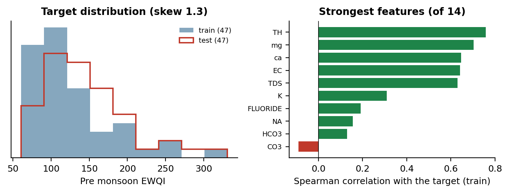
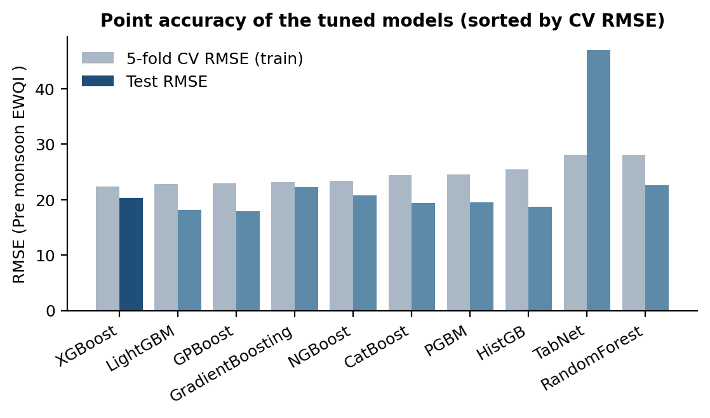
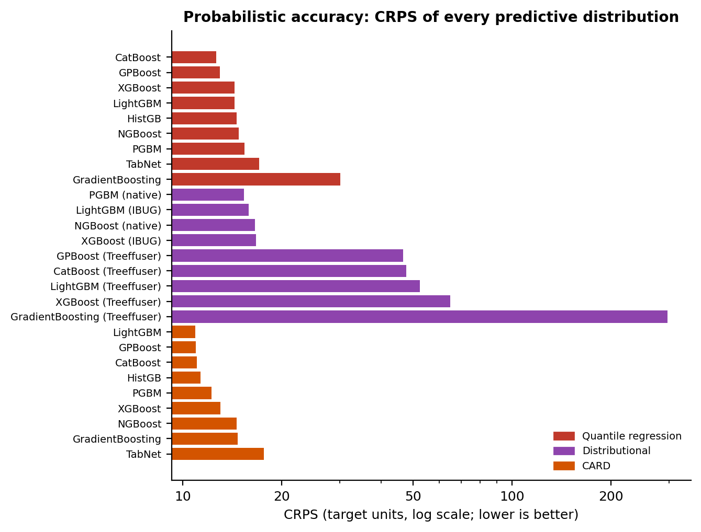
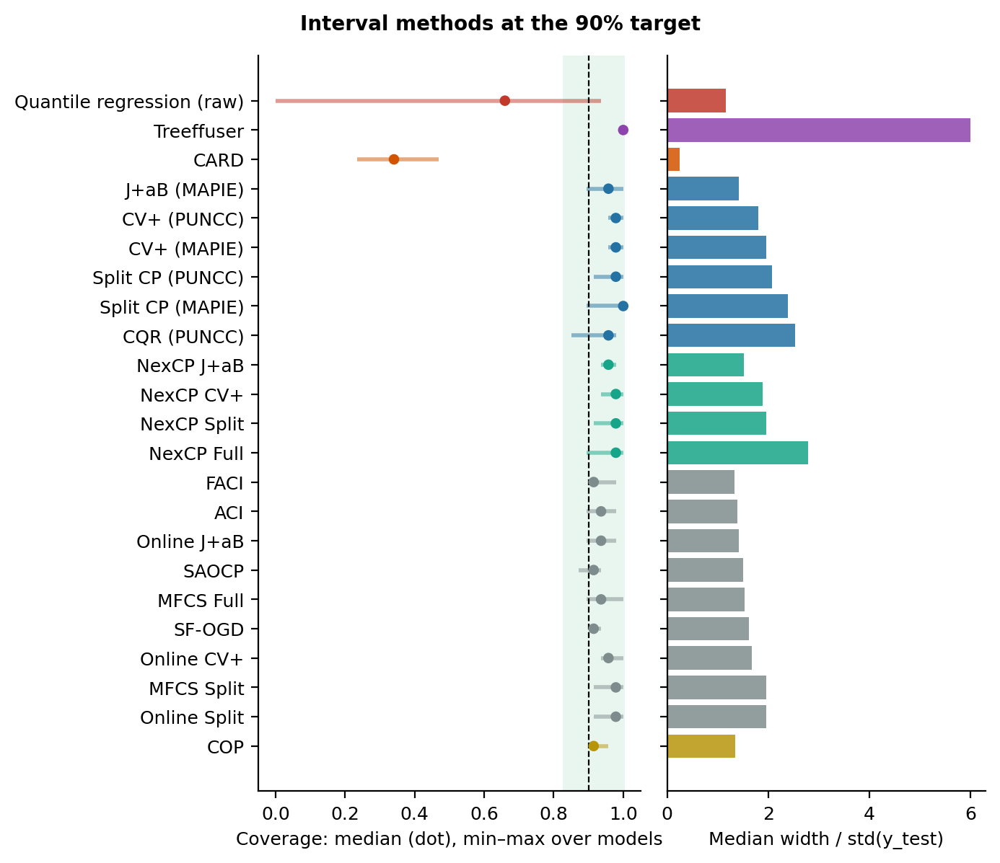
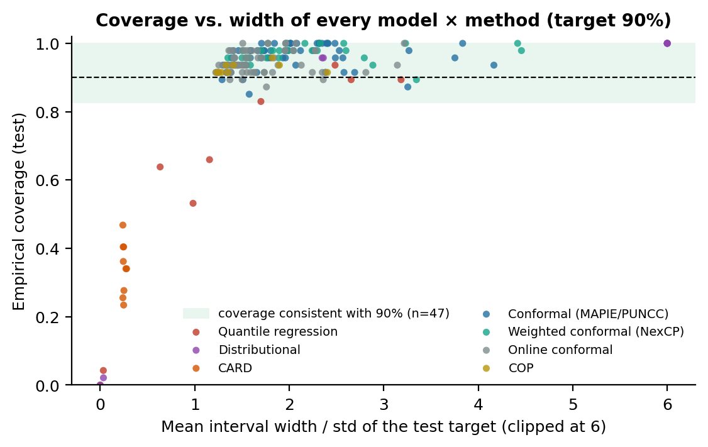

# Water quality (EWQI): how far can the predictions be trusted?

[← main README](../../README.md) · [all datasets](../../README.md#3-results-on-all-nine-datasets) · [report (PDF)](report/paper.pdf) · [method guides](../../notebooks/)

| | |
|---|---|
| **Data** | 47 training / 47 test rows, 14 features, target `Pre monsoon EWQI ` |
| **Key result** | Conformal intervals are valid in **180 of 180** model × method cases; the sharpest valid method is **FACI** (91.5% coverage, 1.33 × std(y) wide) |
| **Watch out** | Raw quantile regression covers only 66.0% (median); native Gaussian intervals: NGBoost 0.0%, PGBM 2.1% |
| **Best point model** | XGBoost (5-fold CV RMSE 22.43) |
| **Full report** | [`report/paper.pdf`](report/paper.pdf): methods with maths, all tables, appendix |

## Contents

1. [The data](#1-the-data)
2. [What was run](#2-what-was-run)
3. [Results, question by question](#3-results-question-by-question)
4. [All interval methods](#4-all-interval-methods)
5. [Folder map and Kaggle runs](#5-folder-map-and-kaggle-runs)

---

## 1. The data

<p align="center"></p>

*__Figure 1.__ Left: the target on the training and test sets. Right: the features most correlated with it (Spearman, training set).*

| Statistic | Train | Test |
|---|--:|--:|
| Rows | 47.00 | 47.00 |
| Mean | 128.6 | 145.8 |
| Std | 57.21 | 57.44 |
| Min | 61.68 | 61.01 |
| Median | 113.1 | 132.3 |
| Max | 322.8 | 330.8 |

**Features:** `pH`, `TDS`, `EC`, `TH`, `ca`, `mg`, `CO3`, `HCO3`, `NA`, `K`, `CHLORIDE`, `SULPHATE`, `NITRATE`, `FLUORIDE`.

**Reading Figure 1.** The target's skewness is 1.34 (a long right tail: a few large values are the hardest to predict and to cover). The test mean differs from the training mean by +0.30 training standard deviations and the test spread is 1.00× the training spread — the two sets are not identically distributed, which strains methods that assume exchangeability. With 3 training rows per feature, the problem is data-poor.

---

## 2. What was run

The same eight notebooks as every other dataset ([pipeline](../../README.md#1-overview-and-pipeline)); every phase folder has its own README with this dataset's numbers.

| Phase | What it computes | Results | Kaggle run(s) |
|---|---|---|---|
| [NB1](hyperparameter_tuning/README.md) | Hyperparameter tuning (Optuna) | [`hyperparameter_tuning/results/`](hyperparameter_tuning/results/) | [REG22_11_2026_14_57](https://www.kaggle.com/code/daneshselwal/reg22-11-2026-14-57) |
| [NB2](quantile_regression/README.md) | Quantile regression | [`quantile_regression/results/`](quantile_regression/results/) | [REG22_11_2026_21_12](https://www.kaggle.com/code/daneshselwal/reg22-11-2026-21-12) |
| [NB3](probabilistic_distribution/README.md) | Distributional (NGBoost, PGBM, IBUG, Treeffuser) | [`probabilistic_distribution/results/`](probabilistic_distribution/results/) | [REG22_11_2026_21_19](https://www.kaggle.com/code/daneshselwal/reg22-11-2026-21-19) |
| [NB4](probabilistic_distribution_card/README.md) | Distributional (CARD diffusion) | [`probabilistic_distribution_card/results/`](probabilistic_distribution_card/results/) | [REG23_11_2026_01_20](https://www.kaggle.com/code/daneshselwal/reg23-11-2026-01-20) |
| [NB5](conformal_predictions_mapie_puncc/README.md) | Conformal (MAPIE, PUNCC) | [`conformal_predictions_mapie_puncc/results/`](conformal_predictions_mapie_puncc/results/) | [REG23_11_2026_01_54](https://www.kaggle.com/code/daneshselwal/reg23-11-2026-01-54) |
| [NB6](conformal_predictions_nexcp_adaptivecp_mfcs/README.md) | NexCP and online conformal | [`conformal_predictions_nexcp_adaptivecp_mfcs/results/`](conformal_predictions_nexcp_adaptivecp_mfcs/results/) | [REG23_11_2026_01_18](https://www.kaggle.com/code/daneshselwal/reg23-11-2026-01-18) |
| [NB7](conformal_predictions_adaptive_coverage_policies/README.md) | Adaptive coverage policies (ACP) | [`conformal_predictions_adaptive_coverage_policies/results/`](conformal_predictions_adaptive_coverage_policies/results/) | [REG22_11_2026_21_42](https://www.kaggle.com/code/daneshselwal/reg22-11-2026-21-42) |
| [NB8](hyperspherical_confidence_mapping_hcm/README.md) | Hyperspherical confidence mapping (HCM) | [`hyperspherical_confidence_mapping_hcm/results/`](hyperspherical_confidence_mapping_hcm/results/) | [REG24_11_2026_15_25](https://www.kaggle.com/code/daneshselwal/reg24-11-2026-15-25), [REG22_11_2026_21_43](https://www.kaggle.com/code/daneshselwal/reg22-11-2026-21-43) |

---

## 3. Results, question by question

Every interval targets **90%**. With 47 test points a correct method can land anywhere above **0.828** by chance, so that is the validity threshold ([why](../../README.md#52-validity-of-a-coverage-value)). Relative width = interval width / std of the test target.

### RQ1 · How accurate are the tuned point predictors?

<p align="center"></p>

**How to read it.** Grey bars: 5-fold CV RMSE on the training set (used to choose the model). Blue bars: RMSE on the untouched test set; dark blue = best CV model.

**What it shows.**

- **XGBoost** has the lowest 5-fold CV RMSE (22.43); on the test set the lowest RMSE is **GPBoost** (17.95).
- The target's test standard deviation is 57.44, so the best test RMSE explains about 90% of the variance (1 − RMSE²/var); the median model explains 88%.
- CV and test rankings agree only roughly: with 47 test points the test RMSE of one model has a sampling error of several percent.
- TabNet, the only neural base model, is among the least accurate, as is common for small tabular data.

> **Takeaway RQ1.** The tree ensembles are close to each other in accuracy, so the choice of UQ method matters more for the quality of the intervals than the choice among the boosted models.

### RQ2 · Does raw quantile regression give a valid 90% interval?

**How to read it.** Quantile regression fits one model per level; its 90% interval is the 5% and 95% models' predictions. No calibration step is involved.

**What it shows.**

- The raw 90% interval [q̂₀.₀₅, q̂₀.₉₅] has a median coverage of **66.0%** over 9 models (range 0.0%–93.6%); 4 of 9 are valid (≥ 0.828).
- Quantiles cross on a median **100.0%** of test points before sorting: the 13 separately fitted models disagree on the order of their own quantiles.
- Its median width is 1.16 × std(y), narrower than most conformal intervals; the narrowness is what makes it undercover.
- Best quantile CRPS: CatBoost (12.64).

> **Takeaway RQ2.** Raw quantile regression is not a reliable 90% interval here; it needs conformal calibration (CQR) or replacement by a conformal method.

### RQ3 · How good are the predictive distributions?

<p align="center"></p>

**How to read it.** CRPS (log scale, lower is better) scores a whole predictive distribution: it rewards a sharp distribution centred on the truth. Coverage, in the text, checks only the 90% interval.

**What it shows.**

- NGBoost (native Gaussian): coverage **0.0%**, width 0.00 × std(y), PIT diagnosis: under-dispersed (over-confident).
- PGBM (native Gaussian): coverage **2.1%**, width 0.03 × std(y), PIT diagnosis: under-dispersed (over-confident).
- IBUG on XGBoost: coverage 95.7%, width 2.36 × std(y).
- IBUG on LightGBM: coverage 95.7%, width 2.35 × std(y).
- Treeffuser (median of 5 models): coverage 100.0%, width 11.78 × std(y).
- CARD (median of 9 guides): coverage 34.0%, width 0.25 × std(y).
- Lowest CRPS of all predictive distributions: **LightGBM (CARD)**, 10.91 (target units).

> **Takeaway RQ3.** The native NGBoost and PGBM distributions are over-confident on this dataset: their σ̂ is too small. A good CRPS does not imply a valid interval: CRPS rewards a sharp distribution centred near the truth, while coverage checks the tails.

### RQ4 · Do conformal methods keep their 90% promise?

<p align="center"></p>

<p align="center"></p>

**How to read it.** Top: one row per method; dot = median coverage over the base models it wraps, bar = min–max, green band = valid region; right panel = median relative width. Bottom: every model × method pair; good intervals sit in the green band, far to the left.

**What it shows.**

- Conformal intervals reach the target in **180 of 180** model × method cases (100.0%).
- No conformal interval falls below the validity threshold.
- NexCP Full intervals sometimes reach the edge of their y-grid, so their width is a lower bound; they are not ranked (†).

> **Takeaway RQ4.** Conformal calibration delivers the promised coverage on almost every model, whatever the model's accuracy.

### RQ5 · Which valid method is the sharpest?

<p align="center"></p>

**How to read it.** The CV+ intervals of XGBoost on every test point, sorted by the observed value; red crosses are misses. Marginal coverage allows misses to cluster, typically at the extremes.

**What it shows.**

- Recommended: **FACI**, median coverage 91.5%, median width 76.56 = **1.33 × std(y)**.
- Next narrowest valid methods: COP 1.35; ACI 1.38; J+aB (MAPIE) 1.42.
- The widest valid method (Treeffuser, 11.78) is 8.8 × wider than the recommended one: validity alone does not pick a method.
- Raw quantile regression is 1.16 × std(y) wide but covers only 66.0%.
- Median width of valid intervals by family: COP 1.35; Online conformal 1.53; Weighted conformal (NexCP) 1.93; Conformal (MAPIE/PUNCC) 1.98; Quantile regression 2.57; Distributional 10.93.

> **Takeaway RQ5.** On this dataset the sharpest valid interval comes from **FACI**.

### RQ6 · What do the learned-coverage and single-network methods add?

**How to read it.** ACP coverage must be compared with its own learned target 1 − α̃, not with 90%. HCM reports a 95% interval and the correlation between its predicted spread and the actual error.

**What it shows.**

- ACP learns its own level: mean learned target 1 − α̃ = 5.4%; realised coverage 53.2%–72.3% across 5 models.
- For 4 of 9 models (CatBoost, GPBoost, HistGB, LightGBM) the ACP policy saturated at α̃ = 0.999: the sets have constant width and the learned level carries no information (realised coverage 59.6%–78.7%).
- HCM (one network, 95% interval): coverage 97.9%, RMSE 58.77, Spearman(|error|, σ̂) = 0.31 — its uncertainty tracks the error.
- Extreme CP (one-sided upper bound): coverage 66.0%–95.7% of the bound y ≤ ŷ + q.

> **Takeaway RQ6.** Learned-level and single-network methods answer different questions from a fixed 90% interval; they are reported for completeness and are not ranked.

---

## 4. All interval methods

Aggregated over the base models each method wraps. *Valid* = share of models with coverage ≥ 0.828. † = some intervals hit the edge of the label grid, so the width is a lower bound (not ranked). **Bold** = recommended.

| Family | Method | Models | Coverage (median) | Coverage range | Width (median) | Relative width | Valid |
|---|---|--:|--:|--:|--:|--:|--:|
| Quantile regression | Quantile regression (raw) | 9 | 66.0% | 0.0%–93.6% | 66.42 | 1.16 | 44% |
| Distributional | NGBoost (native) | 1 | 0.0% | 0.0%–0.0% | 0.000 | 0.00 | 0% |
| Distributional | PGBM (native) | 1 | 2.1% | 2.1%–2.1% | 1.96 | 0.03 | 0% |
| Distributional | IBUG | 2 | 95.7% | 95.7%–95.7% | 135.2 | 2.35 | 100% |
| Distributional | Treeffuser | 5 | 100.0% | 100.0%–100.0% | 676.4 | 11.78 | 100% |
| CARD | CARD | 9 | 34.0% | 23.4%–46.8% | 14.22 | 0.25 | 0% |
| Conformal (MAPIE/PUNCC) | J+aB (MAPIE) | 9 | 95.7% | 89.4%–100.0% | 81.33 | 1.42 | 100% |
| Conformal (MAPIE/PUNCC) | CV+ (PUNCC) | 9 | 97.9% | 95.7%–100.0% | 103.4 | 1.80 | 100% |
| Conformal (MAPIE/PUNCC) | CV+ (MAPIE) | 9 | 97.9% | 95.7%–100.0% | 112.7 | 1.96 | 100% |
| Conformal (MAPIE/PUNCC) | Split CP (PUNCC) | 9 | 97.9% | 91.5%–100.0% | 118.8 | 2.07 | 100% |
| Conformal (MAPIE/PUNCC) | Split CP (MAPIE) | 9 | 100.0% | 89.4%–100.0% | 137.4 | 2.39 | 100% |
| Conformal (MAPIE/PUNCC) | CQR (PUNCC) | 9 | 95.7% | 85.1%–97.9% | 145.3 | 2.53 | 100% |
| Weighted conformal (NexCP) | NexCP J+aB | 9 | 95.7% | 93.6%–97.9% | 87.00 | 1.51 | 100% |
| Weighted conformal (NexCP) | NexCP CV+ | 9 | 97.9% | 93.6%–100.0% | 108.5 | 1.89 | 100% |
| Weighted conformal (NexCP) | NexCP Split | 9 | 97.9% | 91.5%–100.0% | 112.4 | 1.96 | 100% |
| Weighted conformal (NexCP) | NexCP Full † | 9 | 97.9% | 89.4%–100.0% | 160.5 | 2.79 | 100% |
| Online conformal | **FACI** | 9 | 91.5% | 91.5%–97.9% | 76.56 | 1.33 | 100% |
| Online conformal | ACI | 9 | 93.6% | 89.4%–97.9% | 79.45 | 1.38 | 100% |
| Online conformal | Online J+aB | 9 | 93.6% | 89.4%–97.9% | 81.81 | 1.42 | 100% |
| Online conformal | SAOCP | 9 | 91.5% | 87.2%–93.6% | 86.08 | 1.50 | 100% |
| Online conformal | MFCS Full | 9 | 93.6% | 89.4%–100.0% | 87.62 | 1.53 | 100% |
| Online conformal | SF-OGD | 9 | 91.5% | 91.5%–93.6% | 93.18 | 1.62 | 100% |
| Online conformal | Online CV+ | 9 | 95.7% | 93.6%–100.0% | 95.93 | 1.67 | 100% |
| Online conformal | MFCS Split | 9 | 97.9% | 91.5%–100.0% | 112.4 | 1.96 | 100% |
| Online conformal | Online Split | 9 | 97.9% | 91.5%–100.0% | 112.4 | 1.96 | 100% |
| COP | COP | 9 | 91.5% | 91.5%–95.7% | 77.70 | 1.35 | 100% |

<details><summary><b>Tuned models (NB1)</b></summary>

| Model | Pruner | CV RMSE | Test RMSE | Test r |
|---|---|--:|--:|--:|
| XGBoost | HyperbandPruner | 22.43 | 20.34 | 0.953 |
| LightGBM | PercentilePruner | 22.88 | 18.14 | 0.956 |
| GPBoost | SuccessiveHalvingPruner | 22.90 | 17.95 | 0.957 |
| GradientBoosting | SuccessiveHalvingPruner | 23.22 | 22.27 | 0.943 |
| NGBoost | MedianPruner | 23.38 | 20.81 | 0.951 |
| CatBoost | NopPruner | 24.40 | 19.41 | 0.950 |
| PGBM | ThresholdPruner | 24.51 | 19.53 | 0.947 |
| HistGB | WilcoxonPruner | 25.50 | 18.72 | 0.954 |
| TabNet | WilcoxonPruner | 28.13 | 46.99 | 0.876 |
| RandomForest | SuccessiveHalvingPruner | 28.14 | 22.67 | 0.956 |

</details>

---

## 5. Folder map and Kaggle runs

```
water_quality_ewqi_uncertainty_analysis/
├── README.md                 ← you are here
├── data/                     ← train.csv, test.csv (last column = target)
├── hyperparameter_tuning/                            ← NB1
├── quantile_regression/                              ← NB2
├── probabilistic_distribution/                       ← NB3
├── probabilistic_distribution_card/                  ← NB4
├── conformal_predictions_mapie_puncc/                ← NB5
├── conformal_predictions_nexcp_adaptivecp_mfcs/      ← NB6
├── conformal_predictions_adaptive_coverage_policies/ ← NB7
├── hyperspherical_confidence_mapping_hcm/            ← NB8
│   ├── README.md             ← this phase on this dataset
│   ├── <notebook>.ipynb      ← v2.0 code with this dataset's paths (no outputs)
│   └── results/              ← EXECUTED_*.ipynb (every cell output) + Excel files
```

Every run used for the results is linked in the table of [section 2](#2-what-was-run) and in each `results/README.md`. To reproduce, run the eight notebooks in order ([how](../../README.md#6-reproducing-the-results)). Machine-readable numbers: [`results/benchmark_long.csv`](../../results/benchmark_long.csv) (rows with `dataset = water_quality_ewqi`).
