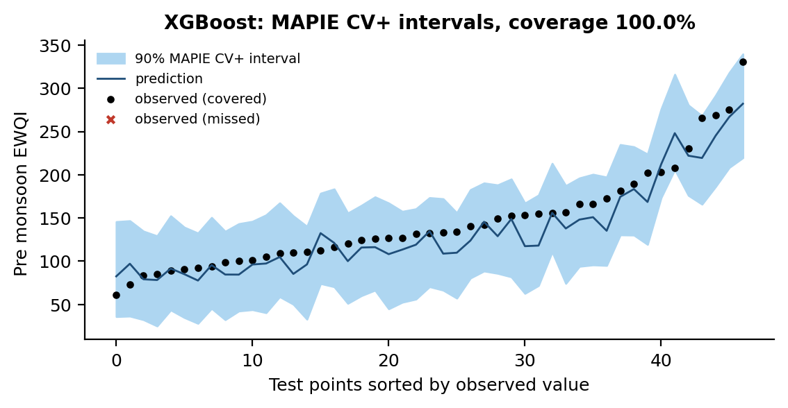

# Water quality (EWQI) dataset: uncertainty quantification results

Results of the full v2.0 pipeline (8 notebooks) on the water quality (ewqi) dataset. The full write-up with the methods, maths and all tables is the paper [`papers/water_quality_ewqi/paper.pdf`](../../papers/water_quality_ewqi/paper.pdf).

| | |
|---|---|
| Training set | `data/` – 47 rows |
| Test set | 47 rows |
| Features (14) | `pH`, `TDS`, `EC`, `TH`, `ca`, `mg`, `CO3`, `HCO3`, `NA`, `K`, `CHLORIDE`, `SULPHATE`, `NITRATE`, `FLUORIDE` |
| Target | `Pre monsoon EWQI ` (test mean 145.8, std 57.44) |
| Nominal level | 90% (α = 0.1); HCM reports 95% |

## Key findings

- Point accuracy: XGBoost has the lowest 5-fold CV RMSE (22.43); on the test set the lowest RMSE is GPBoost (17.95, target std 57.44).
- Raw quantile regression undercovers: median 90%-interval coverage 66.0% (range 0.0%–93.6%); 4 of 9 models reach the target. Quantile crossing occurs on a median 100.0% of test points.
- Best probabilistic score: LightGBM (CARD) with CRPS 10.91.
- NGBoost (native) predictive distributions are over-confident here: the Gaussian 90% interval covers only 0.0%.
- PGBM (native) predictive distributions are over-confident here: the Gaussian 90% interval covers only 2.1%.
- CARD (diffusion) intervals: median coverage 34.0% at 0.25× the target std.
- Recommended interval method: **FACI** – the narrowest method that reaches the 90% target (within sampling tolerance, n=47) on ≥75% of models: median coverage 91.5%, median width 76.56 (1.3× target std).
- Narrowest single valid interval (coverage within tolerance of 90%): FACI on GPBoost, coverage 91.5%, mean width 70.22.
- Among valid intervals, median width / target std by family: COP 1.35; Online conformal 1.53; Weighted conformal (NexCP) 1.93; Conformal (MAPIE/PUNCC) 1.98; Quantile regression 2.57; Distributional 10.93.
- ACP learns its own coverage level (mean learned target 5.4%); realised coverage of its e-value sets is 53.2%–72.3% across models.
- ACP policy saturated at the boundary α̃ = 0.999 for 4 of 9 models (CatBoost, GPBoost, HistGB, LightGBM): the sets have constant width and the learned level carries no information; realised coverage 59.6%–78.7%.
- HCM (single network, 95% interval): coverage 97.9%, RMSE 58.77, error–uncertainty Spearman correlation 0.31.

## Figures

Point accuracy and CRPS

## Interval methods at the 90% target

Aggregated over the base models each method wraps. *Valid* = share of models with coverage ≥ 0.828 (90% minus the one-sided 95% sampling tolerance for n = 47). Relative width = width / std of the test target. † = some intervals hit the edge of the label grid, so the width is a lower bound (not ranked).

| Family | Method | Models | Coverage (median) | Coverage range | Width (median) | Relative width | Valid |
|---|---|---:|---:|---:|---:|---:|---:|
| Quantile regression | Quantile regression (raw) | 9 | 66.0% | 0.0%–93.6% | 66.42 | 1.16 | 44% |
| Distributional | NGBoost (native) | 1 | 0.0% | 0.0%–0.0% | 0.000 | 0.00 | 0% |
| Distributional | PGBM (native) | 1 | 2.1% | 2.1%–2.1% | 1.96 | 0.03 | 0% |
| Distributional | IBUG | 2 | 95.7% | 95.7%–95.7% | 135.2 | 2.35 | 100% |
| Distributional | Treeffuser | 5 | 100.0% | 100.0%–100.0% | 676.4 | 11.78 | 100% |
| CARD | CARD | 9 | 34.0% | 23.4%–46.8% | 14.22 | 0.25 | 0% |
| Conformal (MAPIE/PUNCC) | J+aB (MAPIE) | 9 | 95.7% | 89.4%–100.0% | 81.33 | 1.42 | 100% |
| Conformal (MAPIE/PUNCC) | CV+ (PUNCC) | 9 | 97.9% | 95.7%–100.0% | 103.4 | 1.80 | 100% |
| Conformal (MAPIE/PUNCC) | CV+ (MAPIE) | 9 | 97.9% | 95.7%–100.0% | 112.7 | 1.96 | 100% |
| Conformal (MAPIE/PUNCC) | Split CP (PUNCC) | 9 | 97.9% | 91.5%–100.0% | 118.8 | 2.07 | 100% |
| Conformal (MAPIE/PUNCC) | Split CP (MAPIE) | 9 | 100.0% | 89.4%–100.0% | 137.4 | 2.39 | 100% |
| Conformal (MAPIE/PUNCC) | CQR (PUNCC) | 9 | 95.7% | 85.1%–97.9% | 145.3 | 2.53 | 100% |
| Weighted conformal (NexCP) | NexCP J+aB | 9 | 95.7% | 93.6%–97.9% | 87.00 | 1.51 | 100% |
| Weighted conformal (NexCP) | NexCP CV+ | 9 | 97.9% | 93.6%–100.0% | 108.5 | 1.89 | 100% |
| Weighted conformal (NexCP) | NexCP Split | 9 | 97.9% | 91.5%–100.0% | 112.4 | 1.96 | 100% |
| Weighted conformal (NexCP) | NexCP Full † | 9 | 97.9% | 89.4%–100.0% | 160.5 | 2.79 | 100% |
| Online conformal | FACI | 9 | 91.5% | 91.5%–97.9% | 76.56 | 1.33 | 100% |
| Online conformal | ACI | 9 | 93.6% | 89.4%–97.9% | 79.45 | 1.38 | 100% |
| Online conformal | Online J+aB | 9 | 93.6% | 89.4%–97.9% | 81.81 | 1.42 | 100% |
| Online conformal | SAOCP | 9 | 91.5% | 87.2%–93.6% | 86.08 | 1.50 | 100% |
| Online conformal | MFCS Full | 9 | 93.6% | 89.4%–100.0% | 87.62 | 1.53 | 100% |
| Online conformal | SF-OGD | 9 | 91.5% | 91.5%–93.6% | 93.18 | 1.62 | 100% |
| Online conformal | Online CV+ | 9 | 95.7% | 93.6%–100.0% | 95.93 | 1.67 | 100% |
| Online conformal | MFCS Split | 9 | 97.9% | 91.5%–100.0% | 112.4 | 1.96 | 100% |
| Online conformal | Online Split | 9 | 97.9% | 91.5%–100.0% | 112.4 | 1.96 | 100% |
| COP | COP | 9 | 91.5% | 91.5%–95.7% | 77.70 | 1.35 | 100% |

## Tuned models

| Model | CV RMSE | Test RMSE | Test r |
|---|---:|---:|---:|
| XGBoost | 22.43 | 20.34 | 0.953 |
| LightGBM | 22.88 | 18.14 | 0.956 |
| GPBoost | 22.90 | 17.95 | 0.957 |
| GradientBoosting | 23.22 | 22.27 | 0.943 |
| NGBoost | 23.38 | 20.81 | 0.951 |
| CatBoost | 24.40 | 19.41 | 0.950 |
| PGBM | 24.51 | 19.53 | 0.947 |
| HistGB | 25.50 | 18.72 | 0.954 |
| TabNet | 28.13 | 46.99 | 0.876 |
| RandomForest | 28.14 | 22.67 | 0.956 |

## Folder contents

| Folder | Notebook | Kaggle run(s) |
|---|---|---|
| [`hyperparameter_tuning/`](hyperparameter_tuning/) | NB1 Hyperparameter tuning (Optuna) | [REG22_11_2026_14_57](https://www.kaggle.com/code/daneshselwal/reg22-11-2026-14-57) |
| [`quantile_regression/`](quantile_regression/) | NB2 Quantile regression | [REG22_11_2026_21_12](https://www.kaggle.com/code/daneshselwal/reg22-11-2026-21-12) |
| [`probabilistic_distribution/`](probabilistic_distribution/) | NB3 Distributional (NGBoost, PGBM, IBUG, Treeffuser) | [REG22_11_2026_21_19](https://www.kaggle.com/code/daneshselwal/reg22-11-2026-21-19) |
| [`probabilistic_distribution_card/`](probabilistic_distribution_card/) | NB4 Distributional (CARD diffusion) | [REG23_11_2026_01_20](https://www.kaggle.com/code/daneshselwal/reg23-11-2026-01-20) |
| [`conformal_predictions_mapie_puncc/`](conformal_predictions_mapie_puncc/) | NB5 Conformal (MAPIE, PUNCC) | [REG23_11_2026_01_54](https://www.kaggle.com/code/daneshselwal/reg23-11-2026-01-54) |
| [`conformal_predictions_nexcp_adaptivecp_mfcs/`](conformal_predictions_nexcp_adaptivecp_mfcs/) | NB6 NexCP and online conformal | [REG23_11_2026_01_18](https://www.kaggle.com/code/daneshselwal/reg23-11-2026-01-18) |
| [`conformal_predictions_adaptive_coverage_policies/`](conformal_predictions_adaptive_coverage_policies/) | NB7 Adaptive coverage policies (ACP) | [REG22_11_2026_21_42](https://www.kaggle.com/code/daneshselwal/reg22-11-2026-21-42) |
| [`hyperspherical_confidence_mapping_hcm/`](hyperspherical_confidence_mapping_hcm/) | NB8 Hyperspherical confidence mapping (HCM) | [REG22_11_2026_21_43](https://www.kaggle.com/code/daneshselwal/reg22-11-2026-21-43) |

Each phase folder contains:

- the notebook: the current v2.0 code for this dataset (same code as `notebooks/`, with this dataset's paths, file names and feature names);
- `results/`: what the Kaggle run produced – `EXECUTED_*.ipynb` (the exact notebook that ran, with all cell outputs), the Excel files with every prediction, interval and metric, and a `README.md` naming the run.

`data/` holds the train and test CSV files. To reproduce, run the eight notebooks in order (see the main README); notebooks 2–7 read `hyperparameter_tuning/best_params.pkl` written by notebook 1.
