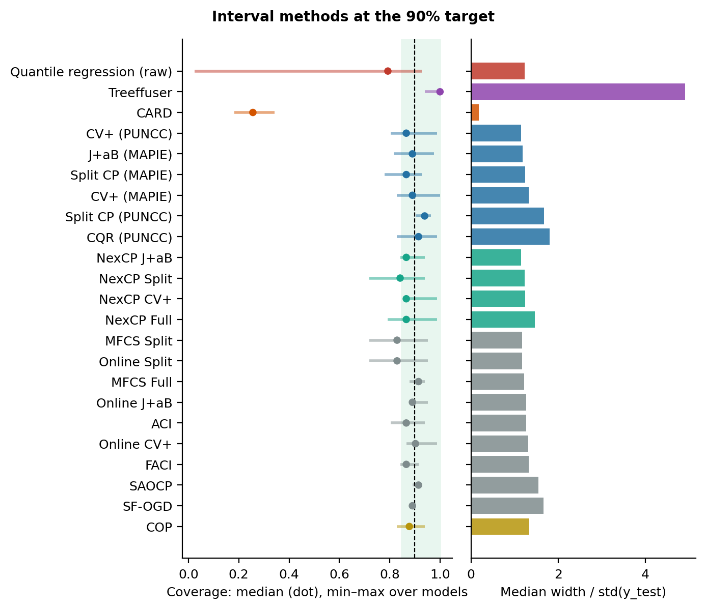
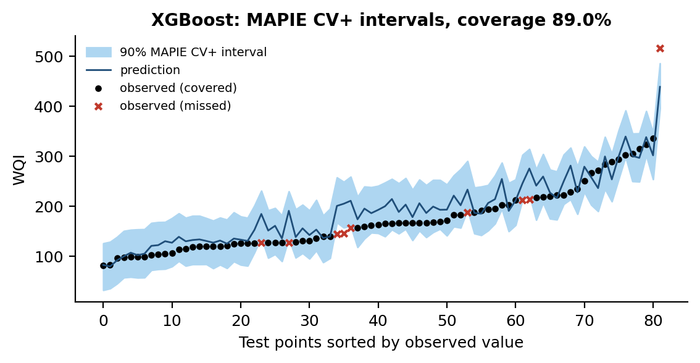
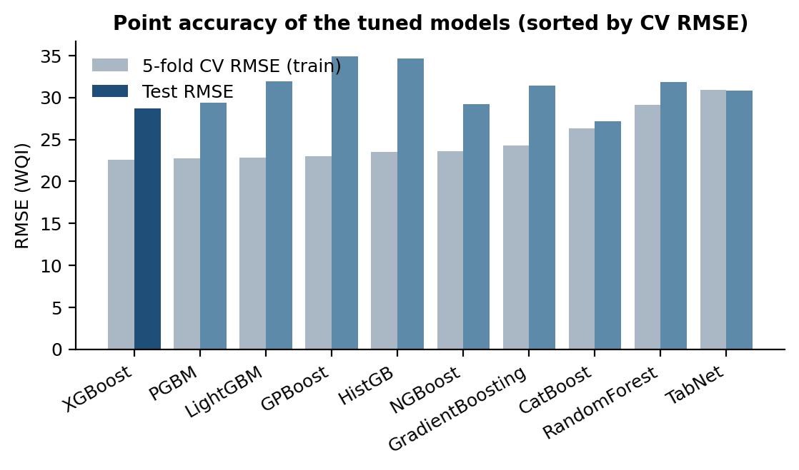

# Water quality (WQI) dataset: uncertainty quantification results

Results of the full v2.0 pipeline (8 notebooks) on the water quality (wqi) dataset. The full write-up with the methods, maths and all tables is the paper [`papers/water_quality_wqi/paper.pdf`](../../papers/water_quality_wqi/paper.pdf).

| | |
|---|---|
| Training set | `data/` – 190 rows |
| Test set | 82 rows |
| Features (151) | `R1` … `R151` |
| Target | `WQI` (test mean 175.4, std 72.93) |
| Nominal level | 90% (α = 0.1); HCM reports 95% |

## Key findings

- Point accuracy: XGBoost has the lowest 5-fold CV RMSE (22.55); on the test set the lowest RMSE is CatBoost (27.16, target std 72.93).
- Raw quantile regression undercovers: median 90%-interval coverage 79.3% (range 2.4%–92.7%); 3 of 9 models reach the target. Quantile crossing occurs on a median 100.0% of test points.
- Best probabilistic score: TabNet (CARD) with CRPS 12.78.
- NGBoost (native) predictive distributions are over-confident here: the Gaussian 90% interval covers only 1.2%.
- PGBM (native) predictive distributions are over-confident here: the Gaussian 90% interval covers only 14.6%.
- CARD (diffusion) intervals: median coverage 25.6% at 0.18× the target std.
- Recommended interval method: **J+aB (MAPIE)** – the narrowest method that reaches the 90% target (within sampling tolerance, n=82) on ≥75% of models: median coverage 89.0%, median width 86.39 (1.2× target std).
- Narrowest single valid interval (coverage within tolerance of 90%): NexCP CV+ on XGBoost, coverage 85.4%, mean width 77.00.
- Among valid intervals, median width / target std by family: Weighted conformal (NexCP) 1.24; COP 1.34; Online conformal 1.34; Conformal (MAPIE/PUNCC) 1.37; Quantile regression 1.44; Distributional 4.57.
- ACP learns its own coverage level (mean learned target 22.8%); realised coverage of its e-value sets is 46.3%–65.9% across models.
- HCM (single network, 95% interval): coverage 81.7%, RMSE 39.88, error–uncertainty Spearman correlation 0.30.

## Figures

Point accuracy and CRPS

## Interval methods at the 90% target

Aggregated over the base models each method wraps. *Valid* = share of models with coverage ≥ 0.846 (90% minus the one-sided 95% sampling tolerance for n = 82). Relative width = width / std of the test target. † = some intervals hit the edge of the label grid, so the width is a lower bound (not ranked).

| Family | Method | Models | Coverage (median) | Coverage range | Width (median) | Relative width | Valid |
|---|---|---:|---:|---:|---:|---:|---:|
| Quantile regression | Quantile regression (raw) | 9 | 79.3% | 2.4%–92.7% | 89.88 | 1.23 | 33% |
| Distributional | NGBoost (native) | 1 | 1.2% | 1.2%–1.2% | 0.719 | 0.01 | 0% |
| Distributional | PGBM (native) | 1 | 14.6% | 14.6%–14.6% | 14.00 | 0.19 | 0% |
| Distributional | IBUG | 2 | 79.9% | 68.3%–91.5% | 82.83 | 1.14 | 50% |
| Distributional | Treeffuser | 5 | 100.0% | 93.9%–100.0% | 358.3 | 4.91 | 100% |
| CARD | CARD | 9 | 25.6% | 18.3%–34.1% | 13.27 | 0.18 | 0% |
| Conformal (MAPIE/PUNCC) | CV+ (PUNCC) | 9 | 86.6% | 80.5%–98.8% | 83.87 | 1.15 | 56% |
| Conformal (MAPIE/PUNCC) | J+aB (MAPIE) | 9 | 89.0% | 81.7%–97.6% | 86.39 | 1.18 | 89% |
| Conformal (MAPIE/PUNCC) | Split CP (MAPIE) | 9 | 86.6% | 78.0%–92.7% | 90.94 | 1.25 | 67% |
| Conformal (MAPIE/PUNCC) | CV+ (MAPIE) | 9 | 89.0% | 82.9%–100.0% | 96.18 | 1.32 | 78% |
| Conformal (MAPIE/PUNCC) | Split CP (PUNCC) | 9 | 93.9% | 90.2%–96.3% | 122.0 | 1.67 | 100% |
| Conformal (MAPIE/PUNCC) | CQR (PUNCC) | 9 | 91.5% | 82.9%–98.8% | 131.5 | 1.80 | 89% |
| Weighted conformal (NexCP) | NexCP J+aB | 9 | 86.6% | 84.1%–93.9% | 83.61 | 1.15 | 67% |
| Weighted conformal (NexCP) | NexCP Split | 9 | 84.1% | 72.0%–93.9% | 89.50 | 1.23 | 44% |
| Weighted conformal (NexCP) | NexCP CV+ | 9 | 86.6% | 85.4%–98.8% | 90.60 | 1.24 | 100% |
| Weighted conformal (NexCP) | NexCP Full † | 9 | 86.6% | 79.3%–98.8% | 107.0 | 1.47 | 67% |
| Online conformal | MFCS Split | 9 | 82.9% | 72.0%–95.1% | 85.75 | 1.18 | 33% |
| Online conformal | Online Split | 9 | 82.9% | 72.0%–95.1% | 85.75 | 1.18 | 33% |
| Online conformal | MFCS Full | 9 | 91.5% | 87.8%–93.9% | 89.11 | 1.22 | 100% |
| Online conformal | Online J+aB | 9 | 89.0% | 89.0%–95.1% | 92.02 | 1.26 | 100% |
| Online conformal | ACI | 9 | 86.6% | 80.5%–93.9% | 92.18 | 1.26 | 89% |
| Online conformal | Online CV+ | 9 | 90.2% | 86.6%–98.8% | 95.52 | 1.31 | 100% |
| Online conformal | FACI | 9 | 86.6% | 84.1%–91.5% | 96.42 | 1.32 | 89% |
| Online conformal | SAOCP | 9 | 91.5% | 89.0%–92.7% | 112.6 | 1.54 | 100% |
| Online conformal | SF-OGD | 9 | 89.0% | 89.0%–90.2% | 121.0 | 1.66 | 100% |
| COP | COP | 9 | 87.8% | 82.9%–93.9% | 97.77 | 1.34 | 89% |

## Tuned models

| Model | CV RMSE | Test RMSE | Test r |
|---|---:|---:|---:|
| XGBoost | 22.55 | 28.74 | 0.946 |
| PGBM | 22.73 | 29.38 | 0.939 |
| LightGBM | 22.80 | 31.90 | 0.925 |
| GPBoost | 22.97 | 34.91 | 0.911 |
| HistGB | 23.54 | 34.61 | 0.915 |
| NGBoost | 23.61 | 29.19 | 0.946 |
| GradientBoosting | 24.30 | 31.41 | 0.931 |
| CatBoost | 26.32 | 27.16 | 0.943 |
| RandomForest | 29.13 | 31.83 | 0.938 |
| TabNet | 30.88 | 30.87 | 0.930 |

## Folder contents

| Folder | Notebook | Kaggle run(s) |
|---|---|---|
| [`hyperparameter_tuning/`](hyperparameter_tuning/) | NB1 Hyperparameter tuning (Optuna) | [REG22_11_2026_19_53](https://www.kaggle.com/code/daneshselwal/reg22-11-2026-19-53) |
| [`quantile_regression/`](quantile_regression/) | NB2 Quantile regression | [REG23_11_2026_08_17](https://www.kaggle.com/code/daneshselwal/reg23-11-2026-08-17) |
| [`probabilistic_distribution/`](probabilistic_distribution/) | NB3 Distributional (NGBoost, PGBM, IBUG, Treeffuser) | [REG23_11_2026_08_48](https://www.kaggle.com/code/daneshselwal/reg23-11-2026-08-48) |
| [`probabilistic_distribution_card/`](probabilistic_distribution_card/) | NB4 Distributional (CARD diffusion) | [REG23_11_2026_08_49](https://www.kaggle.com/code/daneshselwal/reg23-11-2026-08-49) |
| [`conformal_predictions_mapie_puncc/`](conformal_predictions_mapie_puncc/) | NB5 Conformal (MAPIE, PUNCC) | [REG23_11_2026_08_50](https://www.kaggle.com/code/daneshselwal/reg23-11-2026-08-50) |
| [`conformal_predictions_nexcp_adaptivecp_mfcs/`](conformal_predictions_nexcp_adaptivecp_mfcs/) | NB6 NexCP and online conformal | [REG23_11_2026_08_59](https://www.kaggle.com/code/daneshselwal/reg23-11-2026-08-59), [REG23_11_2026_09_10](https://www.kaggle.com/code/daneshselwal/reg23-11-2026-09-10), [REG23_11_2026_10_06](https://www.kaggle.com/code/daneshselwal/reg23-11-2026-10-06), [REG23_11_2026_10_09](https://www.kaggle.com/code/daneshselwal/reg23-11-2026-10-09), [REG23_11_2026_10_18](https://www.kaggle.com/code/daneshselwal/reg23-11-2026-10-18), [REG23_11_2026_10_23](https://www.kaggle.com/code/daneshselwal/reg23-11-2026-10-23), [REG23_11_2026_11_07](https://www.kaggle.com/code/daneshselwal/reg23-11-2026-11-07), [REG23_11_2026_11_12](https://www.kaggle.com/code/daneshselwal/reg23-11-2026-11-12), [REG23_11_2026_11_21](https://www.kaggle.com/code/daneshselwal/reg23-11-2026-11-21) |
| [`conformal_predictions_adaptive_coverage_policies/`](conformal_predictions_adaptive_coverage_policies/) | NB7 Adaptive coverage policies (ACP) | [REG23_11_2026_08_51](https://www.kaggle.com/code/daneshselwal/reg23-11-2026-08-51) |
| [`hyperspherical_confidence_mapping_hcm/`](hyperspherical_confidence_mapping_hcm/) | NB8 Hyperspherical confidence mapping (HCM) | [REG23_11_2026_08_58](https://www.kaggle.com/code/daneshselwal/reg23-11-2026-08-58) |

Each phase folder contains:

- the notebook: the current v2.0 code for this dataset (same code as `notebooks/`, with this dataset's paths, file names and feature names);
- `results/`: what the Kaggle run produced – `EXECUTED_*.ipynb` (the exact notebook that ran, with all cell outputs), the Excel files with every prediction, interval and metric, and a `README.md` naming the run.

`data/` holds the train and test CSV files. To reproduce, run the eight notebooks in order (see the main README); notebooks 2–7 read `hyperparameter_tuning/best_params.pkl` written by notebook 1.
